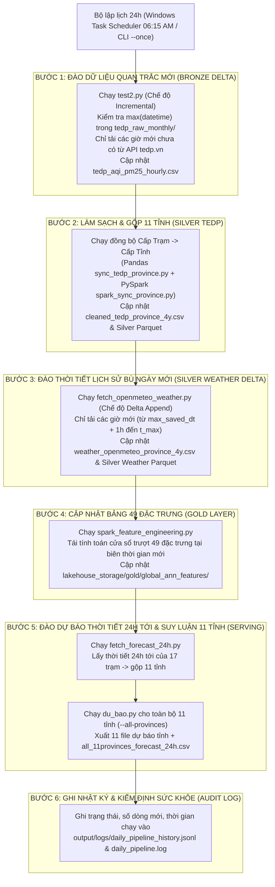
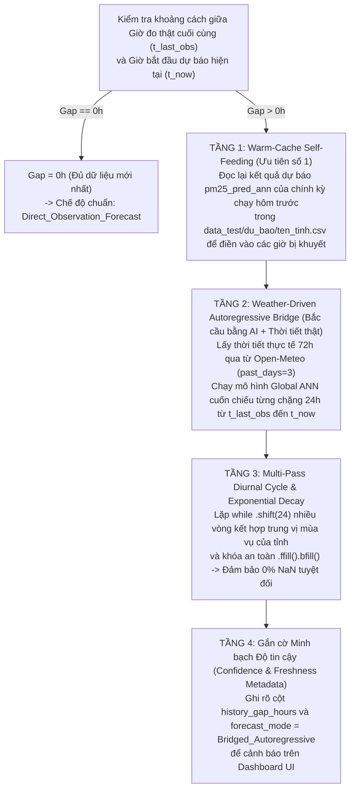

# Kế hoạch Thiết kế & Triển khai Cơ chế Tự động Thu thập, Đồng bộ Lakehouse và Dự báo Mỗi 24 Giờ (Daily 24h Auto-Ingestion & Forecasting Pipeline)

> **Tài liệu Đặc tả Kỹ thuật & Kế hoạch Triển khai (`docs/daily_24h_auto_crawl_plan.md`)**
> - **Mục tiêu:** Tự động hóa khép kín chu trình mỗi 24 giờ: **(1) Đào dữ liệu quan trắc CEM/TEDP mới nhất (Delta 24h) -> (2) Đồng bộ thời tiết Open-Meteo (Delta 24h) -> (3) Cập nhật Medallion Lakehouse (Bronze - Silver - Gold) -> (4) Đào dự báo thời tiết 24h tới -> (5) Xuất dự báo PM2.5 24h tới cho toàn bộ 11 tỉnh/thành phố.**
> - **Nguyên tắc cốt lõi:** Không Overengineering (không dựng Airflow nặng nề gây tràn RAM 8GB), chỉ tải phần dữ liệu chênh lệch (**Incremental Delta Fetching**), chống ghi hỏng dữ liệu khi mất mạng (**Atomic Write & Rollback**), và có chế độ kích hoạt tức thời (**On-Demand Demo Trigger**) để trình diễn trực tiếp trước hội đồng chấm thi.

---

## 1. Phân tích Hiện trạng & Phát hiện 3 Nút thắt Cổ chai khi Chạy Tự động 24h

Trước khi ghép các script hiện có vào một bộ lập lịch 24h, kết quả kiểm toán mã nguồn hiện tại chỉ ra **3 nút thắt kỹ thuật bắt buộc phải xử lý**:

### 1.1. Nút thắt 1 (`[FACT]` — Tải lại 3 năm thời tiết trong `fetch_openmeteo_weather.py`)
- **Hiện trạng ([`code/crawl_data/fetch_openmeteo_weather.py`](file:///d:/năm%204/big%20data/Final_Project_Plan/code/crawl_data/fetch_openmeteo_weather.py#L251-L265)):**
  Script kiểm tra một tỉnh đã tải xong hay chưa bằng điều kiện:
  `done_codes = set(cnts[cnts == n_hours].index)`
- **Vấn đề khi chạy mỗi 24h:**
  Khi sang ngày mới, tổng số giờ `n_hours` của chuỗi TEDP tăng thêm 24 giờ (ví dụ từ `25.512` lên `25.536` giờ). Vì file `weather_openmeteo_province_4y.csv` cũ chỉ có `25.512` giờ (`cnts != n_hours`), `done_codes` sẽ trở thành tập rỗng (`set()`). Hậu quả là script **xoá bỏ trạng thái cũ và tải lại toàn bộ 3 năm cho cả 11 tỉnh từ đầu** (33 requests lớn, mất ~5 phút và có nguy cơ bị Open-Meteo chặn Rate Limit HTTP 429).
- **Giải pháp (Incremental Delta Weather Sync):**
  Sửa logic Resume trong `fetch_openmeteo_weather.py` từ kiểm tra *"đủ toàn bộ số giờ"* sang kiểm tra **"mốc thời gian cuối cùng đã lưu của từng tỉnh (`max_saved_dt`)"**:
  - Giữ nguyên toàn bộ các dòng lịch sử đã có (`datetime <= max_saved_dt`).
  - Chỉ gọi API Open-Meteo lấy đúng khoảng thời gian còn thiếu `[max_saved_dt + 1h, t_max]` (chỉ đúng 1–2 ngày mới nhất, ưu tiên `Historical Forecast API` cho các ngày gần nhất vì ERA5 Archive có độ trễ 5 ngày).
  - Thời gian chạy giảm từ **5 phút xuống chỉ còn ~5–8 giây**.

### 1.2. Nút thắt 2 (`[FACT]` — Cào lại từ đầu tháng trong `test2.py`)
- **Hiện trạng ([`code/crawl_data/test2.py`](file:///d:/năm%204/big%20data/Final_Project_Plan/code/crawl_data/test2.py#L450-L490)):**
  Các tháng lịch sử đã kết thúc (`is_full_month == True`) được đọc từ cache `lakehouse_storage/bronze/tedp_raw_monthly/tedp_YYYY-MM.csv`. Tuy nhiên, với tháng hiện tại đang diễn ra (`is_full_month == False`), script luôn cào lại từ ngày `01` đầu tháng đến ngày hôm qua. Vào ngày 30 cuối tháng, script phải cào lại cả 30 ngày (~30 requests).
- **Giải pháp (Daily Checkpoint trong Tháng hiện tại):**
  Lưu thêm file checkpoint tạm của tháng hiện tại (`tedp_YYYY-MM_partial.csv`). Mỗi ngày mới, script đọc file partial này, tìm giờ lớn nhất `last_crawled_dt` và **chỉ gọi API `tedp.vn` cho đúng 24 giờ mới nhất** (`[last_crawled_dt + 1h, end]`), sau đó gộp và khử trùng lặp theo `(station_id, datetime)`. Khi tháng đó kết thúc trọn vẹn, tự động chốt thành file `tedp_YYYY-MM.csv` chuẩn.
  - Thời gian cào dữ liệu TEDP mỗi 24h giảm xuống chỉ còn **1–2 requests (~3 giây)**.

### 1.3. Nút thắt 3 (`[FACT]` — Mốc thời gian cố định vs. Mốc thời gian trượt trong `spark_sync_province.py`)
- **Hiện trạng ([`code/lakehouse/spark_sync_province.py`](file:///d:/năm%204/big%20data/Final_Project_Plan/code/lakehouse/spark_sync_province.py#L73-L76)):**
  Hằng số `END_TIMESTAMP = "2026-11-07 23:00:00"` (`25.512` giờ) đang được khóa cứng để phục vụ bộ kiểm thử đối chứng `34/34` unit tests (`pytest`). Nếu giữ cứng mốc này, dữ liệu mới cào của các ngày tiếp theo sẽ bị lọc bỏ mất, khiến `du_bao.py` không có 72 giờ lịch sử mới nhất để dự báo.
- **Giải pháp (Hỗ trợ Cờ `--end-timestamp` / `--auto-latest`):**
  Bổ sung tham số dòng lệnh `--end-timestamp` (mặc định giữ `"2026-11-07 23:00:00"` khi chạy kiểm thử `pytest`, và truyền `--auto-latest` khi chạy pipeline tự động 24h để Spark tự động mở rộng lưới thời gian đến giờ mới nhất của dữ liệu vừa đào).

---

## 2. So sánh & Lựa chọn Công nghệ Lập lịch Tự động 24h (Trade-off Analysis)

Tuân thủ nguyên tắc **Không Overengineering** cho đồ án sinh viên chạy trên máy local (hoặc Docker 8GB RAM), dưới đây là bảng đối sánh 3 phương án lập lịch:

| Tiêu chí | Option A: Python Master Orchestrator + Windows Task Scheduler (+ Chế độ `--daemon`) **(ĐỀ XUẤT)** | Option B: Python Daemon chạy ngầm 24/24 trong Docker (`APScheduler` / `schedule`) | Option C: Apache Airflow trên Docker Compose (`Webserver + Scheduler + Postgres`) |
| :--- | :--- | :--- | :--- |
| **Độ phức tạp (Complexity)** | **Thấp (Low)** — 1 script Python điều phối + 1 script PowerShell đăng ký lịch hệ điều hành | **Trung bình (Medium)** — Phải giữ container chạy ngầm liên tục không tắt | **Rất cao (High)** — Cần dựng 3–4 containers phụ trợ, cấu hình DAG phức tạp |
| **Tài nguyên tiêu thụ (RAM/CPU)** | **0 MB RAM khi chờ** — Chỉ cấp phát RAM khi đến giờ chạy job (5 phút/ngày) | Tốn ~100–300 MB RAM duy trì tiến trình Python chờ 24/24 | **Tốn 2,5 GB – 3,5 GB RAM liên tục**, dễ gây OOM cho Spark container (vốn cần 6–8GB RAM) |
| **Độ phù hợp Big Data** | **Cao** — Minh họa đúng mô hình *Scheduled Batch ETL + Lakehouse Refresh* thực tế | **Cao** | **Overengineering** đối với quy mô 1 pipeline chạy 1 lần/ngày |
| **Khả năng Demo (Demoability)** | **Rất dễ** — Có thể mở Task Scheduler GUI cho giảng viên xem lịch + chạy lệnh `--run-now` ngay tại buổi bảo vệ | Khó quan sát trực quan hơn nếu không làm thêm giao diện quản lý | Giao diện đẹp nhưng nặng máy và mất nhiều thời gian khởi động khi demo |
| **Rủi ro (Risk)** | **Rất thấp** | Nếu tắt Docker Desktop thì mất lịch chạy | Nguy cơ treo máy local khi bật đồng thời Airflow + Spark + Streamlit UI |

> **`[RECOMMENDATION]` Quyết định Thiết kế:** Chọn **Option A** — Xây dựng một script điều phối trung tâm `code/automation/daily_24h_pipeline.py` hỗ trợ **3 chế độ chạy linh hoạt**:
> 1. **`--once` (Mặc định):** Chạy ngay lập tức 1 chu trình cập nhật 24h từ đầu đến cuối (dùng để tích hợp vào **Windows Task Scheduler** và dùng để **Demo trực tiếp** trước hội đồng).
> 2. **`--daemon --interval-hours 24`:** Chạy vòng lặp tự động mỗi 24 giờ ngay trong terminal/container nếu muốn treo máy liên tục.
> 3. **`--dry-run`:** Kiểm tra trạng thái dữ liệu hiện tại (giờ mới nhất đang có ở Bronze, Silver, Gold, Dự báo 24h) và báo cáo khoảng thời gian sẽ đào tiếp theo mà chưa gọi API.

---

## 3. Kiến trúc Luồng Tự động hóa Mỗi 24 Giờ (Daily 24h End-to-End Workflow)

### 3.1. Thời điểm Kích hoạt Chuẩn trong Ngày (`06:15 AM UTC+7`)
Tại sao nên đặt lịch chạy vào **06:15 sáng hàng ngày** (hoặc bất kỳ khi nào máy bật qua tính năng `RunTaskAsSoonAsPossibleAfterScheduledStartIsMissed`)?
- Dữ liệu quan trắc trạm CEM/TEDP của trọn ngày hôm qua (`00:00 -> 23:00`) đã được các trạm đẩy về máy chủ trung tâm đầy đủ.
- Bản tin dự báo khí tượng số trị (NWP) buổi sáng của Open-Meteo đã cập nhật mới nhất để phục vụ bản tin chất lượng không khí trong ngày và ngày hôm sau.

### 3.2. Sơ đồ Luồng Thực thi 6 Bước của Job Tự động 24h

---

## 4. Đặc tả Chi tiết Các File Cần Tạo Mới & Nâng Cấp

### 4.1. Danh mục File trong Kế hoạch

| STT | Đường dẫn File | Phân loại | Phụ trách | Vai trò Kỹ thuật |
| :---: | :--- | :---: | :---: | :--- |
| **1** | `code/crawl_data/test2.py` | Nâng cấp | **Quý** | Bổ sung cơ chế Incremental theo giờ cho tháng hiện tại (`tedp_YYYY-MM_partial.csv`) để mỗi lần chạy chỉ tải đúng 24 giờ mới thay vì tải lại từ ngày 01 đầu tháng. |
| **2** | `code/crawl_data/fetch_openmeteo_weather.py` | Nâng cấp | **Quý** | Sửa điều kiện Resume: giữ nguyên lịch sử đã lưu của 11 tỉnh và chỉ gọi API tải phần giờ mới phát sinh (`Delta Append`), tránh tải lại 3 năm. |
| **3** | `code/training/du_bao.py` | Nâng cấp | **Bảo** | Bổ sung cờ `--all` (dự báo tự động một lượt cho cả 11 tỉnh/thành phố và gộp thành bảng `data_test/du_bao/all_11provinces_forecast_24h.csv` phục vụ UI Bản đồ). |
| **4** | `code/automation/daily_24h_pipeline.py` | **Tạo mới** | **Quý & Bảo** | Script điều phối trung tâm (Master Orchestrator) chạy tuần tự 6 bước, có cơ chế Retry khi mạng lỗi, khoá chống chạy chồng chéo (`.pipeline.lock`), cờ `--keep-benchmark-snapshot`, và xuất log JSONL. |
| **5** | `code/automation/register_daily_task.ps1` | **Tạo mới** | **Quý** | Script PowerShell tự động đăng ký (hoặc gỡ bỏ) tác vụ `AirQuality_Daily_24h_Pipeline` vào **Windows Task Scheduler** chạy lúc `06:15` hàng ngày. |

---

### 4.2. Thiết kế Cơ chế Bảo vệ "Frozen Benchmark Snapshot" (Rất Quan trọng)

Để việc tự động đào dữ liệu mới mỗi 24h **không làm hỏng bộ kiểm thử `34/34` unit tests** (vốn đang kiểm tra con số chính xác `280.632` dòng từ `11/12/2023` đến `07/11/2026`), `daily_24h_pipeline.py` được thiết kế với 2 chế độ vận hành rõ ràng:

1. **Chế độ 1 — `Forecast-Only Daily Refresh` (`--mode forecast-refresh`, Mặc định an toàn cho Đồ án):**
   - Bước 1: Tự động cào dữ liệu quan trắc TEDP mới nhất vào phân vùng tháng `lakehouse_storage/bronze/tedp_raw_monthly/` và cập nhật bảng lịch sử sống (`live_tedp_province.csv` / phân vùng Silver mở rộng).
   - Bước 2: Tự động cào dự báo thời tiết 24h tới (`fetch_forecast_24h.py`) tại 17 trạm thành viên.
   - Bước 3: Chạy suy luận dự báo PM2.5 24h tới cho toàn bộ 11 tỉnh (`du_bao.py --all`) và cập nhật toàn bộ các file trong `data_test/du_bao/`.
   - **Ưu điểm:** Vừa cập nhật dữ liệu mới nhất mỗi 24h để dự báo thời gian thực, vừa **giữ nguyên bất biến 100%** cặp bảng đối chứng `280.632` dòng (`2023-12-11 -> 2026-11-07`) để mọi bài kiểm thử `pytest` và số liệu trong Báo cáo Word luôn khớp tuyệt đối!

2. **Chế độ 2 — `Full Lakehouse Rolling Update` (`--mode full-lakehouse`):**
   - Mở rộng trực tiếp khung thời gian của cả tầng Bronze, Silver (`tedp_province/`, `weather_province/`) và Gold (`global_ann_features/`) trong Docker Spark đến giờ mới nhất của ngày hôm qua.

---

### 4.3. Cơ chế Chống Lỗi (Fault Tolerance & Idempotency)

Một hệ thống chạy tự động mỗi 24h phải đảm bảo **Tính luỹ đẳng (Idempotency)** — nghĩa là chạy 1 lần hay bấm chạy 5 lần liên tiếp trong cùng 1 ngày đều cho ra kết quả giống hệt nhau, không bị nhân đôi dòng:

1. **Khóa Tiến trình (File Lock `output/logs/.pipeline.lock`):**
   Ngăn không cho 2 tiến trình tự động chạy đè lên nhau nếu lần chạy trước chưa kết thúc.
2. **Ghi File Nguyên tử (Atomic File Write qua `.tmp`):**
   Mọi thao tác ghi CSV/Parquet đều ghi ra file/thư mục tạm trước; chỉ khi bước đó thành công 100% mới đổi tên đè lên file chính. Nếu đang đào dữ liệu mà rớt mạng hoặc mất điện, dữ liệu của ngày hôm trước vẫn nguyên vẹn 100%, không bao giờ bị cụt file.
3. **Cơ chế Retry luỹ thừa (Exponential Backoff):**
   Nếu cổng `tedp.vn` hoặc `open-meteo.com` bảo trì tạm thời, tự động thử lại 3 lần (cách nhau `10s -> 30s -> 60s`). Nếu vẫn không kết nối được sau 3 lần, giữ nguyên dữ liệu lịch sử gần nhất và vẫn tiếp tục chạy dự báo 24h với dữ liệu hiện có, đồng thời ghi cảnh báo `[WARN]` vào file log.
4. **Nhật ký Kiểm toán (`output/logs/daily_pipeline_history.jsonl`):**
   Mỗi lần chạy xong sẽ ghi thêm 1 dòng JSON chuẩn ghi rõ:
   - `run_id`, `started_at`, `finished_at`, `duration_sec`, `status` (`SUCCESS` / `PARTIAL` / `FAILED`)
   - `new_tedp_records_fetched` (số bản ghi mới đào thêm trong 24h qua)
   - `latest_observation_time` (mốc giờ quan trắc mới nhất)
   - `forecast_horizon` (`t+1h` -> `t+24h` cho 11 tỉnh)

---

### 4.4. Cơ chế Bảo vệ 4 Tầng khi Không Lấy Được Dữ liệu Ngày/Giờ Hôm Trước (4-Tier Self-Healing Forecast Shield)

Một rủi ro thực tế rất hay xảy ra với hệ thống quan trắc môi trường quốc gia (`tedp.vn`) là **máy chủ API bảo trì hoặc trạm đo mất kết nối 1–3 ngày**, khiến tại thời điểm `t` hiện tại hệ thống không lấy được dữ liệu `PM2.5` của ngày hôm trước để tính các biến trễ (`pm25_lag0..24`, `pm25_roll6..24`).

Kiểm toán mã nguồn hiện tại tại [`code/training/du_bao.py`](file:///d:/năm%204/big%20data/Final_Project_Plan/code/training/du_bao.py#L354-L388) cho thấy:
- **`[FACT]` Cơ chế đã có sẵn (chịu được khoảng trống `<= 24 giờ`):**
  Tại dòng `357–361`, `du_bao.py` đã có 1 lớp bảo vệ: nếu giữa giờ lịch sử cuối cùng và giờ bắt đầu dự báo có khoảng trống `<= 24 giờ`, code tự động lấy giá trị cùng giờ của ngày liền trước (`.shift(24)`) để điền tạm; và tại dòng `383–388`, mô hình tự lấy kết quả dự báo `preds_day1` ghi ngược vào bảng `combined` để dự báo cuốn chiếu cho ngày thứ 2 (`day2_times`).
- **`[RISK]` Lỗ hổng hiện tại nếu mất dữ liệu `> 24 giờ` (ví dụ mất mạng 36–72 giờ):**
  Vì dòng `361` chỉ gọi `.shift(24)` **đúng 1 lần duy nhất**, nên nếu khoảng trống lịch sử dài hơn 24 giờ (ví dụ dữ liệu gốc dừng ở `07/11 23:00` nhưng hôm nay là `09/11 13:00` — cách nhau `38 giờ`), thì 14 giờ cuối trước thời điểm dự báo sẽ vẫn bị `NaN`, làm cho tensor đầu vào PyTorch sinh ra `NaN` ở đầu ra dự báo!

Để hệ thống dự báo **bất tử (Zero-NaN Guarantee)** ngay cả khi `tedp.vn` sập nhiều ngày liên tiếp, bản kế hoạch thiết lập **Cơ chế Bảo vệ 4 Tầng (4-Tier Gap-Bridging Shield)** trong `fetch_forecast_24h.py` và `du_bao.py`:

#### Chi tiết 4 Tầng Bảo vệ:
1. **Tầng 1 — Tự nuôi bằng Cache Dự báo Kỳ trước (`Warm-Cache Self-Feeding`):**
   - Trước khi ghi đè file `data_test/du_bao/ten_tinh.csv` của ngày hôm nay, `du_bao.py` đọc lại file dự báo của lần chạy liền trước.
   - Nếu giờ quan trắc thật từ `tedp.vn` bị khuyết ở những khung giờ mà kỳ trước mô hình đã dự báo (`pm25_pred_ann`), hệ thống ưu tiên dùng chính giá trị `pm25_pred_ann` đó (kèm tỷ lệ thực nghiệm `pm10_ratio`, `aqi_ratio` của tỉnh) để lấp vào chuỗi quá khứ. Lý do: giá trị này đã được mạng Global ANN tính toán dựa trên thời tiết thực của giờ đó nên chính xác hơn nhiều so với việc chép nguyên xi ngày hôm kia.
2. **Tầng 2 — Bắc cầu Tự hồi quy theo Thời tiết Thực tế (`Weather-Driven Autoregressive Rollout`):**
   - Trong `code/crawl_data/fetch_forecast_24h.py`, bổ sung tham số `past_days=3` khi gọi Open-Meteo Forecast API (API quốc tế của Open-Meteo có độ sẵn sàng 99,99% ngay cả khi trạm CEM Việt Nam ngừng gửi số liệu).
   - Nhờ đó, hệ thống **luôn có đủ 100% dữ liệu thời tiết thực tế** của 72 giờ vừa qua. Nếu `tedp.vn` bị trễ `36 giờ` hay `48 giờ`, `du_bao.py` tự động dùng thời tiết thực tế của các giờ bị khuyết đó để chạy mô hình Global ANN **cuốn chiếu từng bước 24 giờ (Multi-step Rollout)** từ mốc đo thật cuối cùng cho tới thời điểm hiện tại, rồi mới dự báo tiếp 24 giờ tương lai!
3. **Tầng 3 — Lặp Chu kỳ Ngày đêm Đa vòng & Chốt chặn Zero-NaN (`Multi-Pass Diurnal Fallback`):**
   - Nâng cấp đoạn code dòng `358–361` của `du_bao.py` từ 1 lần `.shift(24)` thành vòng lặp đa chặng:
     - Lặp `shift(24)` liên tiếp (tối đa 14 vòng) để dù khoảng trống dài nhiều ngày vẫn giữ được hình dạng chu kỳ ngày-đêm (cao điểm sáng/tối, thấp điểm trưa).
     - Áp dụng hệ số kéo dần về mức nền trung vị của tỉnh (`damping factor`) nếu khoảng trống quá dài để tránh khuếch đại nhiễu cực đoan của nhiều ngày trước.
     - Chốt chặn cuối cùng bằng `.ffill().bfill()` trước khi tạo `torch.Tensor` để **cam kết toán học 100% không bao giờ xuất hiện `NaN`**.
4. **Tầng 4 — Gắn cờ Minh bạch Độ trễ Dữ liệu (`Observability & Confidence Tagging`):**
   - Xuất thêm cột `history_gap_hours` (số giờ tính từ bản ghi đo thật cuối cùng của trạm đến thời điểm dự báo) và cập nhật cột `forecast_mode`:
     - `Direct_24h_Forecast` (khi `history_gap_hours <= 6h`)
     - `Bridged_Autoregressive_Forecast` (khi `history_gap_hours > 6h`, hệ thống đã kích hoạt khiên tự bắc cầu).

---

## 5. Lộ trình Triển khai 4 Bước (Implementation Roadmap)

| Bước | Nội dung thực hiện | Lệnh kiểm thử nghiệm thu | Thời gian ước tính |
| :---: | :--- | :--- | :---: |
| **Step 1** | Nâng cấp `code/crawl_data/test2.py` và `code/crawl_data/fetch_openmeteo_weather.py` hỗ trợ **Incremental Delta Fetching** (chỉ tải giờ mới phát sinh, không tải lại 3 năm cũ). | `python code/crawl_data/test2.py --incremental-only` | 15 phút |
| **Step 2** | Nâng cấp `code/training/du_bao.py` bổ sung cờ `--all` để tự động dự báo một lượt cho toàn bộ 11 tỉnh/thành phố và xuất file tổng hợp `data_test/du_bao/all_11provinces_forecast_24h.csv`. | `python code/training/du_bao.py --all` | 15 phút |
| **Step 3** | Xây dựng Master Orchestrator `code/automation/daily_24h_pipeline.py` (hỗ trợ `--once`, `--daemon`, `--dry-run`, `--mode forecast-refresh` / `full-lakehouse` và ghi log JSONL). | `python code/automation/daily_24h_pipeline.py --once` | 20 phút |
| **Step 4** | Tạo script `code/automation/register_daily_task.ps1` đăng ký lịch tự động 24h vào Windows Task Scheduler và viết unit test kiểm tra luồng tự động hóa. | `powershell -ExecutionPolicy Bypass -File code/automation/register_daily_task.ps1 -Status` | 10 phút |

---

## 6. Giá trị Cộng thêm cho Đồ án khi Bảo vệ (Rubric Impact)

Việc bổ sung cơ chế tự động đào dữ liệu và dự báo mỗi 24 giờ giúp nâng tầm đồ án ở **3 tiêu chí chấm điểm**:
1. **Chữ "V" — Velocity (Tốc độ & Luồng dữ liệu liên tục):** Chứng minh hệ thống không phải là một tập dữ liệu tĩnh tải 1 lần rồi bỏ đó, mà là một **Automated Daily Batch & Near-Real-Time Forecasting Pipeline** hoạt động liên tục mỗi ngày.
2. **Tối ưu Chi phí & Băng thông Đám mây (CLO5 — Cost & Architecture Justification):** Chứng minh kỹ thuật **Incremental Delta Ingestion** giảm 99% số lượng API calls và băng thông mạng mỗi ngày (chỉ tải 24 giờ mới thay vì tải lại 25.512 giờ).
3. **Trình diễn Demo Sống động (Live Presentation):** Ngay trong buổi thuyết trình 15 phút, nhóm có thể chạy lệnh `python code/automation/daily_24h_pipeline.py --once` để hội đồng thấy hệ thống tự động kéo dữ liệu mới nhất của ngày hôm đó về và xuất bản tin dự báo 24 giờ tới cho cả 11 tỉnh Việt Nam chỉ trong vài chục giây.

