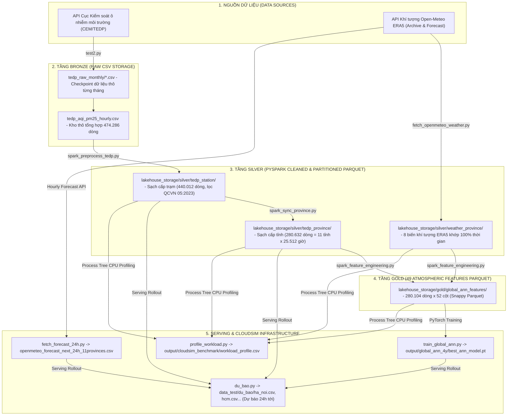

# HƯỚNG DẪN TỔNG QUAN PIPELINE DỰ ÁN (TỪ A ĐẾN Z)

Tài liệu này giải thích ngắn gọn, trực quan để bất kỳ thành viên nào trong nhóm hoặc giảng viên chấm bài đọc qua cũng nắm được ngay:
1. Dự án này giải quyết bài toán gì?
2. Dữ liệu đi từ đâu đến đâu (Input -> Output) qua kiến trúc Medallion Lakehouse?
3. Mỗi file code đóng vai trò như thế nào trong một bức tranh tổng thể?

---

## 1. DỰ ÁN NÀY LÀM GÌ? (Ý TƯỞNG CỐT LÕI)

* **Bài toán:** Bụi mịn PM2.5 rất nguy hiểm cho sức khỏe. Nhưng các ứng dụng thời tiết hiện nay hầu như chỉ báo *"bây giờ bụi đang ở mức bao nhiêu"* (quá khứ và hiện tại), **chứ không báo được ngày mai bụi sẽ tăng hay giảm**.
* **Giải pháp của nhóm:** Xây dựng một hệ thống Big Data Medallion Lakehouse hoàn chỉnh:
  1. **Ingestion:** Thu thập dữ liệu quan trắc ô nhiễm thực tế từ cổng quốc gia (CEM/TEDP) gần 3 năm và dữ liệu khí tượng tái phân tích Open-Meteo ERA5.
  2. **PySpark Medallion Lakehouse:** Làm sạch, đồng bộ lưới giờ 11 tỉnh và trích xuất 49 đặc trưng vật lý khí quyển bằng **100% Apache Spark 3.5.1 Pure Catalyst Window Functions** (không UDF, không Pandas trong ETL core), lưu trữ Parquet nén Snappy phân vùng theo tỉnh.
  3. **Deep Learning:** Huấn luyện mạng nơ-ron toàn cục **Spatio-Temporal Global ANN (With Cross-Province Spatial Attention)** học mối quan hệ phi tuyến giữa khí tượng và bụi mịn trên toàn mạng lưới 11 tỉnh thành (cải thiện +16,50% RMSE so với Baseline, vượt trội trên cả 11/11 tỉnh).
  4. **Serving & Forecasting:** Dự báo chi tiết từng giờ cho **24 giờ tiếp theo** với cơ chế tự phục hồi đa tầng chống khuyết dữ liệu.
  5. **CloudSim Infrastructure:** Đo tải CPU thực tế của Process Tree PySpark và mô phỏng hiệu năng, Makespan, chi phí thuê máy ảo trên môi trường Cloud (AWS/GCP).

---

## 2. BỨC TRANH TỔNG THỂ: DỮ LIỆU ĐI QUA KIẾN TRÚC MEDALLION LAKEHOUSE

Hệ thống được tổ chức theo kiến trúc **Medallion Lakehouse 3 tầng (Bronze -> Silver -> Gold -> Serving)**:



---

## 3. GIẢI THÍCH CHI TIẾT CÁC BƯỚC THỰC THI END-TO-END

### BƯỚC 1: Thu thập dữ liệu thô về tầng Bronze
* **File code:** [`code/crawl_data/test2.py`](file:///d:/năm%204/big%20data/Final_Project_Plan/code/crawl_data/test2.py)
* **Nhiệm vụ:**
  * Cào lịch sử quan trắc từ cổng CEM/TEDP cho 28 trạm trên toàn quốc.
  * Phân chia lưu trữ theo từng tháng (`tedp_raw_monthly/tedp_YYYY-MM.csv`). Tự động phát hiện tháng cũ để bỏ qua, chỉ tải bổ sung dữ liệu mới nhất.
* **Đầu ra Bronze:** [`lakehouse_storage/bronze/tedp_aqi_pm25_hourly.csv`](file:///d:/năm%204/big%20data/Final_Project_Plan/lakehouse_storage/bronze/tedp_aqi_pm25_hourly.csv) (474.286 dòng thô).

---

### BƯỚC 2: Xử lý dữ liệu lớn bằng PySpark Medallion Lakehouse
* **File điều phối tổng:** [`code/lakehouse/build_lakehouse_spark.py`](file:///d:/năm%204/big%20data/Final_Project_Plan/code/lakehouse/build_lakehouse_spark.py)
* **Quy trình 3 tầng bên trong:**
  1. **Bronze -> Silver Station ([`spark_preprocess_tedp.py`](file:///d:/năm%204/big%20data/Final_Project_Plan/code/lakehouse/spark_preprocess_tedp.py)):**
     * Lọc ngưỡng vật lý QCVN 05:2023 (PM2.5: 0–500, PM10: 0–600, AQI: 0–500).
     * Nội suy tuyến tính Catalyst Window `limit=3` cho các gap ngắn; đánh dấu `median_filled` cho gap dài.
     * Xuất Parquet nén Snappy phân vùng theo `province_name` tại `lakehouse_storage/silver/tedp_station/` (440.012 dòng).
  2. **Silver Station -> Silver Province & Weather ([`spark_sync_province.py`](file:///d:/năm%204/big%20data/Final_Project_Plan/code/lakehouse/spark_sync_province.py)):**
     * Lọc giữ 11 tỉnh đạt độ phủ đo thật >= 80% (17 trạm thành viên).
     * Tính trung bình các trạm thành viên có số đo thật theo mốc giờ (KnowAir spatial aggregation pattern).
     * Sinh lưới thời gian liên tục 25.512 giờ (~3 năm, từ 11/12/2023 đến 07/11/2026) và nội suy hai chiều thuần Catalyst.
     * Xuất Parquet phân vùng theo 11 tỉnh tại `lakehouse_storage/silver/tedp_province/` (280.632 dòng) và `lakehouse_storage/silver/weather_province/`.
  3. **Silver Province -> Gold 49 Features ([`spark_feature_engineering.py`](file:///d:/năm%204/big%20data/Final_Project_Plan/code/lakehouse/spark_feature_engineering.py)):**
     * Thực hiện phép Inner Join giữa TEDP và Khí tượng theo `(province_name, datetime)`.
     * Tính toán **49 đặc trưng vật lý khí quyển** (độ trễ lag 1h-48h, rolling mean/std 6h-24h, chênh lệch nhiệt động lực học 24h, ventilation coefficient, dew point deficit, chu kỳ sin/cos) và nhãn mục tiêu `y` (PM2.5 tại t+24h) bằng 100% Catalyst Window (0 UDF).
     * Xuất Parquet nén Snappy tại `lakehouse_storage/gold/global_ann_features/` (280.104 dòng x 52 cột).

---

### BƯỚC 3: Đồng bộ dữ liệu khí tượng lịch sử Open-Meteo ERA5
* **File code:** [`code/crawl_data/fetch_openmeteo_weather.py`](file:///d:/năm%204/big%20data/Final_Project_Plan/code/crawl_data/fetch_openmeteo_weather.py)
* **Nhiệm vụ:**
  * Tải 8 biến thời tiết bề mặt và đối lưu (nhiệt độ, độ ẩm, điểm sương, áp suất, mưa, tốc độ gió, hướng gió, chiều cao lớp biên khí quyển BLH).
  * Đồng bộ chính xác theo từng giờ và tọa độ trọng tâm của 11 tỉnh thành.

---

### BƯỚC 4: Thu thập dự báo thời tiết 24h tới và cầu nối khí tượng 72h
* **File code:** [`code/crawl_data/fetch_forecast_24h.py`](file:///d:/năm%204/big%20data/Final_Project_Plan/code/crawl_data/fetch_forecast_24h.py)
* **Nhiệm vụ:**
  * Gọi Open-Meteo Forecast API theo tọa độ 17 trạm thành viên với tham số `past_days=2` và `forecast_days=2`.
  * Gom trung bình theo tỉnh: vừa tạo file dự báo 24h tới [`openmeteo_forecast_next_24h_11provinces.csv`](file:///d:/năm%204/big%20data/Final_Project_Plan/data_test/du_bao/openmeteo_forecast_next_24h_11provinces.csv), vừa tạo file cầu nối 72h để lấp kín thời tiết thực tế của ngày hôm qua và hôm nay.

---

### BƯỚC 5: Huấn luyện Global ANN và Thực thi suy luận dự báo 24h tới
* **Huấn luyện mô hình:** [`code/training/train_global_ann.py`](file:///d:/năm%204/big%20data/Final_Project_Plan/code/training/train_global_ann.py)
  * Đọc trực tiếp tầng Gold Parquet với Partition Pruning.
  * Huấn luyện mạng nơ-ron không gian - thời gian kết hợp tầng Cross-Province Spatial Attention (ma trận 11x11 đo % phụ thuộc lẫn nhau giữa các tỉnh).
  * Đạt Test RMSE = 17,68 (cải thiện +16,50% so với Baseline 21,17). Lưu checkpoint tại `output/global_ann_4y/best_ann_model.pt`.
* **Suy luận dự báo thời gian thực:** [`code/training/du_bao.py`](file:///d:/năm%204/big%20data/Final_Project_Plan/code/training/du_bao.py)
  * Tích hợp **Cơ chế tự phục hồi đa tầng (Multi-Pass Diurnal Bridge + Autoregressive Rollout)**: nạp bổ sung giờ đo thật trong ngày lẻ từ `silver/tedp_station`, điền kín khoảng trống lịch sử bằng chính mô hình ANN, đảm bảo kết quả xuất ra **25/25 mốc giờ đủ số liệu, tuyệt đối không bị NaN**.
  * Xuất kết quả dự báo ra `data_test/du_bao/<ten_tinh>.csv` (ví dụ `ha_noi.csv`, `hcm.csv`...).

---

### BƯỚC 6: Đo tải tính toán và Mô phỏng hạ tầng CloudSim
* **File code:** [`code/simulation/profile_workload.py`](file:///d:/năm%204/big%20data/Final_Project_Plan/code/simulation/profile_workload.py)
* **Nhiệm vụ:**
  * Đo trực tiếp Process Tree CPU Time (Python Driver + JVM Spark Workers) khi chạy Spark Catalyst Window cho 11 Map Tasks.
  * Bóc tách 3 kịch bản Deep Learning: `ANN_FULL_TRAIN` (huấn luyện toàn bộ), `ANN_WARM_START` (cập nhật định kỳ từ checkpoint) và `ANN_INFERENCE` (suy luận dự báo).
  * Quy đổi sang chiều dài Cloudlet (Million Instructions - MI) xuất ra [`output/cloudsim_benchmark/workload_profile.csv`](file:///d:/năm%204/big%20data/Final_Project_Plan/output/cloudsim_benchmark/workload_profile.csv) phục vụ mô phỏng chi phí và Makespan đa máy ảo trên CloudSim.

---

## 4. BẢNG TỔNG KẾT TOÀN BỘ CÁC FILE TRONG PIPELINE

| Bước | File thực thi | Input chính | Output chính | Công nghệ cốt lõi |
| :---: | :--- | :--- | :--- | :--- |
| **1** | `test2.py` | API CEM/TEDP | `lakehouse_storage/bronze/tedp_aqi_pm25_hourly.csv` | Python REST Ingestion & Monthly Checkpoint |
| **2** | `build_lakehouse_spark.py` | Bảng Bronze thô + Khí tượng | `silver/tedp_station`, `silver/tedp_province`, `gold/global_ann_features` | **100% Apache Spark 3.5.1 Pure Catalyst Window & Snappy Parquet** |
| **3** | `fetch_openmeteo_weather.py` | API Open-Meteo ERA5 | `data_test/weather_openmeteo_province_4y.csv` | REST API, CDS ERA5 BLH interpolation |
| **4** | `fetch_forecast_24h.py` | API Open-Meteo Forecast | `du_bao/openmeteo_forecast_next_24h_11provinces.csv` | Multi-station API Crawling & 72h Weather Bridge |
| **5a**| `train_global_ann.py` | `gold/global_ann_features/` (Parquet) | `output/global_ann_4y/best_ann_model.pt` | PyTorch Deep Learning & Spatial Attention |
| **5b**| `du_bao.py` | Checkpoint ANN + Forecast 24h + Silver Parquet | `data_test/du_bao/ha_noi.csv`, `hcm.csv`... | Autoregressive Rollout & Multi-Pass Gap Recovery |
| **6** | `profile_workload.py` | PySpark Lakehouse Modules + PyTorch ANN | `output/cloudsim_benchmark/workload_profile.csv` | Process Tree CPU Profiling & CloudSim Workload |
| **7** | `benchmark_spark_vs_pandas.py` | CSV vs. Parquet ở 1x, 10x, 50x | `output/cloudsim_benchmark/spark_storage_benchmark.csv` | Multi-Scale Storage & I/O Benchmark |

---

## 5. HƯỚNG DẪN CHẠY PIPELINE END-TO-END TRONG DOCKER

Toàn bộ hệ thống được đóng gói và vận hành chuẩn hóa bên trong Docker container `airquality-spark:3.5.1` (`8GB RAM`, `4 CPUs`):

```powershell
# 1. Chạy Master Orchestrator xây dựng toàn bộ Medallion Lakehouse (Spark Steps 1, 2, 3)
docker run --rm -m 8g --cpus 4 `
  -v "${PWD}:/workspace" -w /workspace `
  airquality-spark:3.5.1 `
  python3 code/lakehouse/build_lakehouse_spark.py --no-verify-diff

# 2. Huấn luyện mô hình Spatio-Temporal Global ANN từ tầng Gold Parquet
docker run --rm -m 8g --cpus 4 `
  -v "${PWD}:/workspace" -w /workspace `
  airquality-spark:3.5.1 `
  python3 code/training/train_global_ann.py --no-tune

# 3. Thu thập dự báo thời tiết và chạy suy luận dự báo 24h tới (Hà Nội & TP.HCM)
docker run --rm -m 8g --cpus 4 `
  -v "${PWD}:/workspace" -w /workspace `
  airquality-spark:3.5.1 `
  bash -c "python3 code/crawl_data/fetch_forecast_24h.py && python3 code/training/du_bao.py --province 'Hà Nội' && python3 code/training/du_bao.py --province 'HCM'"

# 4. Đo tải thực nghiệm PySpark & sinh hồ sơ workload cho CloudSim
docker run --rm -m 8g --cpus 4 `
  -v "${PWD}:/workspace" -w /workspace `
  airquality-spark:3.5.1 `
  python3 code/simulation/profile_workload.py
```
