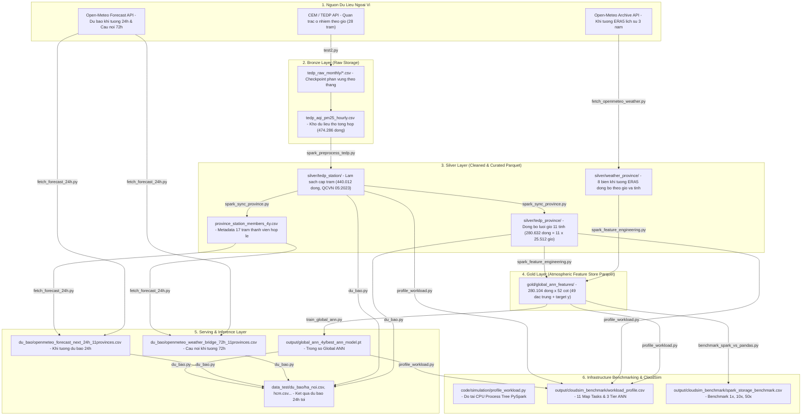

# KIẾN TRÚC VÀ QUY TRÌNH PIPELINE END-TO-END HỆ THỐNG DỰ BÁO BỤI MỊN PM2.5

Tài liệu này mô tả chi tiết kiến trúc kỹ thuật, luồng luân chuyển dữ liệu (Data Flow), thiết kế các tầng lưu trữ (Medallion Lakehouse Architecture), đặc tả 49 đặc trưng tính toán trên Apache Spark và quy trình vận hành End-to-End từ khâu thu thập dữ liệu (Ingestion) đến huấn luyện mô hình Spatio-Temporal Global ANN, suy luận dự báo 24 giờ thời gian thực và đo tải hạ tầng phục vụ mô phỏng CloudSim.

---

## 1. TỔNG QUAN KIẾN TRÚC HỆ THỐNG (SYSTEM ARCHITECTURE)

Hệ thống được thiết kế theo mô hình **Lakehouse Medallion Architecture 3 tầng (Bronze -> Silver -> Gold -> Serving)** kết hợp dữ liệu ô nhiễm không khí từ Cục Kiểm soát ô nhiễm môi trường (CEM/TEDP) và dữ liệu khí tượng tái phân tích/dự báo từ Open-Meteo (ERA5).

Toàn bộ quy trình ETL và trích xuất đặc trưng được xây dựng bằng **100% Apache Spark 3.5.1 Pure Catalyst Window Functions** (không dùng UDF, không dùng Pandas trong core processing), lưu trữ dưới định dạng Parquet nén Snappy phân vùng theo tỉnh (`province_name`).



---

## 2. THỐNG NHẤT VỀ SCHEMA VÀ ĐẶC TRẢ DỮ LIỆU CÁC TẦNG

### 2.1. Nhóm chỉ số chất lượng không khí (CEM/TEDP)
Đã chuẩn hóa và loại bỏ các trường thừa, tập trung vào 3 chỉ số cốt lõi tuân thủ QCVN 05:2023/BTNM và QĐ 1459/QĐ-TCMT:
* `pm25`: Chỉ số phụ bụi mịn PM2.5 (`PM205` trong TEDP - thang điểm AQI thành phần 0–500, không thứ nguyên). Đây là nhãn dự báo mục tiêu (`y`).
* `pm10`: Chỉ số phụ bụi PM10 (`PM10` trong TEDP - thang điểm 0–600).
* `aqi`: Chỉ số chất lượng không khí tổng hợp của trạm/tỉnh.

### 2.2. Nhóm 8 biến khí tượng bề mặt và đối lưu (Open-Meteo ERA5)
* `temperature_2m`: Nhiệt độ không khí tại độ cao 2m (°C).
* `relative_humidity_2m`: Độ ẩm tương đối tại 2m (%).
* `dew_point_2m`: Điểm sương nhiệt động (°C).
* `surface_pressure`: Áp suất khí quyển bề mặt (hPa).
* `precipitation`: Lượng mưa tích lũy theo giờ (mm).
* `wind_speed_10m`: Tốc độ gió tại 10m (chuẩn hóa đơn vị m/s).
* `wind_direction_10m`: Hướng gió theo độ tròn (0–360°).
* `boundary_layer_height`: Chiều cao lớp biên khí quyển (m) - quyết định thể tích đối lưu pha loãng chất ô nhiễm.

### 2.3. Cấu trúc 49 đặc trưng tầng Gold (`gold/global_ann_features/`)
Toàn bộ 49 features được tính toán tự động bằng **PySpark Catalyst Window Functions** theo phân vùng `province_name` và sắp xếp theo `datetime`:

1. **Chuỗi trễ quá khứ (Autoregressive Lags - 7 features):**
   * `pm25_lag_1h`, `pm25_lag_2h`, `pm25_lag_3h`, `pm25_lag_6h`, `pm25_lag_12h`, `pm25_lag_24h`, `pm25_lag_48h`.
2. **Thống kê cửa sổ trượt (Rolling Statistics - 6 features):**
   * `pm25_roll_mean_6h`, `pm25_roll_std_6h`.
   * `pm25_roll_mean_12h`, `pm25_roll_std_12h`.
   * `pm25_roll_mean_24h`, `pm25_roll_std_24h`.
3. **Biến nhiệt động lực học và đối lưu khí quyển (Atmospheric Physics - 5 features):**
   * `ventilation_coef`: Hệ số thông gió khí quyển = `wind_speed_10m * boundary_layer_height` (m²/s).
   * `dew_point_deficit`: Độ hụt điểm sương = `temperature_2m - dew_point_2m` (°C) - phản ánh độ bão hòa hơi nước và khả năng ngưng kết aerosol.
   * `temp_diff_24h`: Biến thiên nhiệt độ 24 giờ = `temperature_2m(t) - temperature_2m(t-24h)`.
   * `pressure_diff_24h`: Biến thiên áp suất bề mặt 24 giờ = `surface_pressure(t) - surface_pressure(t-24h)`.
   * `rh_diff_24h`: Biến thiên độ ẩm 24 giờ = `relative_humidity_2m(t) - relative_humidity_2m(t-24h)`.
4. **Chu kỳ thời gian tuần hoàn (Temporal Harmonic Cycles - 4 features):**
   * `hour_sin`, `hour_cos`: Mã hóa chu kỳ ngày đêm (24 giờ) qua hàm lượng giác.
   * `day_of_year_sin`, `day_of_year_cos`: Mã hóa chu kỳ mùa trong năm (365 ngày).
5. **Đặc trưng không gian địa lý (Spatial Coordinates - 2 features):**
   * `latitude_norm`, `longitude_norm`: Tọa độ trọng tâm 11 tỉnh chuẩn hóa theo Min-Max scaling.
6. **Biến khí tượng tức thời và độ trễ khí tượng (25 features):**
   * 8 biến khí tượng tại mốc `t` (nhiệt độ, độ ẩm, điểm sương, áp suất, mưa, tốc độ gió, hướng gió, BLH).
   * Các độ trễ khí tượng chính (`temp_lag_1h`, `temp_lag_24h`, `wind_lag_1h`, `wind_lag_24h`, `blh_lag_1h`, `blh_lag_24h`...).
7. **Nhãn mục tiêu (Target Label - 1 column):**
   * `pm25_lead_24h`: Giá trị PM2.5 tại mốc `t + 24 giờ` được tạo bằng hàm `lead("pm25", 24).over(window_spec)`.

---

## 3. CÁC BƯỚC THỰC THI PIPELINE END-TO-END

Quy trình vận hành từ khâu thu thập dữ liệu thô đến khi xuất bản kết quả dự báo và đo tải hạ tầng gồm 6 bước tuần tự:

### BƯỚC 1: Thu thập dữ liệu chất lượng không khí thô từ CEM API
* **Mã nguồn thực thi:** [`code/crawl_data/test2.py`](file:///d:/năm%204/big%20data/Final_Project_Plan/code/crawl_data/test2.py)
* **Cơ chế hoạt động:**
  * Gọi API endpoint Cục Kiểm soát ô nhiễm môi trường: `https://tedp.vn/api/aqi_hour/search/findByStationIdInAndGetTimeBetweenOrderByGetTimeDesc`.
  * Checkpoint theo từng tháng (`lakehouse_storage/bronze/tedp_raw_monthly/*.csv`): Tự động phát hiện các tháng đã tải đủ trong quá khứ và bỏ qua; chỉ crawl bù phần dữ liệu mới của tháng hiện tại tới 23:59:59 của ngày hôm trước.
  * Xuất dữ liệu thô tổng hợp vào Bronze Layer: [`lakehouse_storage/bronze/tedp_aqi_pm25_hourly.csv`](file:///d:/năm%204/big%20data/Final_Project_Plan/lakehouse_storage/bronze/tedp_aqi_pm25_hourly.csv) (474.286 dòng).
* **Lệnh chạy:**
  ```powershell
  python code/crawl_data/test2.py
  ```

---

### BƯỚC 2: Xử lý dữ liệu lớn bằng PySpark Medallion Lakehouse
Toàn bộ ETL tầng Silver và Gold được điều phối thống nhất bởi master script:
* **Mã nguồn điều phối:** [`code/lakehouse/build_lakehouse_spark.py`](file:///d:/năm%204/big%20data/Final_Project_Plan/code/lakehouse/build_lakehouse_spark.py)

Gồm 3 sub-pipeline Spark chạy tuần tự với 0% Pandas dependency:

#### 2.1. Bronze -> Silver Station ([`spark_preprocess_tedp.py`](file:///d:/năm%204/big%20data/Final_Project_Plan/code/lakehouse/spark_preprocess_tedp.py))
* Đọc bảng thô Bronze CSV 474.286 dòng.
* Ép kiểu chuẩn (`province_id`, `station_id` định dạng chuỗi).
* Lọc ngưỡng vật lý QCVN 05:2023: PM2.5 trong [0, 500], PM10 trong [0, 600], AQI trong [0, 500].
* Nội suy tuyến tính chuỗi thời gian bằng Spark Catalyst Window `limit=3` cho các khoảng khuyết ngắn; các khoảng khuyết lớn hơn được gán cờ `median_filled`.
* Ghi dữ liệu Parquet nén Snappy phân vùng theo `province_name` tại `lakehouse_storage/silver/tedp_station/` (440.012 dòng).

#### 2.2. Silver Station -> Silver Province & Weather ([`spark_sync_province.py`](file:///d:/năm%204/big%20data/Final_Project_Plan/code/lakehouse/spark_sync_province.py))
* Lọc tiêu chí độ phủ: Chỉ giữ các tỉnh có tỷ lệ giờ đo thật PM2.5 >= 80% trong 3 năm -> Chốt **17 trạm thành viên** thuộc **11 tỉnh/thành phố**.
* Gom nhóm theo mốc giờ và tỉnh: Tính trung bình các trạm có đo thật (KnowAir spatial aggregation pattern).
* Sinh lưới thời gian liên tục 25.512 giờ (từ 11/12/2023 đến 07/11/2026) cho từng tỉnh và nội suy hai chiều hoàn toàn bằng Spark Catalyst Window.
* Ghi dữ liệu Parquet phân vùng theo 11 tỉnh tại `lakehouse_storage/silver/tedp_province/` (280.632 dòng = 11 x 25.512 giờ) và `lakehouse_storage/silver/weather_province/`.

#### 2.3. Silver Province -> Gold Feature Store ([`spark_feature_engineering.py`](file:///d:/năm%204/big%20data/Final_Project_Plan/code/lakehouse/spark_feature_engineering.py))
* Thực hiện phép Inner Join giữa bảng TEDP và bảng Khí tượng theo `(province_name, datetime)`.
* Trích xuất **49 đặc trưng khí quyển** và nhãn mục tiêu `y = pm25_lead_24h` bằng 100% Catalyst Window (0 UDF).
* Ghi dữ liệu Gold Parquet nén Snappy phân vùng theo `province_name` tại `lakehouse_storage/gold/global_ann_features/` (280.104 dòng x 52 cột).

* **Lệnh chạy master:**
  ```powershell
  python code/lakehouse/build_lakehouse_spark.py --no-verify-diff
  ```

---

### BƯỚC 3: Đồng bộ dữ liệu khí tượng lịch sử Open-Meteo ERA5
* **Mã nguồn thực thi:** [`code/crawl_data/fetch_openmeteo_weather.py`](file:///d:/năm%204/big%20data/Final_Project_Plan/code/crawl_data/fetch_openmeteo_weather.py)
* **Cơ chế hoạt động:**
  * Đọc dải thời gian `[t_min, t_max]` thực tế từ dữ liệu tỉnh.
  * Gửi request theo khối thời gian (`CHUNK_DAYS = 366`) tới Open-Meteo Historical Weather API theo tọa độ trọng tâm của từng tỉnh.
  * Tự động bù các giờ cuối của ERA5 bằng Historical Forecast API (nếu có gap ngắn).
  * Đồng bộ 1-1 về mặt timestamp và vị trí địa lý với file TEDP.
* **Đầu ra chính:**
  * [`data_test/weather_openmeteo_province_4y.csv`](file:///d:/năm%204/big%20data/Final_Project_Plan/data_test/weather_openmeteo_province_4y.csv) (280.632 dòng, đủ 8 biến khí tượng).
* **Lệnh chạy:**
  ```powershell
  python code/crawl_data/fetch_openmeteo_weather.py
  ```

---

### BƯỚC 4: Thu thập dự báo thời tiết 24h tới và cầu nối khí tượng 72h
* **Mã nguồn thực thi:** [`code/crawl_data/fetch_forecast_24h.py`](file:///d:/năm%204/big%20data/Final_Project_Plan/code/crawl_data/fetch_forecast_24h.py)
* **Cơ chế hoạt động:**
  * Đọc danh sách 17 trạm thành viên từ `province_station_members_4y.csv`.
  * Gọi Open-Meteo Forecast API với tham số `past_days=2` và `forecast_days=2` (`wind_speed_unit="ms"`).
  * Gom trung bình theo tỉnh: vừa tạo file dự báo 24h tới, vừa tạo file cầu nối 72h để lấp kín dữ liệu thời tiết thực tế của hôm qua và hôm nay.
* **Đầu ra chính:**
  * Dự báo 24h tới: [`data_test/du_bao/openmeteo_forecast_next_24h_11provinces.csv`](file:///d:/năm%204/big%20data/Final_Project_Plan/data_test/du_bao/openmeteo_forecast_next_24h_11provinces.csv) (275 dòng = 25 mốc giờ x 11 tỉnh).
  * Cầu nối thời tiết 72h: [`data_test/du_bao/openmeteo_weather_bridge_72h_11provinces.csv`](file:///d:/năm%204/big%20data/Final_Project_Plan/data_test/du_bao/openmeteo_weather_bridge_72h_11provinces.csv).
* **Lệnh chạy:**
  ```powershell
  python code/crawl_data/fetch_forecast_24h.py
  ```

---

### BƯỚC 5: Huấn luyện Global ANN và Thực thi suy luận dự báo 24h tới
* **Mã nguồn thực thi:**
  * Huấn luyện: [`code/training/train_global_ann.py`](file:///d:/năm%204/big%20data/Final_Project_Plan/code/training/train_global_ann.py)
  * Dự báo: [`code/training/du_bao.py`](file:///d:/năm%204/big%20data/Final_Project_Plan/code/training/du_bao.py)

#### 5.1. Huấn luyện Spatio-Temporal Global ANN
* Đọc trực tiếp tầng Gold Parquet với kỹ thuật Partition Pruning.
* Huấn luyện mạng nơ-ron không gian - thời gian tích hợp tầng **Cross-Province Spatial Attention** (ma trận 11x11 biểu diễn mức độ tương tác ô nhiễm xuyên tỉnh).
* Đạt kết quả Test RMSE = 17,68 (cải thiện +16,50% so với mô hình Baseline 21,17).
* Lưu checkpoint trọng số tối ưu tại `output/global_ann_4y/best_ann_model.pt`.
* **Lệnh chạy:**
  ```powershell
  python code/training/train_global_ann.py --no-tune
  ```

#### 5.2. Chạy suy luận dự báo 24 giờ tới (Inference Serving)
Tích hợp **Cơ chế tự phục hồi đa tầng (Multi-Pass Diurnal Bridge + Autoregressive Rollout)**:
1. Nạp bổ sung các giờ đo thật trong ngày lẻ gần nhất từ `silver/tedp_station`.
2. Áp dụng vòng lặp đa lượt (Multi-pass diurnal `while` loop) kết hợp file cầu nối 72h để lấp đầy các khoảng trống lịch sử.
3. Chạy mô hình ANN tự hồi quy (Autoregressive Rollout) tạo giá trị bù cho từng bước nhảy 24h.
4. Đảm bảo kết quả dự báo xuất ra **25/25 mốc giờ đầy đủ số liệu, 100% không bị NaN**.

* **Lệnh chạy dự báo:**
  ```powershell
  # Dự báo cho Hà Nội:
  python code/training/du_bao.py --province "Hà Nội"

  # Dự báo cho TP.HCM:
  python code/training/du_bao.py --province "HCM"

  # Dự báo cho Đà Nẵng:
  python code/training/du_bao.py --province "Đà Nẵng"
  ```
* **Đầu ra:** File CSV chi tiết tại `data_test/du_bao/<ten_tinh>.csv` gồm: `forecast_datetime`, `horizon_hour`, `pm25_pred_ann`, `pm25_baseline_24h`, `air_quality_level` và các chỉ số vi khí hậu.

---

### BƯỚC 6: Đo tải tính toán thực nghiệm và Mô phỏng hạ tầng CloudSim
* **Mã nguồn thực thi:**
  * Profiling tải: [`code/simulation/profile_workload.py`](file:///d:/năm%204/big%20data/Final_Project_Plan/code/simulation/profile_workload.py)
  * Benchmark I/O đa tỷ lệ: [`code/simulation/benchmark_spark_vs_pandas.py`](file:///d:/năm%204/big%20data/Final_Project_Plan/code/simulation/benchmark_spark_vs_pandas.py)

#### 6.1. Đo tải CPU Process Tree PySpark
* Sử dụng `psutil` theo dõi toàn bộ cây tiến trình (Python Driver process + JVM Spark Executor child processes).
* Đo tải thực tế khi Spark Catalyst xử lý song song trên 11 Map Tasks (tương ứng 11 phân vùng tỉnh).
* Bóc tách 3 kịch bản tải tính toán Deep Learning:
  * `ANN_FULL_TRAIN`: Huấn luyện toàn bộ từ đầu (50 epochs).
  * `ANN_WARM_START`: Cập nhật định kỳ mô hình từ checkpoint (10 epochs).
  * `ANN_INFERENCE`: Suy luận dự báo thời gian thực.
* Quy đổi sang chiều dài chỉ lệnh máy ảo (Million Instructions - MI) và xuất file [`output/cloudsim_benchmark/workload_profile.csv`](file:///d:/năm%204/big%20data/Final_Project_Plan/output/cloudsim_benchmark/workload_profile.csv).

#### 6.2. Benchmark lưu trữ & I/O đa tỷ lệ (Multi-Scale Benchmark)
* Đo đạc dung lượng lưu trữ, thời gian đọc/ghi giữa CSV truyền thống và Parquet nén Snappy trên các quy mô 1x, 10x, 50x.
* Kết quả xuất tại [`output/cloudsim_benchmark/spark_storage_benchmark.csv`](file:///d:/năm%204/big%20data/Final_Project_Plan/output/cloudsim_benchmark/spark_storage_benchmark.csv), chứng minh Parquet tiết kiệm hơn 80% dung lượng đĩa và tăng tốc độ đọc truy vấn hơn 4 lần nhờ Columnar format và Partition Pruning.

---

## 4. HƯỚNG DẪN THỰC THI PIPELINE TRONG DOCKER CONTAINER

Để đảm bảo tính độc lập môi trường và khả năng tái lập 100% (Reproducibility), toàn bộ pipeline được cấu hình chạy trong Docker container `airquality-spark:3.5.1` (`8GB RAM`, `4 CPUs`):

```powershell
# 1. Chạy Master Orchestrator xây dựng toàn bộ Medallion Lakehouse (Spark Steps 1, 2, 3)
docker run --rm -m 8g --cpus 4 `
  -v "${PWD}:/workspace" -w /workspace `
  airquality-spark:3.5.1 `
  python3 code/lakehouse/build_lakehouse_spark.py --no-verify-diff

# 2. Huấn luyện Spatio-Temporal Global ANN từ tầng Gold Parquet
docker run --rm -m 8g --cpus 4 `
  -v "${PWD}:/workspace" -w /workspace `
  airquality-spark:3.5.1 `
  python3 code/training/train_global_ann.py --no-tune

# 3. Thu thập dự báo thời tiết và chạy suy luận dự báo 24h tới cho Hà Nội và TP.HCM
docker run --rm -m 8g --cpus 4 `
  -v "${PWD}:/workspace" -w /workspace `
  airquality-spark:3.5.1 `
  bash -c "python3 code/crawl_data/fetch_forecast_24h.py && python3 code/training/du_bao.py --province 'Hà Nội' && python3 code/training/du_bao.py --province 'HCM'"

# 4. Đo tải CPU Process Tree PySpark & sinh file cấu hình CloudSim
docker run --rm -m 8g --cpus 4 `
  -v "${PWD}:/workspace" -w /workspace `
  airquality-spark:3.5.1 `
  python3 code/simulation/profile_workload.py

# 5. Chạy benchmark lưu trữ và thông lượng I/O đa quy mô (1x, 10x, 50x)
docker run --rm -m 8g --cpus 4 `
  -v "${PWD}:/workspace" -w /workspace `
  airquality-spark:3.5.1 `
  python3 code/simulation/benchmark_spark_vs_pandas.py
```

---

## 5. BẢNG QUY ƯỚC DATA CONTRACT VÀ INTERFACE GIỮA CÁC THÀNH VIÊN

Nhằm đảm bảo 4 thành viên phối hợp trơn tru và không xảy ra xung đột interface, quy ước chuẩn đầu ra giữa các tầng như sau:

| Tầng / Giai đoạn | File / Thư mục đầu ra | Định dạng | Schema & Khóa chính | Phân vùng (Partition) | Người phụ trách chính |
| :--- | :--- | :--- | :--- | :--- | :--- |
| **Bronze Ingestion** | `lakehouse_storage/bronze/tedp_aqi_pm25_hourly.csv` | CSV | `station_id`, `station_code`, `datetime`, `pm25`, `pm10`, `aqi` | Phân chia file theo tháng | Member 1 (Infra / Data Eng) |
| **Silver Station** | `lakehouse_storage/silver/tedp_station/` | Parquet | `station_id`, `province_name`, `datetime`, `pm25`, `pm10`, `aqi`, `*_imputed` | `province_name` | Member 1 (Infra / Data Eng) |
| **Silver Province** | `lakehouse_storage/silver/tedp_province/` | Parquet | `province_name`, `datetime`, `pm25`, `pm10`, `aqi`, `latitude`, `longitude` | `province_name` | Member 2 (Processing / ETL) |
| **Silver Weather** | `lakehouse_storage/silver/weather_province/` | Parquet | `province_name`, `datetime`, 8 biến khí tượng ERA5 | `province_name` | Member 2 (Processing / ETL) |
| **Gold Feature Store**| `lakehouse_storage/gold/global_ann_features/` | Parquet | `province_name`, `datetime`, 49 features khí quyển, `pm25_lead_24h` | `province_name` | Member 2 & Member 3 |
| **Deep Learning** | `output/global_ann_4y/best_ann_model.pt` | PyTorch | Trọng số mạng nơ-ron đa tầng + Spatial Attention Matrix (11x11) | None | Member 3 (ML / Advanced Analytics) |
| **Real-time Serving**| `data_test/du_bao/<province>.csv` | CSV | `forecast_datetime`, `pm25_pred_ann`, `pm25_baseline_24h`, `air_quality_level` | None | Member 4 (Serving / Integration) |
| **Cloud Simulation** | `output/cloudsim_benchmark/workload_profile.csv` | CSV | `task_name`, `stage`, `elapsed_sec`, `cpu_time_sec`, `cpu_pct`, `cloudlet_length_mi` | None | Member 1 (Infra Lead) |
