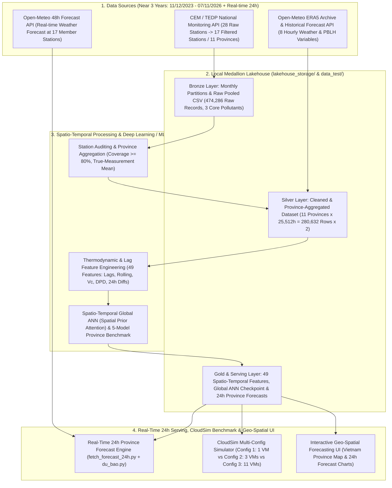

# Distributed Spatio-Temporal Air Quality Forecasting Lakehouse & CloudSim Benchmark: Coupling National In-Situ Monitoring (CEM/TEDP) with Open-Meteo Weather Features

> **Giải pháp Dữ liệu lớn Hoàn chỉnh (End-to-End Big Data Solution) kết hợp kiến trúc Medallion Lakehouse (`Bronze – Silver – Gold`), mạng nơ-ron không gian - thời gian toàn cục (`Spatio-Temporal Global ANN`) cùng bộ 5 mô hình Học máy đối sánh dự báo chỉ số bụi mịn (`I_PM2.5`) trước 24 giờ trên 11 tỉnh/thành phố (tổng hợp từ 17 trạm quan trắc đạt chuẩn trong gần 3 năm tại Việt Nam), tích hợp luồng dự báo thời gian thực 24h tới, mô phỏng hạ tầng đám mây đa cấu hình trên CloudSim và giao diện Bản đồ Dự báo Không gian (Geo-Spatial UI).**

---

## 1. Bối cảnh & Vấn đề Cốt lõi (Problem Statement)

Ô nhiễm bụi mịn (`PM2.5`) tại các trung tâm kinh tế – công nghiệp của Việt Nam (Hà Nội, Bắc Ninh, Hưng Yên, Hải Phòng, TP.HCM, Đà Nẵng...) diễn biến phức tạp theo mùa, chịu sự chi phối chặt chẽ của cả hoạt động phát thải nhân sinh lẫn các hiện tượng vi khí hậu cực đoan (nghịch nhiệt bức xạ mùa đông, gió mùa Đông Bắc, trần khí quyển thấp, rửa trôi ướt do mưa).

Tuy nhiên, việc xây dựng hệ thống giám sát và dự báo chất lượng không khí hiện nay gặp phải **3 rào cản kỹ thuật lớn**:
1. **Thiếu tính dự báo chủ động (Reactive, Not Predictive):** Các hệ thống quan trắc hiện tại chủ yếu hiển thị số liệu quá khứ/tức thời, thiếu khả năng cảnh báo sớm chỉ số `I_PM2.5` trước 24 giờ để phục vụ điều hành và bảo vệ sức khỏe cộng đồng.
2. **Nút thắt về bối cảnh vật lý & tương tác không gian (Physical & Spatial Blindness):** Dữ liệu từ các trạm quan trắc mặt đất (CEM/TEDP) chỉ cung cấp chỉ số ô nhiễm tại điểm đo, hoàn toàn không đo được các thông số nhiệt động lực học thẳng đứng (độ cao tầng biên khí quyển `PBLH`, độ hụt điểm sương `DPD`, vector gió và lượng mưa tích lũy 24 giờ) cũng như sự lan truyền bụi mịn giữa các tỉnh lân cận (ví dụ: hành lang Hà Nội – Bắc Ninh – Hưng Yên – Hải Phòng).
3. **Thách thức Hạ tầng Lưu trữ & Dị thể Không gian (Spatial Heterogeneity & Cloud Cost-Performance Trade-offs):** Mạng lưới trạm quan trắc phân bố không đồng đều giữa các địa phương và có tỷ lệ khuyết thiếu khác nhau. Việc chuẩn hóa thành các nút không gian cấp tỉnh, tổ chức lưu trữ phân vùng hiệu quả (Columnar Partitioned Storage) và lựa chọn cấu hình tài nguyên đám mây tối ưu về mặt Chi phí – Hiệu năng (Cost-Performance) đòi hỏi đánh giá thực nghiệm bài bản.

---

## 2. Mục tiêu Dự án (Project Objectives — Phương án B: Local Pipeline + CloudSim)

* **Xây dựng Kiến trúc Medallion Lakehouse (`Bronze – Silver – Gold`):** Thiết lập quy trình thu nạp tự động có lưu vết phân vùng theo tháng (`tedp_raw_monthly/`), kiểm toán và chuẩn hóa dữ liệu qua 3 tầng vật lý lưu trữ, tối ưu hóa dung lượng và tốc độ truy xuất theo tỉnh.
* **Đồng bộ Không gian - Thời gian Đa năm & Gộp Nút Cấp Tỉnh (Multi-Year Spatio-Temporal Aggregation):** Lọc chất lượng và độ phủ (`>= 80%`) trên chuỗi dữ liệu gần 3 năm (`11/12/2023 – 07/11/2026`, tương đương `25.512` giờ liên tục/tỉnh), gộp **17 trạm quan trắc thành viên đạt chuẩn thành 11 nút tỉnh/thành phố** (theo phương pháp trung bình các trạm đo thật tương tự chuẩn KnowAir quốc tế) và khớp nối 1-1 với 8 biến khí tượng – tầng biên khí quyển theo giờ từ Open-Meteo ERA5 (`280.632` dòng mỗi nguồn).
* **Tinh gọn Schema Ô nhiễm & Kiểm toán Chất lượng (Veracity Control):** Loại bỏ các biến khí phụ ít đóng góp (`no2, so2, o3, co`), chuẩn hóa bộ 3 chỉ số cốt lõi (`pm25, pm10, aqi`), lọc ngưỡng vật lý theo QCVN, loại bỏ các ô điền trung vị (`*_median_filled`) trước khi tính trung bình tỉnh, và nội suy tuyến tính có gắn cờ truy vết (`pm25_imputed`, `is_inserted`, `pm25_gap_hours`).
* **Huấn luyện Mạng Nơ-ron Toàn cục Không gian - Thời gian (`Spatio-Temporal Global ANN`) & Đối sánh Đa mô hình:** Phát triển kiến trúc `SpatioTemporalGlobalANN` tích hợp ma trận tương quan khoảng cách địa lý (`Spatial Prior Matrix` & `Cross-Station Attention`) trên toàn bộ `279.840` mẫu hợp lệ của 11 tỉnh, đồng thời đối sánh với 5 thuật toán học máy (`Linear Regression`, `SVR`, `Random Forest`, `XGBoost`, `LightGBM`) và `Persistence 24h Baseline`.
* **Phục vụ Dự báo Thời gian thực 24h tới (Real-Time 24h Forecasting Serving):** Xây dựng luồng thu thập dự báo thời tiết 24h tới tại tọa độ thực của 17 trạm thành viên, gộp trung bình theo 11 tỉnh (`fetch_forecast_24h.py`) và suy luận dự báo chỉ số `PM2.5` 24 giờ tiếp theo cho từng tỉnh (`du_bao.py`).
* **Mô phỏng Hạ tầng & Chi phí Đám mây Đa cấu hình (CloudSim Resource & Cost Modeling):** Đo đạc thực tế thời gian xử lý CPU và kích thước dữ liệu (`CSV` vs. `Parquet`) ở quy mô thực tế (`1x`) và mở rộng (`10x`, `50x`), sau đó mô phỏng trên **CloudSim** với 3 cấu hình máy ảo đám mây dựa trên bảng giá của Google Cloud (`asia-southeast1`).

---

## 3. Kiến trúc Hệ thống & Luồng Dữ liệu (System Architecture)

---

## 4. Thiết kế Lưu trữ Medallion & Mô hình hóa Tài nguyên CloudSim

Hệ thống triển khai **Phương án B (Mục 4.2 `docs/context.md`)** kết hợp kiến trúc lưu trữ Medallion với bộ mô phỏng hạ tầng **CloudSim**:

1. **Tối ưu hóa Lưu trữ Phân vùng (Monthly Checkpoints & Columnar Partitioning):**
   - Tầng `Bronze` lưu trữ bất biến theo từng phân vùng tháng (`lakehouse_storage/bronze/tedp_raw_monthly/tedp_YYYY-MM.csv`), cho phép cơ chế *Incremental Resume* chỉ tải bổ sung các ngày mới của tháng hiện tại.
   - Tầng `Silver` và `Gold` chuẩn hóa schema tinh gọn (loại bỏ `no2, so2, o3, co`), hỗ trợ đóng gói sang định dạng cột **Apache Parquet (nén Snappy)** phân vùng theo tỉnh để giảm ~80% dung lượng đĩa và tăng tốc độ đọc I/O nhờ *Partition Pruning* & *Column Projection*.
2. **Mô hình hóa Tài nguyên & Định giá Đám mây trên CloudSim (Tham chiếu GCP `asia-southeast1`):**
   - Thời gian xử lý thực tế và kích thước dữ liệu thực tế được đo trực tiếp từ phần cứng cục bộ để quy đổi sang chiều dài tác vụ (**Cloudlet Length tính bằng MI — Million Instructions**).
   - Mô phỏng và đối sánh **3 Cấu hình Hạ tầng Đám mây (Resource Configurations)**:
     - **Config 1 (Sequential Small VM — `1 x e2-standard-2`, 2 vCPUs, 8GB RAM, lưu CSV):** Chạy tuần tự trên 1 máy ảo nhỏ.
     - **Config 2 (Balanced Regional Cluster — `3 x e2-standard-4`, 4 vCPUs, 16GB RAM, lưu Parquet phân vùng):** Phân bổ 11 tỉnh vào 3 máy ảo chạy song song theo thuật toán lập lịch *Longest Processing Time First (LPT)*.
     - **Config 3 (Max-Parallel Cluster — `11 x c2-standard-8`, 8 vCPUs, 32GB RAM):** Mỗi tỉnh chạy trên 1 máy ảo riêng biệt (minh họa quy luật hiệu suất giảm dần do chi phí khởi tạo VM 30s và quy tắc tính phí tối thiểu 60 giây của Google Cloud).

---

## 5. Bốn Nhóm Đặc trưng Nhiệt động lực học & Biến thiên Khí quyển (Thermodynamic Core)

Hệ thống thu thập đầy đủ **8 biến khí tượng theo giờ** từ Open-Meteo (`temperature_2m`, `relative_humidity_2m`, `dew_point_2m`, `surface_pressure`, `precipitation`, `wind_speed_10m` tính bằng `m/s`, `wind_direction_10m`, `boundary_layer_height`) và trích xuất các đặc trưng vật lý khí quyển trong pipeline huấn luyện ([`code/training/common.py`](file:///d:/năm%204/big%20data/Final_Project_Plan/code/training/common.py) và [`code/training/train_global_ann.py`](file:///d:/năm%204/big%20data/Final_Project_Plan/code/training/train_global_ann.py)):

* **Động lực học Gió (Wind Vector Dynamics):** Biến đổi hướng gió (`wind_direction_10m`) sang tọa độ lượng giác liên tục (`wind_dir_sin`, `wind_dir_cos`) kết hợp với tốc độ gió (`wind_speed_10m` đơn vị `m/s`) để mô hình hóa hướng thổi (phân biệt gió mùa Đông Bắc khô mang bụi và gió biển ẩm sạch) cùng khả năng khuếch tán ngang.
* **Dung tích Thông gió Khí quyển (Ventilation Coefficient - `Vc`):** Tích số giữa tốc độ gió và độ cao tầng biên khí quyển (`ventilation_coef = wind_speed_10m * boundary_layer_height`), định lượng khả năng tự pha loãng ô nhiễm theo phương thẳng đứng và phương ngang.
* **Độ ẩm, Điểm sương & Rửa trôi Ướt (Moisture & Precipitation Scavenging):** Tính độ hụt điểm sương (`dew_point_deficit = temperature_2m - dew_point_2m`) phản ánh mức độ bão hòa hơi nước thúc đẩy ngưng tụ hạt aerosol, cùng tổng lượng mưa tích lũy trong suốt 24 giờ (`precip_sum_24h`) mô tả quá trình rửa trôi ướt bầu khí quyển.
* **Động lực Biến thiên Thời tiết 24 giờ (`24h Weather Dynamics`):** Độ chênh lệch nhiệt độ (`temp_diff_24h`), áp suất bề mặt (`pressure_diff_24h`) và độ cao tầng biên (`pblh_diff_24h`) giữa thời điểm dự báo `t+24h` và hiện tại `t`, giúp mô hình nhận diện các đợt không khí lạnh hoặc nghịch nhiệt đang hình thành mà không gây rò rỉ dữ liệu tương lai (Zero Data Leakage).

---

## 6. Ánh xạ Tiêu chí 5V của Big Data

| Chữ "V" | Hiện thực hóa trong dự án (Phương án B: Local Lakehouse + Global ANN + CloudSim) |
| :--- | :--- |
| **Volume** | Thu thập `474.286` bản ghi thô từ 28 trạm quan trắc CEM/TEDP trong gần 3 năm (`2023 – 2026`); chuẩn hóa và gộp thành bộ dữ liệu cấp tỉnh `280.632` dòng × 2 nguồn = `561.264` bản ghi đồng bộ 100% (`11 tỉnh x 25.512 giờ`), kèm thực nghiệm mở rộng quy mô (`1x`, `10x`, `50x` tương đương `14 triệu` dòng) trên CloudSim. |
| **Velocity** | Luồng Ingestion thu nạp chuỗi dữ liệu theo giờ (hourly batch) với cơ chế checkpoint theo tháng (`tedp_raw_monthly/`) và luồng thu thập dự báo thời tiết 24h thời gian thực (`fetch_forecast_24h.py`) phục vụ suy luận tức thời (`du_bao.py`). |
| **Variety** | Kết hợp dữ liệu quan trắc môi trường mặt đất (3 chỉ số cốt lõi: `pm25`, `pm10`, `aqi`), 8 biến khí tượng – tầng biên khí quyển từ mô hình tái phân tích ERA5 / dự báo số trị Open-Meteo và dữ liệu tọa độ không gian GPS (`latitude`, `longitude`, `elevation`). |
| **Veracity** | Pipeline kiểm toán đa tầng: chuẩn hóa định danh chuỗi 29 chữ số, lọc ngưỡng vật lý QCVN, loại bỏ ô fill trung vị giả tạo trước khi lấy trung bình tỉnh, lọc tỉnh đạt độ phủ đo thật `>= 80%`, nội suy tuyến tính và gắn cờ truy vết (`pm25_imputed`, `is_inserted`, `pm25_gap_hours`). |
| **Value** | Mô hình `Spatio-Temporal Global ANN` dự báo sớm chỉ số `I_PM2.5` trước 24 giờ **vượt Baseline tại 11/11 tỉnh/thành phố** (giảm `16.50%` RMSE toàn cục trên tập Test: từ `21.17` xuống `17.68`), xuất trực tiếp dự báo 24h tới cho từng tỉnh tại `data_test/du_bao/`. |

---

## 7. Sản phẩm Đầu ra của Dự án (Deliverables)

1. **Báo cáo Kiểm toán & Độ phủ Dữ liệu (`preprocessing_report.txt`, `province_coverage_4y.csv`, `province_station_members_4y.csv`):** Báo cáo kiểm định chất lượng dữ liệu cấp trạm, bảng độ phủ 14 tỉnh thô và danh sách 17 trạm thành viên thuộc 11 tỉnh đạt chuẩn.
2. **Kho Dữ liệu Medallion Lakehouse (`lakehouse_storage/` & `data_test/`):** Bao gồm phân vùng tháng tầng Bronze (`474.286` dòng) và cặp dữ liệu chuẩn hóa tầng Silver (`cleaned_tedp_province_4y.csv` & `weather_openmeteo_province_4y.csv`, mỗi file `280.632` dòng).
3. **Mô hình Mạng Nơ-ron Toàn cục (`output/global_ann_4y/`):** Trọng số tối ưu `best_ann_model.pt`, bảng dự báo `predictions.csv`, phân tích đóng góp đặc trưng `feature_importance_pct.csv`, ma trận chú ý không gian giữa 11 tỉnh `province_attention_matrix_pct.csv` và chỉ số đánh giá `metrics.json`.
4. **Pipeline Dự báo Thời gian thực 24h tới (`data_test/du_bao/`):** File tổng hợp dự báo thời tiết 24h của 11 tỉnh (`openmeteo_forecast_next_24h_11provinces.csv`) và các file kết quả dự báo `PM2.5` chi tiết từng giờ cho từng tỉnh (`ha_noi.csv`, `hcm.csv`...).
5. **Tài liệu Kiến trúc & Quy trình End-to-End (`docs/`):** Bao gồm `project_overview.md`, `pipeline_detail.md`, `overview.md`, `preprocessing_data_normalization_plan.md` và `task_breakdown_schedule.md`.

---

## 8. Phạm vi Dữ liệu & Pipeline Thực thi Hiện tại

### 8.1. Phạm vi dữ liệu đã chốt (Gần 3 năm: 11/12/2023 – 07/11/2026)

| Hạng mục | Giá trị thực tế trong dự án |
| :--- | :--- |
| **Dữ liệu thô thu thập (Bronze)** | **474.286 dòng** từ **28 trạm / 14 tỉnh thành** (`2023-02-16 14:00` -> `2026-11-07 23:00`) |
| **Cửa sổ đồng bộ chuẩn cấp tỉnh (Silver)** | **Gần 3 năm (1.063 ngày = 2,91 năm)**: `2023-12-11 00:00` -> `2026-11-07 23:00` (**25.512 giờ liên tục/tỉnh**) |
| **Số tỉnh / trạm thành viên vượt bộ lọc** | **11 tỉnh / 17 trạm thành viên** (`HCM` 4 trạm, `Hà Nội` 2 trạm, `Hưng Yên` 2 trạm, `Đà Nẵng` 2 trạm; `Bắc Ninh`, `Gia Lai`, `Hải Phòng`, `Lâm Đồng`, `Ninh Bình`, `Quảng Ngãi`, `Tây Ninh` mỗi tỉnh 1 trạm) |
| **Tổng bản ghi đồng bộ cấp tỉnh** | **280.632 dòng** mỗi nguồn (TEDP 30 cột và Open-Meteo 19 cột), khớp 1-1 tuyệt đối (100%) theo `(station_code, datetime)` |
| **Các chỉ số ô nhiễm giữ lại** | **3 chỉ số cốt lõi:** `pm25`, `pm10`, `aqi` (đã loại bỏ `no2, so2, o3, co`) |
| **Đơn vị biến mục tiêu (`pm25`)** | **Chỉ số AQI thành phần của PM2.5 (`I_PM2.5`, thang điểm 0–500 không thứ nguyên theo QĐ 1459/QĐ-TCMT)** lấy từ trường `PM205` của endpoint `/api/aqi_hour` |

### 8.2. Các script trong Pipeline End-to-End

| Bước | Script | Đầu vào | Đầu ra |
| :--- | :--- | :--- | :--- |
| 1. Crawl dữ liệu CEM/TEDP (có checkpoint tháng) | [`code/crawl_data/test2.py`](file:///d:/năm%204/big%20data/Final_Project_Plan/code/crawl_data/test2.py) | REST API `https://tedp.vn/api` | `lakehouse_storage/bronze/tedp_raw_monthly/*.csv` & `tedp_aqi_pm25_hourly.csv` |
| 2. Tiền xử lý cấp trạm & Tự động gộp trung bình tỉnh | [`code/crawl_data/preprocess_tedp.py`](file:///d:/năm%204/big%20data/Final_Project_Plan/code/crawl_data/preprocess_tedp.py) & [`sync_tedp_province.py`](file:///d:/năm%204/big%20data/Final_Project_Plan/code/crawl_data/sync_tedp_province.py) | `lakehouse_storage/bronze/tedp_aqi_pm25_hourly.csv` | `cleaned_tedp.csv`, `data_test/cleaned_tedp_province_4y.csv` (280.632 dòng × 30 cột), `province_station_members_4y.csv` |
| 3. Đồng bộ 8 biến thời tiết lịch sử ERA5 cấp tỉnh | [`code/crawl_data/fetch_openmeteo_weather.py`](file:///d:/năm%204/big%20data/Final_Project_Plan/code/crawl_data/fetch_openmeteo_weather.py) | `data_test/cleaned_tedp_province_4y.csv` | `data_test/weather_openmeteo_province_4y.csv` (280.632 dòng × 19 cột) |
| 4. Đào dự báo thời tiết 24h tới theo 17 trạm & gộp 11 tỉnh | [`code/crawl_data/fetch_forecast_24h.py`](file:///d:/năm%204/big%20data/Final_Project_Plan/code/crawl_data/fetch_forecast_24h.py) | `data_test/province_station_members_4y.csv` + Open-Meteo Forecast API | `data_test/du_bao/openmeteo_forecast_next_24h_11provinces.csv` (1 file CSV tổng hợp duy nhất) |
| 5. Huấn luyện mô hình Spatio-Temporal Global ANN | [`code/training/train_global_ann.py`](file:///d:/năm%204/big%20data/Final_Project_Plan/code/training/train_global_ann.py) | 2 file `province_4y.csv` trong `data_test/` | `output/global_ann_4y/best_ann_model.pt`, `metrics.json`, `predictions.csv` |
| 6. Suy luận dự báo PM2.5 24h tới cho từng tỉnh | [`code/training/du_bao.py`](file:///d:/năm%204/big%20data/Final_Project_Plan/code/training/du_bao.py) | `best_ann_model.pt` + Lịch sử 72h + File thời tiết 24h | `data_test/du_bao/ten_tinh.csv` (ví dụ: `ha_noi.csv`, `hcm.csv`) |

---

## 9. Nhật ký Quyết định Công nghệ & Quản trị Rủi ro (Decision Log & Risk Register)

### 9.1. Quyết định Công nghệ (Technology Decisions)

| Quyết định kỹ thuật | Lý do lựa chọn (Why?) | Phương án thay thế bị loại | Đánh đổi kỹ thuật (Trade-off) |
| :--- | :--- | :--- | :--- |
| **Gộp trạm thành nút cấp tỉnh (17 trạm -> 11 tỉnh)** | Đồng nhất với chuẩn nghiên cứu quốc tế (KnowAir), giảm nhiễu cục bộ khi 1 trạm bảo trì ngắn hạn, giữ được chuỗi liên tục gần 3 năm (`25.512` giờ) với độ phủ `>= 80%`. | Giữ nguyên từng trạm rời rạc với yêu cầu đủ 100% số ngày | Mất chi tiết vi mô nội đô giữa các quận, nhưng tăng mạnh tính liên tục dài hạn (từ 120 ngày lên gần 3 năm) và độ ổn định khi học sâu. |
| **Loại bỏ `no2, so2, o3, co`, chỉ giữ `pm25, pm10, aqi`** | Các khí phụ có tỷ lệ khuyết thiếu cao tại nhiều trạm tỉnh và không đóng góp vào dự báo `PM2.5` tại `t+24h`. Loại bỏ giúp giảm dung lượng lưu trữ và tránh nhiễu nội suy. | Giữ toàn bộ 7 chỉ số ô nhiễm | Không phục vụ bài toán dự báo đa chất khí, nhưng tối ưu hóa hoàn toàn độ sạch dữ liệu và tốc độ xử lý cho bài toán trọng tâm `PM2.5`. |
| **Đào dự báo thời tiết 24h theo tọa độ 17 trạm rồi lấy trung bình tỉnh** | Đảm bảo tính nhất quán tuyệt đối (Data Consistency) giữa cách tổng hợp dữ liệu ô nhiễm cấp tỉnh (`sync_tedp_province.py`) và dữ liệu thời tiết dự báo đầu vào (`fetch_forecast_24h.py`). | Chỉ gọi API dự báo tại 1 điểm tọa độ trung bình tỉnh | Tốn 17 request thay vì 11 request mỗi lần lấy dự báo (~15 giây), nhưng phản ánh chính xác vi khí hậu tại đúng vị trí đặt các trạm quan trắc thành viên. |
| **Mô hình `Spatio-Temporal Global ANN` có Spatial Attention** | Học chung trên toàn bộ `279.840` mẫu của 11 tỉnh, khai thác tương quan không gian giữa các tỉnh lân cận và đạt kết quả vượt Baseline ở cả `11/11` tỉnh (`+16.50%` RMSE). | Chỉ huấn luyện mô hình cây độc lập trên từng tỉnh nhỏ | Cần chuẩn hóa Z-score và thiết kế kiến trúc mạng phức tạp hơn, nhưng khắc phục triệt để hiện tượng quá khớp (overfitting) ở các tỉnh 1 trạm. |

### 9.2. Quản trị Rủi ro Kỹ thuật (Risk Register)

| Mã | Rủi ro | Mức ảnh hưởng | Giải pháp phòng ngừa (Mitigation) | Phụ trách |
| :---: | :--- | :---: | :--- | :---: |
| **R-01** | Mở và lưu file CSV bằng Excel làm hỏng mã `station_id` / `province_id` 29 chữ số thành số mũ khoa học (`2.84E+28`) | Critical | Ép kiểu `dtype={"province_id": str, "station_id": str, "station_code": str}` trong toàn bộ script Python và khôi phục trực tiếp từ phân vùng gốc `tedp_raw_monthly/`. | Quý |
| **R-02** | Chạy lẻ tẻ bước tiền xử lý mà không chạy đồng bộ pipeline khiến lệch ngày kết thúc giữa file TEDP và file Weather lịch sử | High | Thiết lập quy trình chuẩn 5 bước End-to-End (`test2.py -> preprocess_tedp.py -> fetch_openmeteo_weather.py -> fetch_forecast_24h.py -> du_bao.py`) trong `docs/pipeline_detail.md`. | Bảo |
| **R-03** | Trạm lắp đặt muộn trong tỉnh nhiều trạm làm nhảy bậc giá trị trung bình tỉnh | High | Bộ lọc `filter_stations` trong `sync_tedp_province.py` tự động loại các trạm lắp muộn có độ phủ `< 80%` nếu tỉnh đó đã có trạm dài hạn đạt chuẩn. | Quý |
| **R-04** | Hiểu nhầm đơn vị `pm25` từ CEM là nồng độ `ug/m3` thay vì chỉ số AQI thành phần `I_PM2.5` | Medium | Ghi rõ trong báo cáo và tài liệu kỹ thuật: trường `PM205` từ `/api/aqi_hour` là chỉ số phụ `I_PM2.5` (thang 0–500 theo QĐ 1459/QĐ-TCMT). | Dương |
