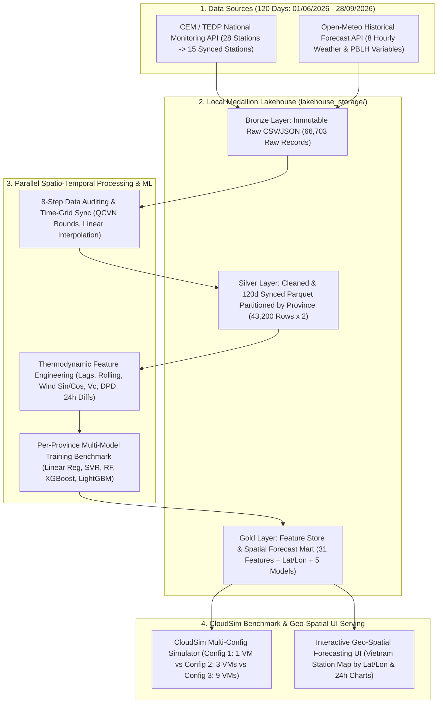

# 🇻🇳 Distributed Spatio-Temporal Air Quality Forecasting Lakehouse & CloudSim Benchmark: Coupling National In-Situ Monitoring (CEM/TEDP) with Open-Meteo Weather Features

> **Giải pháp Dữ liệu lớn Hoàn chỉnh (End-to-End Big Data Solution) kết hợp kiến trúc Medallion Parquet Lakehouse (`Bronze – Silver – Gold`), huấn luyện song song 5 họ mô hình Học máy dự báo chỉ số bụi mịn ($I_{\text{PM2.5}}$) trước 24 giờ trên 9 tỉnh/thành phố tại Việt Nam, tích hợp mô phỏng hạ tầng & chi phí đám mây đa cấu hình trên CloudSim và giao diện Bản đồ Dự báo Không gian (Geo-Spatial UI).**

---

## 1. Bối cảnh & Vấn đề Cốt lõi (Problem Statement)

Ô nhiễm bụi mịn ($PM_{2.5}$) tại các trung tâm kinh tế – công nghiệp của Việt Nam (Hà Nội, Bắc Ninh, Hưng Yên, TP.HCM...) diễn biến phức tạp, chịu sự chi phối chặt chẽ của cả hoạt động phát thải nhân sinh lẫn các hiện tượng vi khí hậu cực đoan (nghịch nhiệt bức xạ, gió mùa, trần khí quyển thấp, rửa trôi ướt do mưa).

Tuy nhiên, việc xây dựng hệ thống giám sát và dự báo chất lượng không khí hiện nay gặp phải **3 rào cản kỹ thuật lớn**:
1. **Thiếu tính dự báo chủ động (Reactive, Not Predictive):** Các hệ thống quan trắc hiện tại chủ yếu hiển thị số liệu quá khứ/tức thời, thiếu khả năng cảnh báo sớm chỉ số $I_{\text{PM2.5}}$ trước 24 giờ để phục vụ điều hành và bảo vệ sức khỏe cộng đồng.
2. **Nút thắt về bối cảnh vật lý (Physical Blindness):** Dữ liệu từ các trạm quan trắc mặt đất (CEM/TEDP) chỉ cung cấp chỉ số ô nhiễm tại điểm đo, hoàn toàn không đo được các thông số nhiệt động lực học thẳng đứng (độ cao tầng biên khí quyển $PBLH$, độ hụt điểm sương $DPD$, vector gió và lượng mưa tích lũy 24 giờ). Điều này khiến các mô hình chỉ dựa vào chuỗi tự hồi quy bị "mù" trước các đợt biến đổi thời tiết giao mùa.
3. **Thách thức Hạ tầng Lưu trữ & Dị thể Không gian (Spatial Heterogeneity & Cloud Cost-Performance Trade-offs):** Mỗi địa phương có mật độ trạm và cơ chế vi khí hậu riêng biệt. Việc tổ chức lưu trữ phân vùng hiệu quả (Columnar Partitioned Storage) và lựa chọn cấu hình tài nguyên tính toán đám mây tối ưu về mặt Chi phí – Hiệu năng (Cost-Performance) đòi hỏi đánh giá thực nghiệm bài bản giữa các định dạng lưu trữ (`CSV` vs. `Parquet`) và các cấu hình cụm máy ảo.

---

## 2. Mục tiêu Dự án (Project Objectives — Phương án B: Local Pipeline + CloudSim)

* **Xây dựng Kiến trúc Medallion Lakehouse (`Bronze – Silver – Gold`) với Apache Parquet Phân vùng:** Thiết lập quy trình thu nạp tự động, kiểm toán và chuẩn hóa dữ liệu qua 3 tầng vật lý lưu trữ dưới định dạng cột **Apache Parquet (nén Snappy) phân vùng theo tỉnh (`province=...`)**, giúp giảm ~80% dung lượng lưu trữ và tối ưu hóa tốc độ đọc nhờ cơ chế *Partition Pruning* & *Column Projection*.
* **Tích hợp Đa nguồn Không gian - Thời gian (Spatio-Temporal Data Fusion):** Khớp nối 1-1 chuỗi đo thực tế mặt đất (Ground Truth $Y$ — chỉ số AQI thành phần $I_{\text{PM2.5}}$ từ CEM/TEDP) với 8 biến thời tiết & tầng biên khí quyển theo giờ tại **đúng tọa độ `(latitude, longitude)` của từng trạm** (Features $X$ từ Open-Meteo) theo khóa `(station_code, datetime)`.
* **Kiểm toán & Chuẩn hóa Chất lượng Dữ liệu Môi trường (Veracity Control):** Chuẩn hóa metadata hành chính; kiểm toán tính nhất quán vật lý theo ngưỡng QCVN; đồng bộ hóa lưới thời gian 120 ngày liên tục (`2.880` giờ/trạm) và bù đắp giờ khuyết ngắn hạn bằng nội suy tuyến tính có gắn cờ truy vết (`*_imputed`, `is_inserted`).
* **Nghiên cứu Đối sánh Đa thuật toán dưới Dịch chuyển Phân phối Giao mùa (Multi-Model Forecasting Benchmark):** So sánh công bằng 5 thuật toán học máy (`Linear Regression`, `SVR`, `Random Forest`, `XGBoost`, `LightGBM`) với mô hình cơ sở `Persistence 24h`, áp dụng cơ chế *Early Stopping* và *Regularization* công bằng trên tập Validation để dự báo chỉ số $I_{\text{PM2.5}}$ trước 24 giờ cho 9 tỉnh thành.
* **Mô phỏng Hạ tầng & Chi phí Đám mây Đa cấu hình (CloudSim Resource & Cost Modeling):** Đo đạc thực tế thời gian xử lý CPU (Empirical Workload Profiling) và kích thước dữ liệu (`CSV` vs. `Parquet`) ở quy mô thực tế (`1x`) và mở rộng (`10x`, `50x`), sau đó mô phỏng trên **CloudSim** với $\ge 3$ cấu hình máy ảo đám mây dựa trên bảng giá công khai của Google Cloud (`asia-southeast1`).
* **Trực quan hóa Bản đồ Dự báo Không gian (Geo-Spatial Forecasting UI):** Kết hợp tọa độ GPS (`latitude`, `longitude`) của 15 trạm / 9 tỉnh thành với kết quả dự báo tầng Gold để hiển thị bản đồ cảnh báo VN_AQI, biểu đồ chuỗi thời gian 5 mô hình, mức độ đóng góp đặc trưng vật lý và báo cáo Benchmark CloudSim.

---

## 3. Kiến trúc Hệ thống & Luồng Dữ liệu (System Architecture)

---

## 4. Thiết kế Lưu trữ Medallion Parquet & Mô hình hóa Tài nguyên CloudSim

Thay vì phụ thuộc vào tài khoản đám mây trả phí hoặc lưu trữ tệp CSV phẳng kém hiệu quả, hệ thống triển khai **Phương án B (Mục 4.2 `docs/context.md`)** kết hợp tối ưu hóa định dạng lưu trữ hướng cột (**Apache Parquet**) với bộ mô phỏng hạ tầng **CloudSim**:

1. **Tối ưu hóa Lưu trữ Hướng cột & Phân vùng (Columnar Parquet & Hive Partitioning):**
   - Dữ liệu ở tầng `Silver` và `Gold` được lưu bằng `pyarrow` với thuật toán nén `Snappy` và phân vùng thư mục theo `province=...`.
   - Khi huấn luyện mô hình cho từng tỉnh hoặc truy vấn dữ liệu trên UI, hệ thống chỉ đọc đúng phân vùng của tỉnh đó (**Partition Pruning**) và chỉ nạp các cột cần thiết vào bộ nhớ (**Column Projection**), giảm ~80% dung lượng đĩa và ~90% lượng dữ liệu quét (Bytes Scanned) so với đọc tệp CSV nguyên khối.
2. **Mô hình hóa Tài nguyên & Định giá Đám mây trên CloudSim (Tham chiếu GCP `asia-southeast1`):**
   - Thời gian xử lý thực tế của từng tỉnh ($T_{\text{local}, i}$) và kích thước dữ liệu thực tế ($S_{\text{CSV}}, S_{\text{Parquet}}$) được đo trực tiếp từ phần cứng cục bộ để quy đổi sang chiều dài tác vụ (**Cloudlet Length tính bằng MI — Million Instructions**).
   - Mô phỏng và đối sánh **3 Cấu hình Hạ tầng Đám mây (Resource Configurations)**:
     - **Config 1 (Sequential Small VM — `1 × e2-standard-2`, 2 vCPUs, 8GB RAM, lưu CSV):** Chạy tuần tự 9 tỉnh trên 1 máy ảo nhỏ.
     - **Config 2 (Balanced Regional Cluster — `3 × e2-standard-4`, 4 vCPUs, 16GB RAM, lưu Parquet phân vùng):** Phân bổ 9 tỉnh vào 3 máy ảo chạy song song theo thuật toán lập lịch *Longest Processing Time First (LPT)* để cân bằng tải giữa các tỉnh nhiều trạm (`TP.HCM`, `Hà Nội`, `Hưng Yên`) và các tỉnh 1 trạm.
     - **Config 3 (Max-Parallel Cluster — `9 × c2-standard-8`, 8 vCPUs, 32GB RAM):** Mỗi tỉnh chạy trên 1 máy ảo riêng biệt (minh họa quy luật hiệu suất giảm dần do chi phí khởi tạo VM và quy tắc tính phí tối thiểu 60 giây của Google Cloud).

---

## 5. Bốn Nhóm Đặc trưng Nhiệt động lực học & Biến thiên Khí quyển (Thermodynamic Core)

Hệ thống thu thập đầy đủ **8 biến khí tượng theo giờ** từ Open-Meteo (`temperature_2m`, `relative_humidity_2m`, `dew_point_2m`, `surface_pressure`, `precipitation`, `wind_speed_10m`, `wind_direction_10m`, `boundary_layer_height`) và tính toán trực tiếp các đặc trưng vật lý khí quyển trong pipeline huấn luyện ([code/training/common.py](file:///d:/năm%204/big%20data/Final_Project_Plan/code/training/common.py)):

* **Động lực học Gió (Wind Vector Dynamics):** Biến đổi hướng gió (`wind_direction_10m`) sang tọa độ lượng giác liên tục ($\sin(\theta), \cos(\theta)$) kết hợp với tốc độ gió (`wind_speed_10m`) để mô hình hóa hướng thổi (phân biệt gió mùa Đông Nam ẩm sạch và gió Đông Bắc khô mang bụi) cùng khả năng khuếch tán ngang.
* **Dung tích Thông gió Khí quyển (Ventilation Coefficient - $V_c$):** Tích số giữa tốc độ gió và độ cao tầng biên khí quyển ($V_c = \text{WS}_{10\text{m}} \times \text{PBLH}$), định lượng khả năng tự pha loãng ô nhiễm theo phương thẳng đứng và phương ngang.
* **Độ ẩm, Điểm sương & Rửa trôi Ướt (Moisture & Precipitation Scavenging):** Tính độ hụt điểm sương ($\text{DPD} = T_{2\text{m}} - T_d$) phản ánh mức độ bão hòa hơi nước thúc đẩy ngưng tụ hạt aerosol, cùng tổng lượng mưa tích lũy trong suốt 24 giờ qua (`precip_sum_24h` — đặc trưng đứng **Top 2 Feature Importance** tại Hà Nội và Hưng Yên) mô tả quá trình rửa trôi ướt bầu khí quyển.
* **Động lực Biến thiên Thời tiết 24 giờ ($\Delta_{24\text{h}}$ Weather Dynamics):** Độ chênh lệch nhiệt độ (`temp_diff_24h`), áp suất bề mặt (`pressure_diff_24h`) và độ cao tầng biên (`pblh_diff_24h`) trong 24 giờ qua, giúp mô hình nhận diện các rãnh áp thấp hoặc sóng lạnh đầu thu đang hình thành mà không gây rò rỉ dữ liệu tương lai (Zero Data Leakage).

---

## 6. Ánh xạ Tiêu chí 5V của Big Data

| Chữ "V" | Hiện thực hóa trong dự án (Phương án B: Local Lakehouse + CloudSim) |
| :--- | :--- |
| **Volume** | Thu thập `66.703` bản ghi thô từ 28 trạm quan trắc CEM/TEDP trong 4 tháng (`06/2026 – 09/2026`); chuẩn hóa thành bộ dữ liệu đối sánh 120 ngày (`43.200` dòng × 2 nguồn = `86.400` bản ghi đồng bộ 100%), kèm thực nghiệm mở rộng quy mô (`1x`, `10x`, `50x` tương đương `13,14 triệu` dòng) trong mô phỏng CloudSim. |
| **Velocity** | Luồng Ingestion thu nạp chuỗi dữ liệu theo giờ (hourly batch) từ REST API của CEM/TEDP và Open-Meteo với cơ chế chia chunk thời gian và retry tự động; đánh giá thời gian lập lịch thực thi song song trên nhiều cấu hình VM. |
| **Variety** | Kết hợp dữ liệu quan trắc môi trường mặt đất (7 thông số AQI thành phần: $I_{\text{PM2.5}}, I_{\text{PM10}}, I_{\text{NO2}}, I_{\text{SO2}}, I_{\text{O3}}, I_{\text{CO}}, \text{AQI}$), 8 biến khí tượng – tầng biên khí quyển từ mô hình số trị Open-Meteo và dữ liệu tọa độ không gian GPS (`latitude`, `longitude`, `elevation`). |
| **Veracity** | Pipeline kiểm toán 8 bước: chuẩn hóa định danh tỉnh/trạm, lọc ngưỡng vật lý theo QCVN, nội suy tuyến tính có giới hạn ($\le 3$h) và gắn cờ truy vết minh bạch (`*_imputed`, `is_inserted`). |
| **Value** | Hệ thống dự báo sớm chỉ số $I_{\text{PM2.5}}$ trước 24 giờ vượt Baseline tại 8/9 tỉnh/thành phố đại diện cả 3 miền Bắc – Trung – Nam và Tây Nguyên, tích hợp lên giao diện UI Bản đồ tương tác và cung cấp mô hình tối ưu hóa chi phí đám mây. |

---

## 7. Sản phẩm Đầu ra của Dự án (Deliverables)

1. **Kiểm toán Chất lượng Dữ liệu Môi trường (`preprocessing_report.txt`):** Báo cáo đánh giá tỷ lệ sai lệch metadata, lọc ngưỡng vật lý QCVN và thống kê nội suy trên mạng lưới quan trắc CEM/TEDP.
2. **Local Medallion Lakehouse (`lakehouse_storage/{bronze,silver,gold}/`):** Kho dữ liệu phân tầng định dạng Apache Parquet (nén Snappy) phân vùng theo tỉnh (`province=...`), tích hợp bảng `gold/spatial_forecasts.parquet` gắn tọa độ `(latitude, longitude)` cho từng trạm.
3. **Bộ Mô hình & Kết quả Đối sánh 5 Thuật toán (`output/province_models/`):** Мо hình đã huấn luyện (`model.joblib`), dự báo chi tiết (`predictions.csv`), mức độ đóng góp đặc trưng (`feature_importance.csv`) và bảng chỉ số đánh giá (`metrics.json`: $RMSE, MAE, R^2$) trên toàn bộ 9 tỉnh thành.
4. **Báo cáo Đo kiểm Lưu trữ & Mô phỏng Đám mây CloudSim (`output/cloudsim_benchmark/`):** Kết quả thực nghiệm so sánh `CSV` vs. `Parquet` và bảng đánh giá `Execution Time`, `Speedup`, `Simulated Cost` giữa 3 cấu hình máy ảo đám mây ở các quy mô `1x – 10x – 50x`.
5. **Ứng dụng UI Bản đồ Dự báo Không gian (`code/ui/app_dashboard.py`):** Giao diện trực quan hóa bản đồ cảnh báo VN_AQI theo tọa độ trạm, đối sánh chuỗi thời gian dự báo 24h của 5 mô hình và hiển thị bảng phân tích hiệu năng/chi phí CloudSim.

---

## 8. Phạm vi Dữ liệu & Pipeline Thực thi Hiện tại

### 8.1. Phạm vi dữ liệu đã chốt (Cập nhật 4 tháng / 120 ngày)

| Hạng mục | Giá trị |
| :--- | :--- |
| **Dữ liệu thô thu thập (Bronze)** | **66.703 dòng** từ **28 trạm / 14 tỉnh thành** (`2026-06-01 00:00` → `2026-09-30 23:00`) |
| **Cửa sổ đồng bộ chuẩn (Silver/Gold)** | **120 ngày**: `2026-06-01 00:00` → `2026-09-28 23:00` (**2.880 giờ/trạm**) |
| **Số trạm / province đạt chuẩn 120 ngày** | **15 trạm / 9 province** (`HCM`, `Hà Nội`, `Đà Nẵng`, `Hưng Yên`, `Bắc Ninh`, `Lâm Đồng`, `Ninh Bình`, `Quảng Ngãi`, `Tây Ninh`) |
| **Tổng bản ghi đồng bộ** | **43.200 dòng** mỗi nguồn (TEDP 35 cột và Open-Meteo 18 cột), khớp 1-1 tuyệt đối (100%) theo `(station_code, datetime)` |
| **Đơn vị biến mục tiêu (`pm25`)** | **Chỉ số AQI thành phần của $\text{PM}_{2.5}$ ($I_{\text{PM2.5}}$ theo chuẩn VN_AQI)** từ endpoint `/api/aqi_hour` của TEDP |

### 8.2. Các script trong Pipeline

| Bước | Script | Đầu vào | Đầu ra |
| :--- | :--- | :--- | :--- |
| 1. Crawl dữ liệu TEDP 4 tháng | [code/crawl_data/test2.py](file:///d:/năm%204/big%20data/Final_Project_Plan/code/crawl_data/test2.py) | REST API `https://tedp.vn/api` | `lakehouse_storage/bronze/tedp_aqi_pm25_hourly.csv` (66.703 dòng) |
| 2. Tiền xử lý & Kiểm toán 8 bước | [code/crawl_data/preprocess_tedp.py](file:///d:/năm%204/big%20data/Final_Project_Plan/code/crawl_data/preprocess_tedp.py) | `lakehouse_storage/bronze/tedp_aqi_pm25_hourly.csv` | `lakehouse_storage/bronze/cleaned_tedp.csv` + `preprocessing_report.txt` |
| 3. Đồng bộ lưới 120 ngày | [code/crawl_data/sync_tedp_120days.py](file:///d:/năm%204/big%20data/Final_Project_Plan/code/crawl_data/sync_tedp_120days.py) | `lakehouse_storage/bronze/cleaned_tedp.csv` | `data_test/cleaned_tedp_synced_120d.csv` (43.200 dòng × 35 cột) |
| 4. Tải 8 biến thời tiết theo trạm | [code/crawl_data/fetch_openmeteo_weather.py](file:///d:/năm%204/big%20data/Final_Project_Plan/code/crawl_data/fetch_openmeteo_weather.py) | `data_test/cleaned_tedp_synced_120d.csv` | `data_test/weather_openmeteo_station_120d.csv` (43.200 dòng × 18 cột) |
| 5. Huấn luyện & Đánh giá 5 models | [code/training/run_all.py](file:///d:/năm%204/big%20data/Final_Project_Plan/code/training/run_all.py) | 2 file `120d` trong `data_test/` | `output/province_models/<tinh>/metrics.json`, `predictions.csv` |

### 8.3. Data Contract giữa các tầng dữ liệu

- **Tầng Silver — TEDP Ground Truth (`43.200` dòng × 35 cột):** Khóa chính `(station_code, datetime)`, tọa độ `(latitude, longitude)`, 7 chỉ số ô nhiễm (`pm25, aqi, pm10, no2, so2, o3, co`) và 8 cột cờ kiểm toán (`*_imputed`, `is_inserted`).
- **Tầng Silver — Open-Meteo Weather (`43.200` dòng × 18 cột):** Khóa chính `(station_code, datetime)`, tọa độ trạm và ô lưới, độ cao `elevation`, và 8 biến khí tượng (`temperature_2m`, `relative_humidity_2m`, `dew_point_2m`, `surface_pressure`, `precipitation`, `wind_speed_10m`, `wind_direction_10m`, `boundary_layer_height`).
- **Tầng Gold — Spatial Forecast Mart (`spatial_forecasts.parquet`):** Kết hợp `province_name, region, station_code, station_name, latitude, longitude, elevation, origin_time, target_time` với giá trị thực `y_true`, `y_baseline` và dự báo của 5 mô hình ML (`y_linear_regression, y_svr, y_random_forest, y_xgboost, y_lightgbm`) cùng phân loại màu cảnh báo `vn_aqi_category`.

---

## 9. Nhật ký Quyết định Công nghệ & Quản trị Rủi ro (Decision Log & Risk Register)

### 9.1. Quyết định Công nghệ (Technology Decisions)

| Quyết định kỹ thuật | Lý do lựa chọn (Why?) | Phương án thay thế bị loại | Đánh đổi kỹ thuật (Trade-off) |
| :--- | :--- | :--- | :--- |
| **Phương án B: Local Pipeline + CloudSim** | Tuân thủ Mục 4.2 của `docs/context.md`, chi phí `$0`, không bị giới hạn Quota 8 vCPU khi thử nghiệm cụm 9 VMs, an toàn tuyệt đối khi demo trực tiếp. | Triển khai trực tiếp trên GCP trả phí (Phương án A) | Không dùng giao diện GCP Console thật, nhưng thực nghiệm đối sánh được nhiều cấu hình hạ tầng và quy mô dữ liệu (`1x, 10x, 50x`) sâu sắc hơn. |
| **Apache Parquet (Snappy) + Hive Partitioning (`province=...`)** | Định dạng hướng cột giúp nén giảm ~80% dung lượng so với CSV, hỗ trợ *Partition Pruning* và *Column Projection* giảm ~90% dữ liệu quét khi train theo tỉnh. | Lưu trữ phẳng bằng tệp CSV hoặc JSON | Cần bước chuyển đổi sang Parquet ở tầng Silver, nhưng tăng tốc độ đọc I/O gấp nhiều lần và giảm mạnh chi phí lưu trữ/băng thông đám mây. |
| **Huấn luyện độc lập theo tỉnh (Per-Province Partitioned Training)** | Phù hợp với bản chất *Embarrassingly Parallel* (không tốn băng thông trộn dữ liệu liên máy chủ) và nắm bắt đặc thù vi khí hậu từng vùng. | Gom toàn bộ vào 1 mô hình đơn lẻ (Single Global Model) | Các tỉnh chỉ có 1 trạm (`2.880` dòng) có ít mẫu hơn các tỉnh lớn, đòi hỏi kiểm soát quá khớp bằng *Early Stopping* và đối sánh với `Linear Regression`. |
| **Streamlit + Plotly Geo-Spatial UI** | Xây dựng bằng 100% Python, hỗ trợ bản đồ tọa độ tương tác và biểu đồ chuỗi thời gian đa mô hình trực quan cho buổi bảo vệ 15 phút. | Web Full-stack (React/FastAPI) hoặc Looker Studio | Tiết kiệm 90% thời gian làm giao diện để tập trung vào chất lượng mô hình, mô phỏng CloudSim và báo cáo học thuật. |

### 9.2. Quản trị Rủi ro Kỹ thuật (Risk Register)

| Mã | Rủi ro | Mức ảnh hưởng | Giải pháp phòng ngừa (Mitigation) | Phụ trách |
| :---: | :--- | :---: | :--- | :---: |
| **R-01** | Giám khảo chất vấn việc chạy Local có thể hiện rõ tính chất Cloud/Big Data hay không | High | Lưu trữ chuẩn **Medallion Partitioned Parquet**, đo kiểm thực tế `CSV` vs `Parquet` và mô phỏng 3 cấu hình cụm VM ở quy mô `1x - 10x - 50x` trên **CloudSim** theo đúng Mục 4.2 đề bài. | Hiếu |
| **R-02** | Mô phỏng CloudSim quá đơn giản (chỉ chia tuyến tính theo CPU mà quên độ trễ mạng/I/O) | High | Đưa vào công thức mô phỏng đầy đủ: `VM Boot Time` + `Network Transfer Time (Data Size / Bandwidth)` + `Quy tắc tính phí tối thiểu 60s của GCP`. | Hiếu |
| **R-03** | Giải thích chưa chặt chẽ việc mỗi tỉnh có mô hình thắng khác nhau (nguy cơ bị coi là chọn số đẹp trên tập Test) | High | Định vị rõ đây là **Multi-Model Empirical Benchmark**: phân tích dựa trên `Feature Importance` (quán tính chu kỳ 24h vs cú sốc thời tiết) và mật độ mẫu (tỉnh nhiều trạm vs tỉnh 1 trạm). | Bảo |
| **R-04** | Lỗi mạng hoặc môi trường khi Demo trực tiếp trong 15 phút bảo vệ | Critical | Đóng gói sẵn toàn bộ tầng `Gold` (Parquet/CSV) trên ổ đĩa cục bộ để UI Bản đồ đọc trực tiếp với độ trễ dưới 0.2 giây. | Quý |

---

## 10. Lưu ý Học thuật & Chiến lược Đánh giá Khả năng Co giãn (Big Data Scalability Note)

> **[NOTE — Giải trình Quy mô Dữ liệu, Mô hình hóa & Mô phỏng CloudSim cho Hội đồng]**
> 1. **Về tập dữ liệu thực tế (Real-world Anchor Dataset):** Mạng lưới trạm quan trắc không khí tự động công khai của Cục Kiểm soát ô nhiễm môi trường (CEM/TEDP) trên toàn lãnh thổ Việt Nam hiện có **28 trạm hoạt động**. Việc thu thập trọn vẹn 4 tháng liên tục (`66.703` bản ghi thô $\rightarrow$ `43.200` bản ghi đồng bộ sạch 99.82% ghép với `43.200` bản ghi khí tượng 8 biến) phản ánh đúng **100% quy mô dữ liệu thực tế hiện có của quốc gia** ở độ phân giải theo giờ.
> 2. **Về ý nghĩa khoa học của Đối sánh Đa mô hình theo Tỉnh (Multi-Model Empirical Benchmark):**
>    * Việc huấn luyện 5 họ thuật toán (`Linear Regression`, `SVR`, `Random Forest`, `XGBoost`, `LightGBM`) trên từng tỉnh không nhằm mục đích chọn số đẹp trên tập Test (*Test-set cherry-picking*), mà để kiểm chứng sự đánh đổi giữa **Khả năng học tương tác khí tượng phi tuyến (Tree-based)** và **Khả năng ngoại suy tuyến tính bền vững khi ít mẫu (Linear Regression)**.
>    * Thực nghiệm chứng minh: Tại các tỉnh có mật độ trạm cao ($\ge 2$ trạm) và biến động thời tiết mạnh (`Hà Nội`, `Hưng Yên`, `Ninh Bình`, `Đà Nẵng`), `LightGBM` và `XGBoost` vượt trội hoàn toàn nhờ khai thác các ngưỡng mưa rửa trôi 24h (`precip_sum_24h`), biến thiên áp suất (`pressure_diff_24h`) và hướng gió (`wind_dir_cos`). Ngược lại, tại các tỉnh chỉ có 1 trạm đơn lẻ (`2.880` mẫu) chịu hiện tượng trôi phân phối giao mùa hoặc quán tính chu kỳ ngày đêm lớn (`Lâm Đồng`, `Quảng Ngãi`, `Bắc Ninh`, `TP.HCM`), `Linear Regression` thể hiện độ bền vững ngoại suy cao nhất.
> 3. **Về đánh giá khả năng mở rộng bằng CloudSim (CloudSim Multi-Config Benchmarking):**
>    * Thiết kế lưu trữ phân vùng (`province=...`) và huấn luyện độc lập theo tỉnh có bản chất **Embarrassingly Parallel** (không phát sinh chi phí trộn dữ liệu qua mạng giữa các nút).
>    * Dựa trên thông số thời gian CPU thực tế và tỷ lệ nén Parquet thực tế đo từ bộ dữ liệu 4 tháng (`1x`), hệ thống mô phỏng trên **CloudSim** các kịch bản mở rộng mạng lưới cảm biến IoT quốc gia (`10x` = 150 trạm × 1 năm; `50x` = 500 trạm × 3 năm ≈ `13,14 triệu` dòng) trên 3 cấu hình máy ảo đám mây khác nhau để chứng minh định luật Amdahl và tìm ra điểm tối ưu chi phí – hiệu năng.
