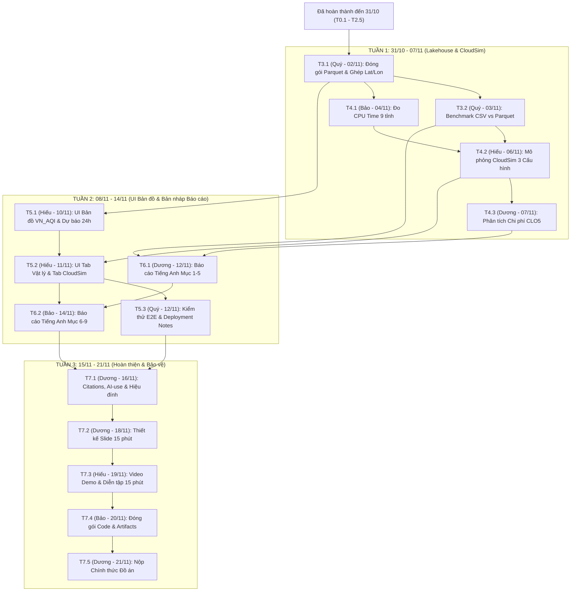

# BẢNG PHÂN RÃ CÔNG VIỆC VÀ LỊCH TRÌNH CHI TIẾT (TASK BREAKDOWN & SCHEDULE)
**Dự án: Hệ thống Lakehouse và Mô phỏng Đám mây Dự báo Chất lượng Không khí Việt Nam (CEM/TEDP + Open-Meteo)**

- **Phương án triển khai:** Phương án B — Local Medallion Parquet Lakehouse + CloudSim Multi-Config Simulation + Geo-Spatial UI
- **Nguyên tắc phân công:** Mỗi task chỉ có duy nhất 1 người chịu trách nhiệm chính (Single Point of Accountability)
- **Ngày cập nhật:** 31/10/2026
- **Hạn chót hoàn thành (Hard Deadline):** 21/11/2026 (Còn đúng 21 ngày / 3 tuần)

---

## 1. NGUYÊN TẮC LẬP LỊCH VÀ THỨ TỰ ƯU TIÊN

1. **Mỗi Task = 1 Người phụ trách duy nhất:** Mỗi mã công việc (từ T0.1 đến T7.5) chỉ giao cho đúng 1 thành viên chịu trách nhiệm chính về tiến độ và chất lượng đầu ra.
2. **Thứ tự ưu tiên trên đường găng (Critical Path):**
   `Core Pipeline (Đã xong) -> Lakehouse Storage & CloudSim Benchmark -> Geo-Spatial UI Demo -> Technical Report (8-12 trang) -> Presentation (15 phút)`
   - **P0 (Critical):** Bắt buộc hoàn thành đúng ngày Due Date; nếu trễ sẽ chặn trực tiếp công việc của thành viên tiếp theo.
   - **P1 (Important):** Nâng cao chất lượng phân tích và trực quan hóa.

---

## 2. TỔNG HỢP KHỐI LƯỢNG CÔNG VIỆC THEO THÀNH VIÊN

| Thành viên | Vai trò chính | Đã xong | Cần làm (31/10 - 21/11) | Tổng số Task | Trọng tâm từ nay đến 21/11/2026 |
| :--- | :--- | :---: | :---: | :---: | :--- |
| **Quý** | Data & Storage Engineer | 6 | 3 | **9** | Đóng gói dữ liệu Parquet 3 tầng (Bronze/Silver/Gold), đo kiểm nén CSV vs Parquet, kiểm thử tích hợp và viết Deployment Notes. |
| **Bảo** | ML & Processing Engineer | 4 | 3 | **7** | Đo thời gian CPU thực tế 9 tỉnh, viết chính phần Phương pháp và Kết quả ML (Mục 6-9) trong Báo cáo, đóng gói bộ code cuối kỳ. |
| **Hiếu** | CloudSim & UI Engineer | 1 | 4 | **5** | Xây dựng mô phỏng đa cấu hình trên CloudSim, phát triển toàn bộ UI Bản đồ Dự báo theo tọa độ (lat, lon), chuẩn bị Demo. |
| **Dương** | Tech Writer, Cost Analyst & PM | 2 | 5 | **7** | Tính toán chi phí mô phỏng CloudSim, viết chính phần Kiến trúc và Chi phí (Mục 1-5) của Báo cáo, làm Slide 15 phút và nộp bài. |

---

## 3. PHẦN A — CÁC GIAI ĐOẠN ĐÃ HOÀN THÀNH (ĐẾN 31/10/2026)

### PHASE 0: Khảo sát Yêu cầu, Chốt Đề tài và Thiết kế Data Contract (01/10/2026 - 10/10/2026)

| Mã Task | Tên công việc | Phụ trách | Phụ thuộc | Ưu tiên | Due Date | Trạng thái | Sản phẩm bàn giao |
| :---: | :--- | :---: | :---: | :---: | :---: | :---: | :--- |
| **T0.1** | Khảo sát yêu cầu môn học, chốt đề tài và lập kế hoạch tổng thể | **Dương** | — | P0 | 03/10/2026 | Đã xong | `docs/context.md`, `team_member/menber.md` |
| **T0.2** | Định nghĩa Data Contract và quy chuẩn khóa ghép nối (station_code, datetime) | **Quý** | T0.1 | P0 | 05/10/2026 | Đã xong | `docs/preprocessing_data_normalization_plan.md` |
| **T0.3** | Khởi tạo cấu trúc thư mục dự án và cài đặt môi trường Python | **Bảo** | T0.1 | P0 | 10/10/2026 | Đã xong | Cấu trúc `code/`, `data_test/`, `output/`, `.venv` |

### PHASE 1: Thu nạp Dữ liệu Thực tế, Kiểm toán 8 Bước và Đồng bộ 120 Ngày (11/10/2026 - 29/10/2026)

| Mã Task | Tên công việc | Phụ trách | Phụ thuộc | Ưu tiên | Due Date | Trạng thái | Sản phẩm bàn giao |
| :---: | :--- | :---: | :---: | :---: | :---: | :---: | :--- |
| **T1.1** | Xây dựng script thu thập dữ liệu tự động từ API TEDP có chia chunk và retry | **Quý** | T0.2 | P0 | 25/10/2026 | Đã xong | `code/crawl_data/test2.py` |
| **T1.2** | Crawl dữ liệu CEM/TEDP 4 tháng (01/06 - 30/09/2026), thu thập 66.703 dòng từ 28 trạm | **Quý** | T1.1 | P0 | 28/10/2026 | Đã xong | `lakehouse_storage/bronze/tedp_aqi_pm25_hourly.csv` |
| **T1.3** | Xây dựng và chạy pipeline kiểm toán 8 bước, lọc ngưỡng QCVN, gắn cờ imputed | **Quý** | T1.2 | P0 | 29/10/2026 | Đã xong | `code/crawl_data/preprocess_tedp.py`, `lakehouse_storage/bronze/cleaned_tedp.csv` |
| **T1.4** | Đồng bộ lưới thời gian 120 ngày (2.880 giờ/trạm), chốt 9 tỉnh / 15 trạm (43.200 dòng) | **Quý** | T1.3 | P0 | 29/10/2026 | Đã xong | `code/crawl_data/sync_tedp_120days.py`, `data_test/cleaned_tedp_synced_120d.csv` |
| **T1.5** | Thu thập đủ 8 biến thời tiết và độ cao tầng biên từ Open-Meteo tại tọa độ 15 trạm | **Quý** | T1.4 | P0 | 29/10/2026 | Đã xong | `code/crawl_data/fetch_openmeteo_weather.py`, `data_test/weather_openmeteo_station_120d.csv` |

### PHASE 2: Kỹ thuật Đặc trưng Khí quyển và Huấn luyện Đa mô hình 9 Tỉnh (29/10/2026 - 31/10/2026)

| Mã Task | Tên công việc | Phụ trách | Phụ thuộc | Ưu tiên | Due Date | Trạng thái | Sản phẩm bàn giao |
| :---: | :--- | :---: | :---: | :---: | :---: | :---: | :--- |
| **T2.1** | Xây dựng 30-31 đặc trưng trễ, trung bình trượt, nhiệt động lực học và biến thiên 24h | **Bảo** | T1.4, T1.5 | P0 | 29/10/2026 | Đã xong | `code/training/common.py` |
| **T2.2** | Thiết lập Early Stopping (30 vòng) và Regularization công bằng cho XGBoost và LightGBM | **Bảo** | T2.1 | P0 | 29/10/2026 | Đã xong | `code/training/common.py` |
| **T2.3** | Viết script huấn luyện 9 tỉnh và chạy thực nghiệm đối sánh 5 mô hình ML với Baseline | **Bảo** | T2.2 | P0 | 29/10/2026 | Đã xong | `code/training/run_all.py`, `output/province_models/` |
| **T2.4** | Kiểm định kết quả thực nghiệm (8/9 tỉnh vượt Baseline) và phân tích Feature Importance | **Hiếu** | T2.3 | P0 | 30/10/2026 | Đã xong | Các file `metrics.json`, `feature_importance.csv` |
| **T2.5** | Chốt Phương án B (Local + CloudSim + UI) và đồng bộ toàn bộ tài liệu kiến trúc | **Dương** | T2.4 | P0 | 31/10/2026 | Đã xong | `project_context.md`, `master_plan.md`, `project_overview.md` |

---

## 4. PHẦN B — CÁC CÔNG VIỆC CẦN LÀM TỪ HÔM NAY ĐẾN HẠN CHÓT (31/10/2026 -> 21/11/2026)

### TUẦN 1 (31/10/2026 - 07/11/2026): Đóng gói Medallion Parquet Lakehouse và Mô phỏng Hạ tầng CloudSim
*Mục tiêu tuần 1: Hoàn tất 100% tầng lưu trữ Parquet phân vùng, ghép tọa độ GPS vào kết quả dự báo, và chạy xong số liệu mô phỏng đa cấu hình trên CloudSim.*

| Mã Task | Tên công việc | Phụ trách | Phụ thuộc | Ưu tiên | Due Date | Trạng thái | Sản phẩm bàn giao |
| :---: | :--- | :---: | :---: | :---: | :---: | :---: | :--- |
| **T3.1** | Xây dựng Local Medallion Parquet Lakehouse và ghép tọa độ trạm tầng Gold | **Quý** | T1.5, T2.3 | P0 | **02/11/2026** | Cần làm | `code/lakehouse/build_lakehouse.py`, `lakehouse_storage/` |
| **T3.2** | Thực nghiệm đo kiểm hiệu năng lưu trữ CSV vs Partitioned Parquet (1x, 10x, 50x) | **Quý** | T3.1 | P0 | **03/11/2026** | Cần làm | `output/cloudsim_benchmark/storage_benchmark.csv` |
| **T4.1** | Đo kiểm thời gian CPU thực tế 9 tỉnh và quy đổi khối lượng lệnh Cloudlet (MI) | **Bảo** | T2.3, T3.1 | P0 | **04/11/2026** | Cần làm | `output/cloudsim_benchmark/workload_profile.csv` |
| **T4.2** | Xây dựng và chạy mô phỏng đa cấu hình máy ảo trên CloudSim (Config 1, 2, 3) | **Hiếu** | T3.2, T4.1 | P0 | **06/11/2026** | Cần làm | `code/simulation/run_cloudsim_benchmark.py`, `cloudsim_results.csv` |
| **T4.3** | Phân tích chi phí đám mây mô phỏng và đánh đổi kiến trúc (CLO5) | **Dương** | T4.2 | P0 | **07/11/2026** | Cần làm | Bảng phân tích chi phí Mục 4, 5, 6 cho Báo cáo |

**Chi tiết yêu cầu thực hiện trong Tuần 1:**
- **T3.1 (Phụ trách: Quý — Hạn: 02/11/2026):**
  - Tạo cấu trúc thư mục 3 tầng `lakehouse_storage/bronze/`, `lakehouse_storage/silver/`, `lakehouse_storage/gold/`.
  - Chuyển đổi dữ liệu sạch 120 ngày sang định dạng cột Apache Parquet (nén Snappy), phân vùng vật lý theo từng tỉnh (`province=...`).
  - Ghép tọa độ GPS (`latitude`, `longitude`, `elevation`, `region`) từ bảng trạm vào kết quả dự báo 5 mô hình của cả 9 tỉnh để xuất bảng `gold/spatial_forecasts.parquet`.
- **T3.2 (Phụ trách: Quý — Hạn: 03/11/2026):**
  - Đo dung lượng lưu trữ (MB), tỷ lệ nén (%), lượng dữ liệu quét (Bytes Scanned) và tốc độ đọc I/O (ms) khi truy vấn theo tỉnh giữa CSV nguyên khối và Partitioned Parquet.
  - Thực hiện đo ở 3 mức quy mô: 1x (43.200 dòng thực tế), 10x (1,31 triệu dòng), 50x (13,14 triệu dòng).
- **T4.1 (Phụ trách: Bảo — Hạn: 04/11/2026):**
  - Ghi nhận chính xác thời gian CPU thực thi (`train_time_sec`) và số lượng mẫu của từng tỉnh trong 9 tỉnh.
  - Quy đổi thời gian thực thi sang đơn vị chiều dài tác vụ Cloudlet (MI — Million Instructions) để làm đầu vào cho CloudSim.
- **T4.2 (Phụ trách: Hiếu — Hạn: 06/11/2026):**
  - Mô phỏng thực thi pipeline trên 3 cấu hình máy ảo đám mây (tham chiếu bảng giá Google Cloud Singapore `asia-southeast1`):
    1. Cấu hình 1: 1 máy ảo nhỏ `e2-standard-2` (2 vCPUs, chạy tuần tự 9 tỉnh + đọc CSV).
    2. Cấu hình 2: Cụm 3 máy ảo `e2-standard-4` (lập lịch cân bằng tải LPT theo vùng + đọc Parquet phân vùng).
    3. Cấu hình 3: Cụm 9 máy ảo `c2-standard-8` (9 máy ảo chạy song song tối đa 9 tỉnh).
  - Tính toán đầy đủ: Thời gian khởi tạo VM, thời gian truyền dữ liệu qua mạng, tổng thời gian hoàn thành (Makespan), độ tăng tốc (Speedup) và quy tắc tính phí tối thiểu 60 giây.
- **T4.3 (Phụ trách: Dương — Hạn: 07/11/2026):**
  - Lập bảng tính chi phí lưu trữ phân tầng theo vòng đời dữ liệu (`Standard $0.020/GB`, `Nearline $0.010/GB` sau 30 ngày, `Archive $0.0025/GB` sau 90 ngày).
  - Viết lập luận giải thích tại sao Cấu hình 2 (3 VMs + Parquet) đạt điểm tối ưu về Chi phí - Hiệu năng so với Cấu hình 1 và Cấu hình 3.

---

### TUẦN 2 (08/11/2026 - 14/11/2026): Phát triển UI Bản đồ Dự báo Không gian và Viết Bản nháp Báo cáo
*Mục tiêu tuần 2: Hoàn thiện ứng dụng UI Bản đồ tương tác phục vụ Demo và viết xong bản nháp đầy đủ (Full Draft) 9 mục của Báo cáo kỹ thuật tiếng Anh.*

| Mã Task | Tên công việc | Phụ trách | Phụ thuộc | Ưu tiên | Due Date | Trạng thái | Sản phẩm bàn giao |
| :---: | :--- | :---: | :---: | :---: | :---: | :---: | :--- |
| **T5.1** | Phát triển UI Bản đồ Dự báo Không gian (Phần 1: Bản đồ tọa độ VN_AQI và Chuỗi dự báo 24h) | **Hiếu** | T3.1 | P0 | **10/11/2026** | Cần làm | `code/ui/app_dashboard.py` (Tab Bản đồ & Dự báo) |
| **T5.2** | Phát triển UI Bản đồ Dự báo Không gian (Phần 2: Tab Giải thích Vật lý và Tab CloudSim) | **Hiếu** | T4.2, T5.1 | P0 | **11/11/2026** | Cần làm | `code/ui/app_dashboard.py` (Hoàn thiện đủ 3 Tabs) |
| **T5.3** | Kiểm thử tích hợp End-to-End và viết tài liệu hướng dẫn triển khai (Deployment Notes) | **Quý** | T5.2 | P0 | **12/11/2026** | Cần làm | `docs/deployment_notes.md` |
| **T6.1** | Viết Technical Report tiếng Anh — Phần 1 (Mục 1 đến Mục 5: Bài toán, Kiến trúc, Chi phí, Lưu trữ) | **Dương** | T3.2, T4.3 | P0 | **12/11/2026** | Cần làm | Bản thảo Sections 1-5 (4-5 trang tiếng Anh) |
| **T6.2** | Viết Technical Report tiếng Anh — Phần 2 (Mục 6 đến Mục 9: Trade-offs, Thuật toán, Kết quả, Bài học) | **Bảo** | T2.4, T4.2, T6.1 | P0 | **14/11/2026** | Cần làm | Bản thảo Sections 6-9 (Ghép thành Full Draft 8-12 trang) |

**Chi tiết yêu cầu thực hiện trong Tuần 2:**
- **T5.1 (Phụ trách: Hiếu — Hạn: 10/11/2026):**
  - Đọc trực tiếp dữ liệu từ tầng Gold (`spatial_forecasts.parquet`), ghim 15 trạm thuộc 9 tỉnh lên bản đồ Việt Nam tương tác theo tọa độ `(latitude, longitude)`.
  - Tự động tô màu điểm trạm theo 6 cấp độ cảnh báo VN_AQI dựa trên giá trị dự báo 24 giờ tới.
  - Thêm bộ lọc chọn tỉnh/trạm, chọn thuật toán ML và vẽ biểu đồ đường so sánh giá trị thực tế (`y_true`) với dự báo của 5 mô hình và `Baseline`.
- **T5.2 (Phụ trách: Hiếu — Hạn: 11/11/2026):**
  - Bổ sung Tab đối sánh bảng chỉ số `RMSE, MAE, R2` của 9 tỉnh và biểu đồ mức độ đóng góp đặc trưng vật lý (`Feature Importance`: mưa tích lũy 24h, biến thiên áp suất, hướng gió, độ cao tầng biên).
  - Bổ sung Tab trực quan hóa kết quả CloudSim Benchmark (biểu đồ nén CSV vs Parquet và biểu đồ Thời gian vs Chi phí của 3 cấu hình VM).
- **T5.3 (Phụ trách: Quý — Hạn: 12/11/2026):**
  - Chạy kiểm thử toàn bộ quy trình từ đóng gói dữ liệu đến khởi chạy CloudSim và mở giao diện UI.
  - Viết hướng dẫn cài đặt và chạy lại từng bước vào `docs/deployment_notes.md`.
- **T6.1 (Phụ trách: Dương — Hạn: 12/11/2026):**
  - Viết bằng tiếng Anh 5 phần đầu của báo cáo: (1) Problem Definition, (2) System / Big Data Architecture, (3) Service / Resource Selection, (4) Cost Estimation, (5) Storage Selection.
- **T6.2 (Phụ trách: Bảo — Hạn: 14/11/2026):**
  - Viết bằng tiếng Anh 4 phần cuối của báo cáo: (6) Technical Trade-offs, (7) Algorithms / Processing Methods, (8) Experimental Results (bao gồm bảng quy đổi đơn vị VN_AQI sang ug/m3, kết quả 9 tỉnh và kết quả CloudSim), (9) Lessons Learned.

---

### TUẦN 3 (15/11/2026 - 21/11/2026): Hoàn thiện Báo cáo, Thiết kế Slide, Diễn tập Bảo vệ và Nộp Đồ án
*Mục tiêu tuần 3: Chuẩn hóa chất lượng tiếng Anh, hoàn tất thủ tục trích dẫn và AI-use Statement, luyện tập thuyết trình 15 phút và nộp bài đúng hạn.*

| Mã Task | Tên công việc | Phụ trách | Phụ thuộc | Ưu tiên | Due Date | Trạng thái | Sản phẩm bàn giao |
| :---: | :--- | :---: | :---: | :---: | :---: | :---: | :--- |
| **T7.1** | Hoàn thiện Trích dẫn (Citations), AI-use Statement và hiệu đính Báo cáo tiếng Anh | **Dương** | T6.2 | P0 | **16/11/2026** | Cần làm | Bản chốt Final Technical Report (PDF/DOCX, 8-12 trang) |
| **T7.2** | Thiết kế bộ Slide thuyết trình cuối kỳ (English, 15 phút) | **Dương** | T5.2, T7.1 | P0 | **18/11/2026** | Cần làm | Slide Deck hoàn chỉnh (12-15 slides) |
| **T7.3** | Quay video backup Demo UI và điều phối buổi diễn tập thuyết trình bấm giờ 15 phút | **Hiếu** | T7.2 | P0 | **19/11/2026** | Cần làm | Video backup Demo + Kịch bản phản biện Q&A |
| **T7.4** | Đóng gói và kiểm duyệt bộ hồ sơ Mã nguồn, Dữ liệu và Artifacts cuối kỳ | **Bảo** | T5.3, T7.1, T7.3 | P0 | **20/11/2026** | Cần làm | Gói nộp bài hoàn chỉnh trước hạn chót 24 giờ |
| **T7.5** | Nộp chính thức toàn bộ hồ sơ Đồ án cuối kỳ lên hệ thống | **Dương** | T7.4 | P0 | **21/11/2026** | Cột mốc | Hoàn thành nộp bài và bảo vệ đúng hạn 21/11/2026 |

---

## 5. SƠ ĐỒ ĐƯỜNG GĂNG (CRITICAL PATH: 31/10/2026 -> 21/11/2026)

---

## 6. KỊCH BẢN PHÂN CHIA THỜI LƯỢNG THUYẾT TRÌNH 15 PHÚT

Theo quy định tại Mục 5.3 của `docs/context.md`: Thời lượng thuyết trình là 15 phút bằng tiếng Anh, tất cả 4 thành viên đều tham gia trình bày đúng phần việc mình phụ trách chính:

| Thứ tự | Thành viên | Thời lượng | Nội dung trình bày chính |
| :---: | :---: | :---: | :--- |
| **Phần 1** | **Dương** | 00:00 - 03:30 (3.5 phút) | Định nghĩa bài toán dự báo PM2.5 trước 24h, kiến trúc tổng thể 5V Big Data và bảng phân tích chi phí mô phỏng đám mây (Tasks T0.1, T4.3, T6.1). |
| **Phần 2** | **Quý** | 03:30 - 07:00 (3.5 phút) | Quy trình thu thập dữ liệu 4 tháng (43.200 dòng), kiểm toán 8 bước QCVN, lưu trữ phân vùng Parquet và kết quả nén/tăng tốc I/O so với CSV (Tasks T1.1-T1.5, T3.1, T3.2). |
| **Phần 3** | **Bảo** | 07:00 - 11:00 (4.0 phút) | Kỹ thuật đặc trưng vật lý khí quyển (31 biến), cơ chế Early Stopping công bằng và phân tích kết quả đối sánh 5 mô hình ML trên 9 tỉnh (Tasks T2.1-T2.3, T4.1, T6.2). |
| **Phần 4** | **Hiếu** | 11:00 - 15:00 (4.0 phút) | Kết quả mô phỏng 3 cấu hình máy ảo trên CloudSim (quy mô 1x, 10x, 50x) và Demo trực tiếp UI Bản đồ Dự báo Không gian theo tọa độ 15 trạm (Tasks T2.4, T4.2, T5.1, T5.2). |
