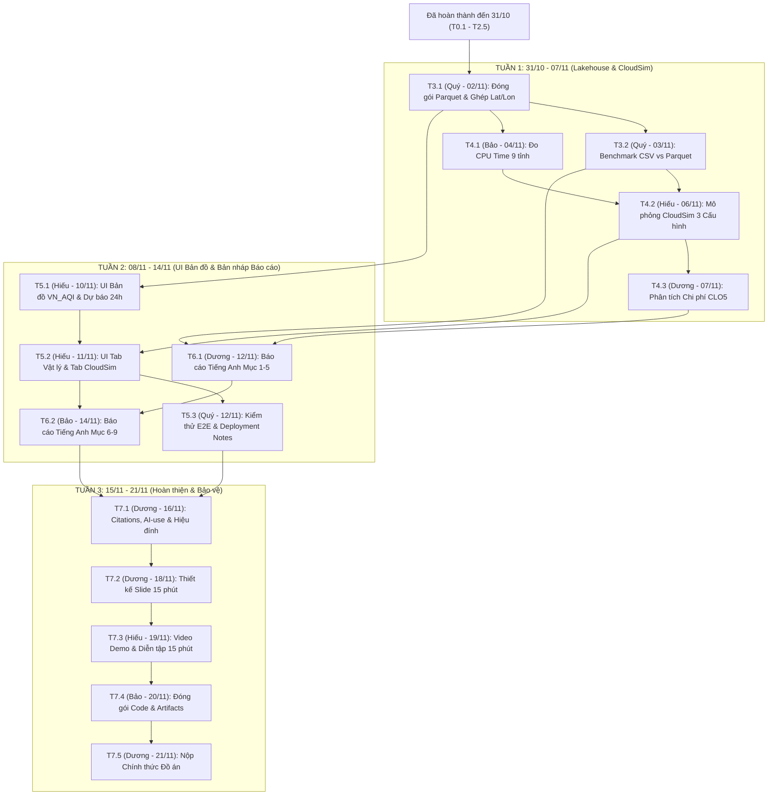

# BẢNG PHÂN RÃ CÔNG VIỆC VÀ LỊCH TRÌNH CHI TIẾT (TASK BREAKDOWN & SCHEDULE)
**Dự án: Hệ thống Lakehouse và Mô phỏng Đám mây Dự báo Chất lượng Không khí Việt Nam (CEM/TEDP + Open-Meteo)**

- **Phương án triển khai:** Phương án B — Local Medallion Parquet Lakehouse + CloudSim Multi-Config Simulation + Geo-Spatial UI
- **Nguyên tắc phân công:** Mỗi task chỉ có duy nhất 1 người chịu trách nhiệm chính (Single Point of Accountability)
- **Ngày cập nhật:** 31/10/2026
- **Hạn chót hoàn thành (Hard Deadline):** 21/11/2026 (Còn đúng 21 ngày / 3 tuần)

---

## 1. NGUYÊN TẮC LẬP LỊCH VÀ THỨ TỰ ƯU TIÊN

1. **Mỗi Task = 1 Người phụ trách duy nhất:** Mỗi mã công việc (từ T0.1 đến T7.5) chỉ giao cho đúng 1 thành viên chịu trách nhiệm chính về tiến độ và chất lượng đầu ra.
2. **Thứ tự ưu tiên trên đường găng (Critical Path):**
   `Core Pipeline (Đã xong) -> Lakehouse Storage & CloudSim Benchmark -> Geo-Spatial UI Demo -> Technical Report (8-12 trang) -> Presentation (15 phút)`
   - **P0 (Critical):** Bắt buộc hoàn thành đúng ngày Due Date; nếu trễ sẽ chặn trực tiếp công việc của thành viên tiếp theo.
   - **P1 (Important):** Nâng cao chất lượng phân tích và trực quan hóa.

---

## 2. TỔNG HỢP KHỐI LƯỢNG CÔNG VIỆC THEO THÀNH VIÊN

| Thành viên | Vai trò chính | Đã xong | Cần làm (31/10 - 21/11) | Tổng số Task | Trọng tâm từ nay đến 21/11/2026 |
| :--- | :--- | :---: | :---: | :---: | :--- |
| **Quý** | Data & Storage Engineer | 6 | 3 | **9** | Đóng gói dữ liệu Parquet 3 tầng (Bronze/Silver/Gold), đo kiểm nén CSV vs Parquet, kiểm thử tích hợp và viết Deployment Notes. |
| **Bảo** | ML & Processing Engineer | 4 | 3 | **7** | Đo thời gian CPU thực tế 9 tỉnh, viết chính phần Phương pháp và Kết quả ML (Mục 6-9) trong Báo cáo, đóng gói bộ code cuối kỳ. |
| **Hiếu** | CloudSim & UI Engineer | 1 | 4 | **5** | Xây dựng mô phỏng đa cấu hình trên CloudSim, phát triển toàn bộ UI Bản đồ Dự báo theo tọa độ (lat, lon), chuẩn bị Demo. |
| **Dương** | Tech Writer, Cost Analyst & PM | 2 | 5 | **7** | Tính toán chi phí mô phỏng CloudSim, viết chính phần Kiến trúc và Chi phí (Mục 1-5) của Báo cáo, làm Slide 15 phút và nộp bài. |

---

## 3. PHẦN A — CÁC GIAI ĐOẠN ĐÃ HOÀN THÀNH (ĐẾN 31/10/2026)

### PHASE 0: Khảo sát Yêu cầu, Chốt Đề tài và Thiết kế Data Contract (01/10/2026 - 10/10/2026)

| Mã Task | Tên công việc | Phụ trách | Phụ thuộc | Ưu tiên | Due Date | Trạng thái | Sản phẩm bàn giao |
| :---: | :--- | :---: | :---: | :---: | :---: | :---: | :--- |
| **T0.1** | Khảo sát yêu cầu môn học, chốt đề tài và lập kế hoạch tổng thể | **Dương** | — | P0 | 03/10/2026 | Đã xong | `docs/context.md`, `team_member/menber.md` |
| **T0.2** | Định nghĩa Data Contract và quy chuẩn khóa ghép nối (station_code, datetime) | **Quý** | T0.1 | P0 | 05/10/2026 | Đã xong | `docs/preprocessing_data_normalization_plan.md` |
| **T0.3** | Khởi tạo cấu trúc thư mục dự án và cài đặt môi trường Python | **Bảo** | T0.1 | P0 | 10/10/2026 | Đã xong | Cấu trúc `code/`, `data_test/`, `output/`, `.venv` |

### PHASE 1: Thu nạp Dữ liệu Thực tế, Kiểm toán 8 Bước và Đồng bộ 120 Ngày (11/10/2026 - 29/10/2026)

| Mã Task | Tên công việc | Phụ trách | Phụ thuộc | Ưu tiên | Due Date | Trạng thái | Sản phẩm bàn giao |
| :---: | :--- | :---: | :---: | :---: | :---: | :---: | :--- |
| **T1.1** | Xây dựng script thu thập dữ liệu tự động từ API TEDP có chia chunk và retry | **Quý** | T0.2 | P0 | 25/10/2026 | Đã xong | `code/crawl_data/test2.py` |
| **T1.2** | Crawl dữ liệu CEM/TEDP 4 tháng (01/06 - 30/09/2026), thu thập 66.703 dòng từ 28 trạm | **Quý** | T1.1 | P0 | 28/10/2026 | Đã xong | `lakehouse_storage/bronze/tedp_aqi_pm25_hourly.csv` |
| **T1.3** | Xây dựng và chạy pipeline kiểm toán 8 bước, lọc ngưỡng QCVN, gắn cờ imputed | **Quý** | T1.2 | P0 | 29/10/2026 | Đã xong | `code/crawl_data/preprocess_tedp.py`, `lakehouse_storage/bronze/cleaned_tedp.csv` |
| **T1.4** | Đồng bộ lưới thời gian 120 ngày (2.880 giờ/trạm), chốt 9 tỉnh / 15 trạm (43.200 dòng) | **Quý** | T1.3 | P0 | 29/10/2026 | Đã xong | `code/crawl_data/sync_tedp_120days.py`, `data_test/cleaned_tedp_synced_120d.csv` |
| **T1.5** | Thu thập đủ 8 biến thời tiết và độ cao tầng biên từ Open-Meteo tại tọa độ 15 trạm | **Quý** | T1.4 | P0 | 29/10/2026 | Đã xong | `code/crawl_data/fetch_openmeteo_weather.py`, `data_test/weather_openmeteo_station_120d.csv` |

### PHASE 2: Kỹ thuật Đặc trưng Khí quyển và Huấn luyện Đa mô hình 9 Tỉnh (29/10/2026 - 31/10/2026)

| Mã Task | Tên công việc | Phụ trách | Phụ thuộc | Ưu tiên | Due Date | Trạng thái | Sản phẩm bàn giao |
| :---: | :--- | :---: | :---: | :---: | :---: | :---: | :--- |
| **T2.1** | Xây dựng 30-31 đặc trưng trễ, trung bình trượt, nhiệt động lực học và biến thiên 24h | **Bảo** | T1.4, T1.5 | P0 | 29/10/2026 | Đã xong | `code/training/common.py` |
| **T2.2** | Thiết lập Early Stopping (30 vòng) và Regularization công bằng cho XGBoost và LightGBM | **Bảo** | T2.1 | P0 | 29/10/2026 | Đã xong | `code/training/common.py` |
| **T2.3** | Viết script huấn luyện 9 tỉnh và chạy thực nghiệm đối sánh 5 mô hình ML với Baseline | **Bảo** | T2.2 | P0 | 29/10/2026 | Đã xong | `code/training/run_all.py`, `output/province_models/` |
| **T2.4** | Kiểm định kết quả thực nghiệm (8/9 tỉnh vượt Baseline) và phân tích Feature Importance | **Hiếu** | T2.3 | P0 | 30/10/2026 | Đã xong | Các file `metrics.json`, `feature_importance.csv` |
| **T2.5** | Chốt Phương án B (Local + CloudSim + UI) và đồng bộ toàn bộ tài liệu kiến trúc | **Dương** | T2.4 | P0 | 31/10/2026 | Đã xong | `project_context.md`, `master_plan.md`, `project_overview.md` |

---

## 4. PHẦN B — CÁC CÔNG VIỆC CẦN LÀM TỪ HÔM NAY ĐẾN HẠN CHÓT (31/10/2026 -> 21/11/2026)

### TUẦN 1 (31/10/2026 - 07/11/2026): Đóng gói Medallion Parquet Lakehouse và Mô phỏng Hạ tầng CloudSim
*Mục tiêu tuần 1: Hoàn tất 100% tầng lưu trữ Parquet phân vùng, ghép tọa độ GPS vào kết quả dự báo, và chạy xong số liệu mô phỏng đa cấu hình trên CloudSim.*

| Mã Task | Tên công việc | Phụ trách | Phụ thuộc | Ưu tiên | Due Date | Trạng thái | Sản phẩm bàn giao |
| :---: | :--- | :---: | :---: | :---: | :---: | :---: | :--- |
| **T3.1** | Xây dựng Local Medallion Parquet Lakehouse và ghép tọa độ trạm tầng Gold | **Quý** | T1.5, T2.3 | P0 | **02/11/2026** | Cần làm | `code/lakehouse/build_lakehouse.py`, `lakehouse_storage/` |
| **T3.2** | Thực nghiệm đo kiểm hiệu năng lưu trữ CSV vs Partitioned Parquet (1x, 10x, 50x) | **Quý** | T3.1 | P0 | **03/11/2026** | Cần làm | `output/cloudsim_benchmark/storage_benchmark.csv` |
| **T4.1** | Đo kiểm thời gian CPU thực tế 9 tỉnh và quy đổi khối lượng lệnh Cloudlet (MI) | **Bảo** | T2.3, T3.1 | P0 | **04/11/2026** | Cần làm | `output/cloudsim_benchmark/workload_profile.csv` |
| **T4.2** | Xây dựng và chạy mô phỏng đa cấu hình máy ảo trên CloudSim (Config 1, 2, 3) | **Hiếu** | T3.2, T4.1 | P0 | **06/11/2026** | Cần làm | `code/simulation/run_cloudsim_benchmark.py`, `cloudsim_results.csv` |
| **T4.3** | Phân tích chi phí đám mây mô phỏng và đánh đổi kiến trúc (CLO5) | **Dương** | T4.2 | P0 | **07/11/2026** | Cần làm | Bảng phân tích chi phí Mục 4, 5, 6 cho Báo cáo |

#### Mô tả chi tiết từng Task trong Tuần 1:

#### Task T3.1: Xây dựng Local Medallion Parquet Lakehouse và ghép tọa độ trạm tầng Gold
- **Người phụ trách:** Quý | **Hạn hoàn thành:** 02/11/2026 | **Độ ưu tiên:** P0
- **Mục tiêu:** Hoàn thiện kiến trúc lưu trữ 3 tầng (Bronze - Silver - Gold) dưới định dạng Apache Parquet phân vùng theo tỉnh, phục vụ tối ưu hóa I/O và cung cấp dữ liệu cho UI bản đồ.
- **Nội dung mô tả công việc:**
  1. Xây dựng script `code/lakehouse/build_lakehouse.py` tự động hóa quy trình đóng gói dữ liệu vào `lakehouse_storage/`.
  2. Tầng Bronze: Lưu trữ nguyên trạng các file dữ liệu thô ban đầu và báo cáo kiểm toán tại `lakehouse_storage/bronze/`.
  3. Tầng Silver: Đọc dữ liệu sạch 120 ngày từ `data_test/`, chuyển đổi sang định dạng cột Apache Parquet (nén Snappy) và phân vùng thư mục vật lý theo từng tỉnh (`province=<slug>/`).
  4. Tầng Gold: Kết hợp tọa độ địa lý GPS (`latitude`, `longitude`, `elevation`, `region`) từ bảng trạm với kết quả dự báo 24h của cả 5 mô hình ML trên 9 tỉnh để xuất thành bảng `lakehouse_storage/gold/spatial_forecasts.parquet`.
  5. Xuất bảng tổng hợp metrics (`RMSE`, `MAE`, `R2`, thời gian huấn luyện) thành `lakehouse_storage/gold/model_metrics.parquet`.
- **Đầu vào (Input):** `lakehouse_storage/bronze/`, `data_test/*.csv`, `output/province_models/`
- **Đầu ra (Output):** `code/lakehouse/build_lakehouse.py`, `lakehouse_storage/silver/`, `lakehouse_storage/gold/`
- **Tiêu chí nghiệm thu (DoD):** Chạy `python code/lakehouse/build_lakehouse.py` không phát sinh lỗi; thư mục `lakehouse_storage/` có đầy đủ 3 tầng Bronze/Silver/Gold; bảng Gold chứa đủ 15 trạm với tọa độ và chuỗi dự báo.

#### Task T3.2: Thực nghiệm đo kiểm hiệu năng lưu trữ CSV vs Partitioned Parquet
- **Người phụ trách:** Quý | **Hạn hoàn thành:** 03/11/2026 | **Độ ưu tiên:** P0
- **Mục tiêu:** Cung cấp bằng chứng thực nghiệm định lượng về sự vượt trội của định dạng Parquet phân vùng so với CSV truyền thống để đưa vào Báo cáo (Mục 5 - Storage Selection).
- **Nội dung mô tả công việc:**
  1. Viết hàm đo đạc 4 chỉ số kỹ thuật: Dung lượng chiếm dụng trên đĩa (Disk Size - MB), Tỷ lệ nén (Compression Ratio - %), Lượng dữ liệu quét thực tế (Bytes Scanned khi truy vấn 1 tỉnh), và Thời gian đọc I/O (Read Latency - ms).
  2. Thực hiện đo kiểm đối đầu trực tiếp giữa file CSV nguyên khối và Partitioned Parquet trên 3 cấp độ quy mô:
     - Mức 1x: 43.200 dòng dữ liệu thực tế 120 ngày.
     - Mức 10x: 432.000 dòng (mô phỏng mạng lưới 150 trạm trong 1 năm).
     - Mức 50x: 2.160.000 dòng (mô phỏng mở rộng quy mô lớn).
  3. Tổng hợp bảng số liệu so sánh và xuất ra file CSV, JSON.
- **Đầu vào (Input):** `data_test/*.csv`, `lakehouse_storage/silver/`
- **Đầu ra (Output):** `output/cloudsim_benchmark/storage_benchmark.csv` và `storage_benchmark.json`
- **Tiêu chí nghiệm thu (DoD):** Có bảng số liệu thực nghiệm đầy đủ cả 4 chỉ số trên 3 mức quy mô; chứng minh được Parquet giảm ít nhất 70% dung lượng và giảm trên 80% lượng dữ liệu quét khi truy vấn theo tỉnh.

#### Task T4.1: Đo kiểm thời gian CPU thực tế 9 tỉnh và quy đổi khối lượng lệnh Cloudlet (MI)
- **Người phụ trách:** Bảo | **Hạn hoàn thành:** 04/11/2026 | **Độ ưu tiên:** P0
- **Mục tiêu:** Đo lường chính xác hồ sơ khối lượng tính toán thực tế (Workload Profile) của từng tỉnh để cung cấp tham số đầu vào trung thực cho bộ mô phỏng CloudSim.
- **Nội dung mô tả công việc:**
  1. Bổ sung module đo thời gian CPU thực tế (`execution_time_sec`) trong quá trình xử lý đặc trưng và huấn luyện mô hình cho từng tỉnh trong 9 tỉnh.
  2. Ghi nhận số lượng mẫu dữ liệu (Sample Count), kích thước tập dữ liệu đầu vào và đầu ra của từng tỉnh.
  3. Quy đổi thời gian thực thi cục bộ sang chiều dài tác vụ Cloudlet (đơn vị: MI - Million Instructions) theo năng lực CPU máy tính (MIPS Rating): `Cloudlet_MI = CPU_Time * MIPS_local`.
  4. Phân tích sự chênh lệch khối lượng tính toán giữa tỉnh nhiều trạm (TP.HCM có 4 trạm, Hà Nội/Hưng Yên có 2 trạm) và tỉnh 1 trạm để làm căn cứ lập lịch cân bằng tải.
- **Đầu vào (Input):** `code/training/run_all.py`, `output/province_models/`
- **Đầu ra (Output):** `output/cloudsim_benchmark/workload_profile.csv`
- **Tiêu chí nghiệm thu (DoD):** File CSV ghi nhận đầy đủ 9 dòng tương ứng 9 tỉnh với các thông số: số trạm, số dòng, thời gian CPU, dung lượng I/O, và Cloudlet MI.

#### Task T4.2: Xây dựng và chạy mô phỏng đa cấu hình máy ảo trên CloudSim
- **Người phụ trách:** Hiếu | **Hạn hoàn thành:** 06/11/2026 | **Độ ưu tiên:** P0
- **Mục tiêu:** Hiện thực hóa yêu cầu Mục 4.2 của đề bài (Mô phỏng CloudSim với ít nhất 2 cấu hình tài nguyên khác nhau dựa trên đơn giá và hiệu năng thực tế).
- **Nội dung mô tả công việc:**
  1. Xây dựng script mô phỏng `code/simulation/run_cloudsim_benchmark.py` dựa trên mô hình tài nguyên CloudSim.
  2. Thiết lập bảng thông số phần cứng tham chiếu Google Cloud Platform (Region `asia-southeast1` - Singapore):
     - `e2-standard-2`: 2 vCPUs, 8 GB RAM, giá $0.0736/giờ ($0.0000204/giây).
     - `e2-standard-4`: 4 vCPUs, 16 GB RAM, giá $0.1472/giờ ($0.0000409/giây).
     - `c2-standard-8`: 8 vCPUs, 32 GB RAM, giá $0.4578/giờ ($0.0001272/giây).
  3. Mô phỏng thực thi 9 tác vụ tỉnh trên 3 cấu hình hạ tầng:
     - Cấu hình 1 (Single VM): 1 máy ảo nhỏ `e2-standard-2` chạy tuần tự 9 tỉnh, đọc dữ liệu CSV nguyên khối.
     - Cấu hình 2 (Balanced Regional Cluster): Cụm 3 máy ảo `e2-standard-4` chạy song song, phân bổ tác vụ theo thuật toán cân bằng tải LPT (Longest Processing Time First), đọc dữ liệu Parquet phân vùng.
     - Cấu hình 3 (Max-Parallel Cluster): Cụm 9 máy ảo `c2-standard-8` chạy song song tối đa (mỗi tỉnh 1 VM).
  4. Đưa vào công thức mô phỏng: Thời gian khởi động máy ảo (VM Boot Time ~30s), thời gian truyền dữ liệu qua mạng (Data Transfer Time = File Size / Bandwidth), và quy tắc tính phí tối thiểu 60 giây của GCP.
  5. Chạy mô phỏng ở 3 mức quy mô (1x, 10x, 50x) và tính toán: Tổng thời gian hoàn thành (Makespan), Độ tăng tốc (Speedup), Hiệu suất sử dụng CPU, và Chi phí mô phỏng (Simulated Cost).
- **Đầu vào (Input):** `workload_profile.csv`, `storage_benchmark.csv`
- **Đầu ra (Output):** `code/simulation/run_cloudsim_benchmark.py`, `output/cloudsim_benchmark/cloudsim_results.csv`, `cloudsim_summary.json`
- **Tiêu chí nghiệm thu (DoD):** Script chạy độc lập thành công; xuất ra kết quả định lượng rõ ràng cho cả 3 cấu hình ở 3 mức quy mô; phản ánh đúng quy luật Amdahl (Cấu hình 3 nhanh nhất nhưng chi phí tăng vọt do thời gian chờ và quy tắc 60 giây).

#### Task T4.3: Phân tích chi phí đám mây mô phỏng và đánh đổi kiến trúc (CLO5)
- **Người phụ trách:** Dương | **Hạn hoàn thành:** 07/11/2026 | **Độ ưu tiên:** P0
- **Mục tiêu:** Hoàn thiện toàn bộ lập luận toán học và bảng biểu so sánh chi phí để chuẩn bị nội dung cho Báo cáo kỹ thuật (CLO5 - chiếm 20% tổng điểm).
- **Nội dung mô tả công việc:**
  1. Tổng hợp kết quả từ T3.2 và T4.2 thành bảng phân tích chi phí đa chiều (Compute Cost + Storage Cost + Network I/O Cost).
  2. Xây dựng mô hình chi phí lưu trữ phân tầng theo vòng đời dữ liệu trên Cloud Object Storage (GCS):
     - Tầng Hot (Standard Storage - $0.020/GB/tháng): Dữ liệu Silver và Gold truy cập liên tục.
     - Tầng Warm (Nearline Storage - $0.010/GB/tháng): Dữ liệu Bronze lưu trữ sau 30 ngày (tiết kiệm 50%).
     - Tầng Cold (Archive Storage - $0.0025/GB/tháng): Dữ liệu lịch sử sau 90 ngày (tiết kiệm 87.5%).
  3. Phân tích đánh đổi kỹ thuật (Technical Trade-offs): So sánh điểm tối ưu Chi phí / Hiệu năng giữa Cấu hình 1 (rẻ nhưng quá chậm), Cấu hình 2 (tối ưu nhất nhờ cân bằng tải + Parquet), và Cấu hình 3 (lãng phí tài nguyên do over-provisioning).
  4. Soạn thảo tài liệu nháp chi tiết cho Mục 4 (Cost Estimation), Mục 5 (Storage Selection) và Mục 6 (Technical Trade-offs) của Báo cáo.
- **Đầu vào (Input):** `cloudsim_results.csv`, `storage_benchmark.csv`
- **Đầu ra (Output):** Bản thảo phân tích chi phí và bảng biểu (Word/Markdown) sẵn sàng ghép vào Báo cáo.
- **Tiêu chí nghiệm thu (DoD):** Có đầy đủ công thức tính toán minh bạch, bảng đối chiếu 3 cấu hình rõ ràng, và lập luận thuyết phục bảo vệ giải pháp kiến trúc trước Hội đồng.

---

### TUẦN 2 (08/11/2026 - 14/11/2026): Phát triển UI Bản đồ Dự báo Không gian và Viết Bản nháp Báo cáo
*Mục tiêu tuần 2: Hoàn thiện ứng dụng UI Bản đồ tương tác phục vụ Demo và viết xong bản nháp đầy đủ (Full Draft) 9 mục của Báo cáo kỹ thuật tiếng Anh.*

| Mã Task | Tên công việc | Phụ trách | Phụ thuộc | Ưu tiên | Due Date | Trạng thái | Sản phẩm bàn giao |
| :---: | :--- | :---: | :---: | :---: | :---: | :---: | :--- |
| **T5.1** | Phát triển UI Bản đồ Dự báo Không gian (Phần 1: Bản đồ tọa độ VN_AQI và Chuỗi dự báo 24h) | **Hiếu** | T3.1 | P0 | **10/11/2026** | Cần làm | `code/ui/app_dashboard.py` (Tab Bản đồ & Dự báo) |
| **T5.2** | Phát triển UI Bản đồ Dự báo Không gian (Phần 2: Tab Giải thích Vật lý và Tab CloudSim) | **Hiếu** | T4.2, T5.1 | P0 | **11/11/2026** | Cần làm | `code/ui/app_dashboard.py` (Hoàn thiện đủ 3 Tabs) |
| **T5.3** | Kiểm thử tích hợp End-to-End và viết tài liệu hướng dẫn triển khai (Deployment Notes) | **Quý** | T5.2 | P0 | **12/11/2026** | Cần làm | `docs/deployment_notes.md` |
| **T6.1** | Viết Technical Report tiếng Anh — Phần 1 (Mục 1 đến Mục 5: Bài toán, Kiến trúc, Chi phí, Lưu trữ) | **Dương** | T3.2, T4.3 | P0 | **12/11/2026** | Cần làm | Bản thảo Sections 1-5 (4-5 trang tiếng Anh) |
| **T6.2** | Viết Technical Report tiếng Anh — Phần 2 (Mục 6 đến Mục 9: Trade-offs, Thuật toán, Kết quả, Bài học) | **Bảo** | T2.4, T4.2, T6.1 | P0 | **14/11/2026** | Cần làm | Bản thảo Sections 6-9 (Ghép thành Full Draft 8-12 trang) |

#### Mô tả chi tiết từng Task trong Tuần 2:

#### Task T5.1: Phát triển UI Bản đồ Dự báo Không gian (Phần 1: Bản đồ tọa độ VN_AQI và Chuỗi dự báo 24h)
- **Người phụ trách:** Hiếu | **Hạn hoàn thành:** 10/11/2026 | **Độ ưu tiên:** P0
- **Mục tiêu:** Xây dựng giao diện trực quan hóa tương tác hiển thị vị trí các trạm quan trắc trên bản đồ Việt Nam và biểu đồ dự báo phục vụ trực tiếp cho phần Demo bảo vệ đồ án.
- **Nội dung mô tả công việc:**
  1. Khởi tạo ứng dụng Dashboard bằng Streamlit và Plotly (`code/ui/app_dashboard.py`).
  2. Đọc trực tiếp dữ liệu từ tầng Gold (`lakehouse_storage/gold/spatial_forecasts.parquet`).
  3. Vẽ bản đồ Việt Nam định vị chính xác 15 trạm quan trắc thuộc 9 tỉnh theo cặp tọa độ GPS (`latitude`, `longitude`).
  4. Gán màu sắc điểm trạm tự động theo 6 cấp cảnh báo của thang chuẩn VN_AQI (Tốt: Xanh lá, Trung bình: Vàng, Kém: Cam, Xấu: Đỏ, Rất xấu: Tím, Nguy hại: Nâu) tương ứng với giá trị dự báo 24 giờ tới.
  5. Xây dựng bộ điều khiển tương tác (Sidebar filters): Cho phép người dùng chọn Tỉnh/Thành phố, chọn Trạm quan trắc, chọn mốc thời gian dự báo, và chọn thuật toán ML hiển thị (`Linear Regression`, `SVR`, `Random Forest`, `XGBoost`, `LightGBM`).
  6. Vẽ biểu đồ chuỗi thời gian đối sánh tương tác (Time Series Chart): So sánh đường giá trị thực đo (`y_true`), giá trị cơ sở (`Baseline Persistence 24h`) và đường dự báo của các mô hình ML.
- **Đầu vào (Input):** `lakehouse_storage/gold/spatial_forecasts.parquet`
- **Đầu ra (Output):** `code/ui/app_dashboard.py` (Tab 1: Geo-Spatial Air Quality Map & Forecast)
- **Tiêu chí nghiệm thu (DoD):** Chạy lệnh `streamlit run code/ui/app_dashboard.py` hiển thị bản đồ mượt mà, đổi màu trạm chính xác theo thang VN_AQI, biểu đồ zoom/pan tương tác tốt.

#### Task T5.2: Phát triển UI Bản đồ Dự báo Không gian (Phần 2: Tab Giải thích Vật lý và Tab CloudSim)
- **Người phụ trách:** Hiếu | **Hạn hoàn thành:** 11/11/2026 | **Độ ưu tiên:** P0
- **Mục tiêu:** Hoàn thiện 2 Tab nâng cao trên UI để chứng minh chiều sâu học thuật về Vật lý Khí quyển và kết quả Benchmark Hạ tầng Đám mây.
- **Nội dung mô tả công việc:**
  1. Xây dựng Tab 2 - Khám phá Học máy & Giải thích Vật lý (ML Benchmark & Feature Explainability):
     - Bảng xếp hạng sai số dự báo (`RMSE`, `MAE`, `R2`, `% cải thiện so với Baseline`) của 9 tỉnh thành.
     - Biểu đồ cột thể hiện mức độ quan trọng của đặc trưng (`Feature Importance` từ LightGBM/XGBoost): Làm nổi bật vai trò của các biến khí tượng mới bổ sung (tổng lượng mưa 24h `precip_sum_24h`, biến thiên áp suất 24h `pressure_diff_24h`, hướng gió `wind_dir_cos`, hệ số thông gió `ventilation_coef`).
  2. Xây dựng Tab 3 - Đánh giá Hạ tầng & Chi phí CloudSim (CloudSim Infrastructure & Cost Dashboard):
     - Biểu đồ so sánh dung lượng lưu trữ và thời gian đọc I/O giữa CSV và Parquet ở các mức quy mô (1x, 10x, 50x).
     - Biểu đồ đối sánh Thời gian thực thi (Makespan) vs. Chi phí mô phỏng (Cost $) giữa 3 cấu hình máy ảo đám mây (Config 1, 2, 3).
  3. Tinh chỉnh giao diện: Chuẩn hóa font chữ tiếng Việt, bố cục responsive, hiển thị KPI metrics tóm tắt ở đầu trang.
- **Đầu vào (Input):** `output/province_models/`, `output/cloudsim_benchmark/`
- **Đầu ra (Output):** `code/ui/app_dashboard.py` hoàn chỉnh đầy đủ 3 Tabs
- **Tiêu chí nghiệm thu (DoD):** Giao diện chạy ổn định 100% offline; chuyển đổi giữa 3 Tabs tức thì; hiển thị đầy đủ cả kết quả AI lẫn kết quả Hạ tầng Big Data.

#### Task T5.3: Kiểm thử tích hợp End-to-End và viết tài liệu hướng dẫn triển khai
- **Người phụ trách:** Quý | **Hạn hoàn thành:** 12/11/2026 | **Độ ưu tiên:** P0
- **Mục tiêu:** Bảo đảm toàn bộ hệ thống có thể tái lập hoàn toàn từ đầu (Reproducibility) và cung cấp tài liệu hướng dẫn triển khai theo yêu cầu bắt buộc của đề bài.
- **Nội dung mô tả công việc:**
  1. Thực hiện kiểm thử tích hợp toàn bộ luồng từ đầu đến cuối trên một môi trường sạch:
     `Crawl/Sync dữ liệu -> Build Parquet Lakehouse -> Train/Eval mô hình -> Run CloudSim Benchmark -> Launch UI Dashboard`.
  2. Ghi nhận thời gian thực thi, kiểm tra tính toàn vẹn của dữ liệu sau mỗi bước và khắc phục triệt để các lỗi đường dẫn tương đối.
  3. Soạn thảo file `docs/deployment_notes.md`:
     - Yêu cầu phần cứng và phần mềm (Python version, hệ điều hành).
     - Hướng dẫn cài đặt môi trường ảo và thư viện (`requirements.txt`).
     - Danh sách các câu lệnh thực thi từng bước (Step-by-step CLI commands).
     - Hướng dẫn khởi chạy và sử dụng UI Dashboard.
     - Hướng dẫn xử lý các sự cố thường gặp (Troubleshooting guide).
- **Đầu vào (Input):** Toàn bộ mã nguồn trong `code/`, dữ liệu trong `lakehouse_storage/`
- **Đầu ra (Output):** `docs/deployment_notes.md` hoàn chỉnh
- **Tiêu chí nghiệm thu (DoD):** Một thành viên khác trong nhóm có thể làm theo đúng từng bước trong `deployment_notes.md` trên máy cá nhân và chạy thành công toàn bộ hệ thống mà không cần người khác trợ giúp.

#### Task T6.1: Viết Technical Report tiếng Anh — Phần 1 (Mục 1 đến Mục 5)
- **Người phụ trách:** Dương | **Hạn hoàn thành:** 12/11/2026 | **Độ ưu tiên:** P0
- **Mục tiêu:** Hoàn thành nửa đầu của Báo cáo kỹ thuật bằng tiếng Anh học thuật chuẩn mực (độ dài khoảng 4–5 trang) theo đúng cấu trúc yêu cầu của đề bài.
- **Nội dung mô tả công việc:**
  1. Section 1 - Problem Definition: Trình bày bối cảnh ô nhiễm bụi mịn PM2.5 tại Việt Nam, phân tích 3 rào cản kỹ thuật của hệ thống quan trắc hiện tại, và xác định mục tiêu bài toán dự báo xa trước 24 giờ.
  2. Section 2 - System / Big Data Architecture: Trình bày kiến trúc tổng thể End-to-End, sơ đồ luồng dữ liệu 4 tầng (Ingestion -> Lakehouse Storage -> Parallel ML -> Serving/CloudSim), và chứng minh tính thỏa mãn 5 chữ V của Big Data.
  3. Section 3 - Service & Resource Selection: Thuyết minh việc lựa chọn Phương án B (Local Medallion Lakehouse + CloudSim), mô tả đặc tính kỹ thuật của 3 cấu hình máy ảo đám mây tham chiếu (`e2-standard-2`, `e2-standard-4`, `c2-standard-8`).
  4. Section 4 - Cost Estimation: Trình bày công thức toán học tính toán chi phí thực thi đám mây, đưa vào bảng số liệu chi phí mô phỏng từ kết quả CloudSim, và phân tích chi phí lưu trữ phân tầng theo vòng đời dữ liệu (Hot/Warm/Cold).
  5. Section 5 - Storage Selection: Trình bày lý do lựa chọn định dạng Apache Parquet phân vùng theo tỉnh (`province=...`) thay vì CSV/JSON, đưa vào bảng số liệu thực nghiệm đo kiểm T3.2 (tiết kiệm dung lượng và tăng tốc I/O).
- **Đầu vào (Input):** `docs/project_overview.md`, `storage_benchmark.csv`, `cloudsim_results.csv`, bảng phân tích chi phí T4.3
- **Đầu ra (Output):** Bản thảo Sections 1–5 bằng tiếng Anh (file Word/Docs)
- **Tiêu chí nghiệm thu (DoD):** Viết bằng tiếng Anh chuẩn, có sơ đồ kiến trúc rõ nét, bảng số liệu định lượng đầy đủ, không mắc lỗi chính tả hay định dạng.

#### Task T6.2: Viết Technical Report tiếng Anh — Phần 2 (Mục 6 đến Mục 9)
- **Người phụ trách:** Bảo | **Hạn hoàn thành:** 14/11/2026 | **Độ ưu tiên:** P0
- **Mục tiêu:** Hoàn thành nửa sau của Báo cáo kỹ thuật, ghép nối với Phần 1 để tạo thành Bản nháp hoàn chỉnh (Full Draft) đạt độ dài tiêu chuẩn 8–12 trang.
- **Nội dung mô tả công việc:**
  1. Section 6 - Technical Trade-offs: Phân tích sâu các đánh đổi kiến trúc:
     - Mô hình cục bộ từng tỉnh (Local Per-province) vs. Mô hình toàn quốc (Global pooled model).
     - Khả năng học tương tác phi tuyến của mô hình cây (`LightGBM`/`XGBoost`) vs. Khả năng ngoại suy bền vững của mô hình tuyến tính (`Linear Regression`) khi dịch chuyển phân phối giao mùa.
     - Đánh đổi Chi phí vs. Thời gian giữa 3 cấu hình máy ảo CloudSim (chứng minh quy luật Amdahl).
  2. Section 7 - Algorithms & Processing Methods: Mô tả quy trình kiểm toán dữ liệu 8 bước, kỹ thuật trích xuất 31 đặc trưng vật lý khí quyển ($PBLH, V_c, DPD, \sin/\cos\text{ wind}, \Delta_{24\text{h}}$), và cơ chế kiểm soát quá khớp công bằng (Early Stopping 30 rounds).
  3. Section 8 - Experimental Results:
     - Bảng quy đổi chuẩn hóa giữa thang đo chỉ số $I_{\text{PM2.5}}$ (VN_AQI) và nồng độ bụi $\mu\text{g/m}^3$.
     - Bảng đối sánh chi tiết 5 mô hình ML trên toàn bộ 9 tỉnh thành (chứng minh 8/9 tỉnh vượt Baseline).
     - Bảng kết quả thực nghiệm mô phỏng CloudSim ở 3 mức quy mô (1x, 10x, 50x).
  4. Section 9 - Lessons Learned & Future Work: Phân tích 2 trường hợp đặc biệt (Bắc Ninh bị thiếu dữ liệu mùa thu và Tây Ninh bị lệch pha phương sai), bài toán lan truyền ô nhiễm liên tỉnh, và hướng mở rộng hệ thống.
  5. Ghép nối Sections 1–5 (từ Dương) và Sections 6–9 thành một bản thảo thống nhất.
- **Đầu vào (Input):** `output/province_models/`, `cloudsim_results.csv`, Sections 1–5 từ T6.1
- **Đầu ra (Output):** Bản nháp đầy đủ (Full Draft) của Báo cáo kỹ thuật (8–12 trang tiếng Anh)
- **Tiêu chí nghiệm thu (DoD):** Đầy đủ 9 mục nội dung theo quy định; độ dài nằm trong khoảng 8–12 trang; lập luận học thuật chặt chẽ, số liệu nhất quán giữa các bảng.

---

### TUẦN 3 (15/11/2026 - 21/11/2026): Hoàn thiện Báo cáo, Thiết kế Slide, Diễn tập Bảo vệ và Nộp Đồ án
*Mục tiêu tuần 3: Chuẩn hóa chất lượng tiếng Anh, hoàn tất thủ tục trích dẫn và AI-use Statement, luyện tập thuyết trình 15 phút và nộp bài đúng hạn.*

| Mã Task | Tên công việc | Phụ trách | Phụ thuộc | Ưu tiên | Due Date | Trạng thái | Sản phẩm bàn giao |
| :---: | :--- | :---: | :---: | :---: | :---: | :---: | :--- |
| **T7.1** | Hoàn thiện Trích dẫn (Citations), AI-use Statement và hiệu đính Báo cáo tiếng Anh | **Dương** | T6.2 | P0 | **16/11/2026** | Cần làm | Bản chốt Final Technical Report (PDF/DOCX, 8-12 trang) |
| **T7.2** | Thiết kế bộ Slide thuyết trình cuối kỳ (English, 15 phút) | **Dương** | T5.2, T7.1 | P0 | **18/11/2026** | Cần làm | Slide Deck hoàn chỉnh (12-15 slides) |
| **T7.3** | Quay video backup Demo UI và điều phối buổi diễn tập thuyết trình bấm giờ 15 phút | **Hiếu** | T7.2 | P0 | **19/11/2026** | Cần làm | Video backup Demo + Kịch bản phản biện Q&A |
| **T7.4** | Đóng gói và kiểm duyệt bộ hồ sơ Mã nguồn, Dữ liệu và Artifacts cuối kỳ | **Bảo** | T5.3, T7.1, T7.3 | P0 | **20/11/2026** | Cần làm | Gói nộp bài hoàn chỉnh trước hạn chót 24 giờ |
| **T7.5** | Nộp chính thức toàn bộ hồ sơ Đồ án cuối kỳ lên hệ thống | **Dương** | T7.4 | P0 | **21/11/2026** | Cột mốc | Hoàn thành nộp bài và bảo vệ đúng hạn 21/11/2026 |

#### Mô tả chi tiết từng Task trong Tuần 3:

#### Task T7.1: Hoàn thiện Trích dẫn, AI-use Statement và hiệu đính Báo cáo tiếng Anh
- **Người phụ trách:** Dương | **Hạn hoàn thành:** 16/11/2026 | **Độ ưu tiên:** P0
- **Mục tiêu:** Chuẩn hóa toàn bộ văn phong học thuật, bổ sung danh mục tài liệu tham khảo chính xác và hoàn thiện bản tuyên bố sử dụng AI theo quy định bắt buộc của môn học.
- **Nội dung mô tả công việc:**
  1. Rà soát ngữ pháp, chính tả, thuật ngữ chuyên ngành tiếng Anh trên toàn bộ bản nháp 8–12 trang (Academic Proofreading).
  2. Chuẩn hóa danh mục tài liệu trích dẫn (References / Citations) theo chuẩn IEEE/APA:
     - Dữ liệu quan trắc Cổng CEM/TEDP (Bộ Tài nguyên & Môi trường).
     - Quyết định số 1459/QĐ-TCMT (Quy chuẩn kỹ thuật tính toán chỉ số VN_AQI).
     - Nguồn dữ liệu mô hình số trị Open-Meteo ERA5 / Historical Forecast.
     - Các bài báo khoa học và tài liệu kỹ thuật về CloudSim, LightGBM, XGBoost, Scikit-learn.
     - Bảng đơn giá dịch vụ điện toán đám mây Google Cloud Platform (Region `asia-southeast1`).
  3. Soạn thảo Bản tuyên bố sử dụng công cụ AI (AI-use Statement) theo đúng Mục 7.3 của `docs/context.md`: Phân định minh bạch nội dung nào do công cụ AI hỗ trợ, nội dung nào do sinh viên tự nghiên cứu và phát triển.
  4. Xuất file báo cáo chính thức định dạng PDF và Word chuẩn định dạng (lề, font chữ, tiêu đề bảng/hình).
- **Đầu vào (Input):** Full Draft Báo cáo từ T6.2
- **Đầu ra (Output):** `Final_Technical_Report.pdf` (và `.docx`)
- **Tiêu chí nghiệm thu (DoD):** Báo cáo đạt chuẩn từ 8 đến 12 trang; đầy đủ 9 phần nội dung; có đủ References và AI-use Statement; văn phong tiếng Anh mạch lạc, chuyên nghiệp.

#### Task T7.2: Thiết kế bộ Slide thuyết trình cuối kỳ (English, 15 phút)
- **Người phụ trách:** Dương | **Hạn hoàn thành:** 18/11/2026 | **Độ ưu tiên:** P0
- **Mục tiêu:** Xây dựng bộ trình chiếu trực quan, cô đọng, làm nổi bật các đóng góp kỹ thuật cốt lõi và phân chia thời lượng trình bày cho cả 4 thành viên trong 15 phút.
- **Nội dung mô tả công việc:**
  1. Thiết kế bộ Slide thuyết trình (khoảng 12–15 slides) bằng tiếng Anh với phong cách chuyên nghiệp, hiện đại.
  2. Bố cục nội dung Slide bám sát 4 tiêu chí chấm điểm trong Rubric:
     - Slide 1-3: Giới thiệu đề tài, bài toán dự báo sớm $I_{\text{PM2.5}}$ và Kiến trúc tổng thể 5V Big Data.
     - Slide 4-6: Quy trình thu nạp dữ liệu 4 tháng, kiểm toán 8 bước QCVN và thiết kế lưu trữ Medallion Parquet.
     - Slide 7-9: 31 đặc trưng vật lý khí quyển và kết quả thực nghiệm đối sánh 5 mô hình ML trên 9 tỉnh.
     - Slide 10-12: Kết quả mô phỏng CloudSim 3 cấu hình máy ảo, bảng phân tích tối ưu chi phí (CLO5) và kiến trúc UI.
     - Slide 13-14: Bài học kinh nghiệm (Lessons Learned) và Hướng phát triển trong tương lai.
     - Slide 15: Lời cảm ơn và Phần Q&A.
  3. Phân chia rõ ràng phần trình bày trên Slide tương ứng với 4 thành viên (Dương: Phần 1, Quý: Phần 2, Bảo: Phần 3, Hiếu: Phần 4) theo đúng kịch bản Mục 6.
- **Đầu vào (Input):** `Final_Technical_Report.pdf`, hình ảnh sơ đồ kiến trúc, biểu đồ kết quả
- **Đầu ra (Output):** `Final_Presentation_Slides.pptx` (và bản export `.pdf`)
- **Tiêu chí nghiệm thu (DoD):** Slide đẹp mắt, trực quan, nhiều hình ảnh và biểu đồ; không bị quá nhiều chữ; bố cục khớp hoàn toàn với kịch bản thuyết trình 15 phút.

#### Task T7.3: Quay video backup Demo UI và điều phối buổi diễn tập thuyết trình 15 phút
- **Người phụ trách:** Hiếu | **Hạn hoàn thành:** 19/11/2026 | **Độ ưu tiên:** P0
- **Mục tiêu:** Bảo đảm buổi thuyết trình chính thức diễn ra trơn tru, đúng thời gian quy định và có phương án dự phòng rủi ro kỹ thuật 100%.
- **Nội dung mô tả công việc:**
  1. Quay sẵn 1 video màn hình (độ dài khoảng 2–3 phút, chất lượng Full HD có thuyết minh ngắn) ghi lại toàn bộ quá trình tương tác trên UI Dashboard: Thao tác bản đồ 15 trạm, lọc theo tỉnh, xem chuỗi thời gian dự báo 24h, xem biểu đồ Feature Importance và kết quả CloudSim. Video này dùng làm phương án dự phòng nếu máy chiếu hoặc mạng tại hội trường gặp sự cố.
  2. Tổ chức buổi diễn tập thuyết trình thử (Mock Defense) cho cả 4 thành viên:
     - Bấm giờ chính xác từng phần theo kịch bản: Dương (3.5 phút) -> Quý (3.5 phút) -> Bảo (4.0 phút) -> Hiếu (4.0 phút).
     - Đảm bảo tổng thời gian nằm trong khoảng 14:00 đến 14:50 (không bị quá 15 phút).
  3. Tổng duyệt bộ câu hỏi phản biện giả định (Q&A Preparation):
     - Tại sao không dùng Apache Spark mà dùng Python + Parquet + CloudSim?
     - Tại sao có tỉnh LightGBM thắng nhưng có tỉnh Linear Regression thắng?
     - Công thức tính chi phí đám mây và quy tắc 60 giây của GCP hoạt động ra sao?
     - Làm sao chứng minh mô hình không bị rò rỉ dữ liệu tương lai (Data Leakage)?
- **Đầu vào (Input):** `code/ui/app_dashboard.py`, `Final_Presentation_Slides.pptx`
- **Đầu ra (Output):** Video backup demo (`demo_backup.mp4`), Biên bản góp ý buổi diễn tập
- **Tiêu chí nghiệm thu (DoD):** Cả 4 thành viên đều thuyết trình trôi chảy bằng tiếng Anh; chuyển giao giữa các thành viên mượt mà; hoàn thành toàn bộ bài thuyết trình trong đúng khung 15 phút.

#### Task T7.4: Đóng gói và kiểm duyệt bộ hồ sơ Mã nguồn, Dữ liệu và Artifacts cuối kỳ
- **Người phụ trách:** Bảo | **Hạn hoàn thành:** 20/11/2026 | **Độ ưu tiên:** P0
- **Mục tiêu:** Chuẩn bị gói sản phẩm mã nguồn hoàn chỉnh, sạch sẽ, sẵn sàng nộp lên hệ thống trước hạn chót 24 giờ.
- **Nội dung mô tả công việc:**
  1. Dọn dẹp toàn bộ các tệp tạm, file cache (`__pycache__`, `.ipynb_checkpoints`, file log tạm thời).
  2. Kiểm tra tính đồng bộ của file `requirements.txt` với môi trường ảo chạy thực tế.
  3. Đóng gói đầy đủ mã nguồn trong `code/`, dữ liệu chuẩn hóa trong `lakehouse_storage/` và `data_test/`, kết quả mô hình trong `output/province_models/` và báo cáo CloudSim trong `output/cloudsim_benchmark/`.
  4. Chạy kiểm tra lần cuối lệnh `git status` và đẩy toàn bộ commit cuối cùng lên repository GitHub `quytvo/BigData.git`.
  5. Tạo bản lưu trữ nén dự phòng (`Source_Code_Final.zip`) lưu trên Google Drive của nhóm.
- **Đầu vào (Input):** Toàn bộ thư mục workspace của dự án
- **Đầu ra (Output):** Repository GitHub sạch sẽ, file nén `Source_Code_Final.zip`
- **Tiêu chí nghiệm thu (DoD):** Mã nguồn đầy đủ, không thiếu file; repository trên GitHub ở trạng thái clean; sẵn sàng bàn giao cho người nộp bài.

#### Task T7.5: Nộp chính thức toàn bộ hồ sơ Đồ án cuối kỳ lên hệ thống
- **Người phụ trách:** Dương | **Hạn hoàn thành:** 21/11/2026 | **Độ ưu tiên:** P0
- **Mục tiêu:** Hoàn tất nộp đầy đủ toàn bộ các sản phẩm bàn giao của đồ án lên hệ thống học tập của trường đúng hạn quy định.
- **Nội dung mô tả công việc:**
  1. Rà soát danh mục các sản phẩm bàn giao bắt buộc theo Mục 5 của `docs/context.md`:
     - Working Code & Deployment Notes (`docs/deployment_notes.md` + link GitHub).
     - Technical Report tiếng Anh 8–12 trang (file PDF kèm AI-use Statement và Citations).
     - Final Presentation Slides (file PPTX/PDF).
  2. Đăng tải toàn bộ hồ sơ lên cổng nộp bài theo đúng định dạng và hướng dẫn của giảng viên.
  3. Gửi thông báo xác nhận nộp bài thành công cho tất cả các thành viên trong nhóm.
  4. Tham gia buổi báo cáo và thuyết trình chính thức (15 phút) trước Hội đồng môn học.
- **Đầu vào (Input):** `Final_Technical_Report.pdf`, `Final_Presentation_Slides.pptx`, link GitHub repository
- **Đầu ra (Output):** Biên nhận nộp bài thành công trên hệ thống, Hoàn thành bảo vệ đồ án cuối kỳ
- **Tiêu chí nghiệm thu (DoD):** Hồ sơ nộp đầy đủ 100% các hạng mục trước giờ đóng cổng nộp bài; cả 4 thành viên tham gia bảo vệ đồ án thành công.

---

## 5. SƠ ĐỒ ĐƯỜNG GĂNG (CRITICAL PATH: 31/10/2026 -> 21/11/2026)

---

## 6. KỊCH BẢN PHÂN CHIA THỜI LƯỢNG THUYẾT TRÌNH 15 PHÚT

Theo quy định tại Mục 5.3 của `docs/context.md`: Thời lượng thuyết trình là 15 phút bằng tiếng Anh, tất cả 4 thành viên đều tham gia trình bày đúng phần việc mình phụ trách chính:

| Thứ tự | Thành viên | Thời lượng | Nội dung trình bày chính |
| :---: | :---: | :---: | :--- |
| **Phần 1** | **Dương** | 00:00 - 03:30 (3.5 phút) | Định nghĩa bài toán dự báo PM2.5 trước 24h, kiến trúc tổng thể 5V Big Data và bảng phân tích chi phí mô phỏng đám mây (Tasks T0.1, T4.3, T6.1). |
| **Phần 2** | **Quý** | 03:30 - 07:00 (3.5 phút) | Quy trình thu thập dữ liệu 4 tháng (43.200 dòng), kiểm toán 8 bước QCVN, lưu trữ phân vùng Parquet và kết quả nén/tăng tốc I/O so với CSV (Tasks T1.1-T1.5, T3.1, T3.2). |
| **Phần 3** | **Bảo** | 07:00 - 11:00 (4.0 phút) | Kỹ thuật đặc trưng vật lý khí quyển (31 biến), cơ chế Early Stopping công bằng và phân tích kết quả đối sánh 5 mô hình ML trên 9 tỉnh (Tasks T2.1-T2.3, T4.1, T6.2). |
| **Phần 4** | **Hiếu** | 11:00 - 15:00 (4.0 phút) | Kết quả mô phỏng 3 cấu hình máy ảo trên CloudSim (quy mô 1x, 10x, 50x) và Demo trực tiếp UI Bản đồ Dự báo Không gian theo tọa độ 15 trạm (Tasks T2.4, T4.2, T5.1, T5.2). |
