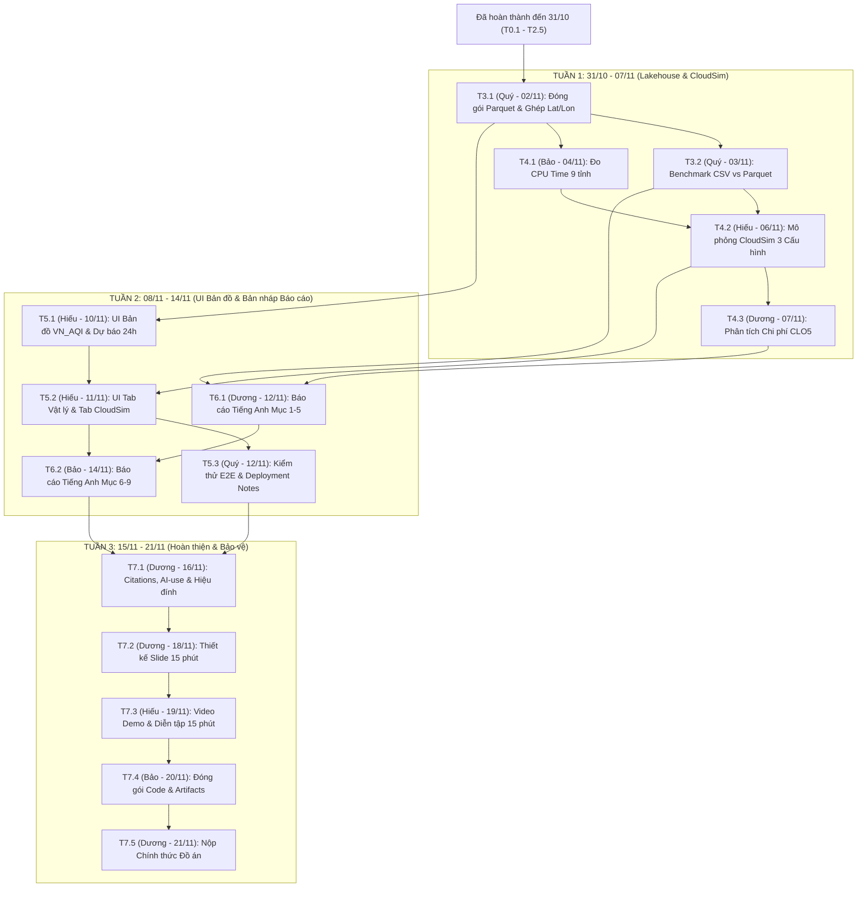

# BẢNG PHÂN RÃ CÔNG VIỆC VÀ LỊCH TRÌNH CHI TIẾT (TASK BREAKDOWN & SCHEDULE)
**Dự án: Hệ thống Lakehouse và Mô phỏng Đám mây Dự báo Chất lượng Không khí Việt Nam (CEM/TEDP + Open-Meteo)**

- **Phương án triển khai:** Phương án B — Local Medallion Parquet Lakehouse + CloudSim Multi-Config Simulation + Geo-Spatial UI
- **Nguyên tắc phân công:** Mỗi task chỉ có duy nhất 1 người chịu trách nhiệm chính (Single Point of Accountability)
- **Ngày cập nhật:** 31/10/2026
- **Hạn chót hoàn thành (Hard Deadline):** 21/11/2026 (Còn đúng 21 ngày / 3 tuần)

---

## 1. NGUYÊN TẮC LẬP LỊCH VÀ THỨ TỰ ƯU TIÊN

1. **Mỗi Task = 1 Người phụ trách duy nhất:** Mỗi mã công việc (từ T0.1 đến T7.5) chỉ giao cho đúng 1 thành viên chịu trách nhiệm chính về tiến độ và chất lượng đầu ra.
2. **Thứ tự ưu tiên trên đường găng (Critical Path):**
   `Core Pipeline (Đã xong) -> Lakehouse Storage & CloudSim Benchmark -> Geo-Spatial UI Demo -> Technical Report (8-12 trang) -> Presentation (15 phút)`
   - **P0 (Critical):** Bắt buộc hoàn thành đúng ngày Due Date; nếu trễ sẽ chặn trực tiếp công việc của thành viên tiếp theo.
   - **P1 (Important):** Nâng cao chất lượng phân tích và trực quan hóa.

---

## 2. TỔNG HỢP KHỐI LƯỢNG CÔNG VIỆC THEO THÀNH VIÊN

| Thành viên | Vai trò chính | Đã xong | Cần làm (31/10 - 21/11) | Tổng số Task | Trọng tâm từ nay đến 21/11/2026 |
| :--- | :--- | :---: | :---: | :---: | :--- |
| **Quý** | Data & Storage Engineer | 6 | 3 | **9** | Đóng gói dữ liệu Parquet 3 tầng (Bronze/Silver/Gold), đo kiểm nén CSV vs Parquet, kiểm thử tích hợp và viết Deployment Notes. |
| **Bảo** | ML & Processing Engineer | 4 | 3 | **7** | Đo thời gian CPU thực tế 9 tỉnh, viết chính phần Phương pháp và Kết quả ML (Mục 6-9) trong Báo cáo, đóng gói bộ code cuối kỳ. |
| **Hiếu** | CloudSim & UI Engineer | 1 | 4 | **5** | Xây dựng mô phỏng đa cấu hình trên CloudSim, phát triển toàn bộ UI Bản đồ Dự báo theo tọa độ (lat, lon), chuẩn bị Demo. |
| **Dương** | Tech Writer, Cost Analyst & PM | 2 | 5 | **7** | Tính toán chi phí mô phỏng CloudSim, viết chính phần Kiến trúc và Chi phí (Mục 1-5) của Báo cáo, làm Slide 15 phút và nộp bài. |

---

## 3. PHẦN A — CÁC GIAI ĐOẠN ĐÃ HOÀN THÀNH (ĐẾN 31/10/2026)

### PHASE 0: Khảo sát Yêu cầu, Chốt Đề tài và Thiết kế Data Contract (01/10/2026 - 10/10/2026)

| Mã Task | Tên công việc | Phụ trách | Phụ thuộc | Ưu tiên | Due Date | Trạng thái | Sản phẩm bàn giao |
| :---: | :--- | :---: | :---: | :---: | :---: | :---: | :--- |
| **T0.1** | Khảo sát yêu cầu môn học, chốt đề tài và lập kế hoạch tổng thể | **Dương** | — | P0 | 03/10/2026 | Đã xong | `docs/context.md`, `team_member/menber.md` |
| **T0.2** | Định nghĩa Data Contract và quy chuẩn khóa ghép nối (station_code, datetime) | **Quý** | T0.1 | P0 | 05/10/2026 | Đã xong | `docs/preprocessing_data_normalization_plan.md` |
| **T0.3** | Khởi tạo cấu trúc thư mục dự án và cài đặt môi trường Python | **Bảo** | T0.1 | P0 | 10/10/2026 | Đã xong | Cấu trúc `code/`, `data_test/`, `output/`, `.venv` |

### PHASE 1: Thu nạp Dữ liệu Thực tế, Kiểm toán 8 Bước và Đồng bộ 120 Ngày (11/10/2026 - 29/10/2026)

| Mã Task | Tên công việc | Phụ trách | Phụ thuộc | Ưu tiên | Due Date | Trạng thái | Sản phẩm bàn giao |
| :---: | :--- | :---: | :---: | :---: | :---: | :---: | :--- |
| **T1.1** | Xây dựng script thu thập dữ liệu tự động từ API TEDP có chia chunk và retry | **Quý** | T0.2 | P0 | 25/10/2026 | Đã xong | `code/crawl_data/test2.py` |
| **T1.2** | Crawl dữ liệu CEM/TEDP 4 tháng (01/06 - 30/09/2026), thu thập 66.703 dòng từ 28 trạm | **Quý** | T1.1 | P0 | 28/10/2026 | Đã xong | `lakehouse_storage/bronze/tedp_aqi_pm25_hourly.csv` |
| **T1.3** | Xây dựng và chạy pipeline kiểm toán 8 bước, lọc ngưỡng QCVN, gắn cờ imputed | **Quý** | T1.2 | P0 | 29/10/2026 | Đã xong | `code/crawl_data/preprocess_tedp.py`, `lakehouse_storage/bronze/cleaned_tedp.csv` |
| **T1.4** | Đồng bộ lưới thời gian 120 ngày (2.880 giờ/trạm), chốt 9 tỉnh / 15 trạm (43.200 dòng) | **Quý** | T1.3 | P0 | 29/10/2026 | Đã xong | `code/crawl_data/sync_tedp_120days.py`, `data_test/cleaned_tedp_synced_120d.csv` |
| **T1.5** | Thu thập đủ 8 biến thời tiết và độ cao tầng biên từ Open-Meteo tại tọa độ 15 trạm | **Quý** | T1.4 | P0 | 29/10/2026 | Đã xong | `code/crawl_data/fetch_openmeteo_weather.py`, `data_test/openmeteo_weather_120d.csv` |

### PHASE 2: Kỹ thuật Đặc trưng Khí quyển và Huấn luyện Đa mô hình 9 Tỉnh (29/10/2026 - 31/10/2026)

| Mã Task | Tên công việc | Phụ trách | Phụ thuộc | Ưu tiên | Due Date | Trạng thái | Sản phẩm bàn giao |
| :---: | :--- | :---: | :---: | :---: | :---: | :---: | :--- |
| **T2.1** | Xây dựng 30-31 đặc trưng trễ, trung bình trượt, nhiệt động lực học và biến thiên 24h | **Bảo** | T1.4, T1.5 | P0 | 29/10/2026 | Đã xong | `code/training/common.py` |
| **T2.2** | Thiết lập Early Stopping (30 vòng) và Regularization công bằng cho XGBoost và LightGBM | **Bảo** | T2.1 | P0 | 29/10/2026 | Đã xong | `code/training/common.py` |
| **T2.3** | Viết script huấn luyện 9 tỉnh và chạy thực nghiệm đối sánh 5 mô hình ML với Baseline | **Bảo** | T2.2 | P0 | 29/10/2026 | Đã xong | `code/training/run_all.py`, `output/province_models/` |
| **T2.4** | Kiểm định kết quả thực nghiệm (8/9 tỉnh vượt Baseline) và phân tích Feature Importance | **Hiếu** | T2.3 | P0 | 30/10/2026 | Đã xong | Các file `metrics.json`, `feature_importance.csv` |
| **T2.5** | Chốt Phương án B (Local + CloudSim + UI) và đồng bộ toàn bộ tài liệu kiến trúc | **Dương** | T2.4 | P0 | 31/10/2026 | Đã xong | `README.md`, `docs/project_overview.md`, `docs/task_breakdown_schedule.md` |

---

## 4. PHẦN B — CÁC CÔNG VIỆC CẦN LÀM TỪ HÔM NAY ĐẾN HẠN CHÓT (31/10/2026 -> 21/11/2026)

### TUẦN 1 (31/10/2026 - 07/11/2026): Đóng gói Medallion Parquet Lakehouse và Mô phỏng Hạ tầng CloudSim
*Mục tiêu tuần 1: Hoàn tất 100% tầng lưu trữ Parquet phân vùng, ghép tọa độ GPS vào kết quả dự báo, và chạy xong số liệu mô phỏng đa cấu hình trên CloudSim.*

| Mã Task | Tên công việc | Phụ trách | Phụ thuộc | Ưu tiên | Due Date | Trạng thái | Sản phẩm bàn giao |
| :---: | :--- | :---: | :---: | :---: | :---: | :---: | :--- |
| **T3.1** | Xây dựng Local Medallion Parquet Lakehouse và ghép tọa độ trạm tầng Gold | **Quý** | T1.5, T2.3 | P0 | **02/11/2026** | Cần làm | `code/lakehouse/build_lakehouse.py`, `lakehouse_storage/` |
| **T3.2** | Thực nghiệm đo kiểm hiệu năng lưu trữ CSV vs Partitioned Parquet (1x, 10x, 50x) | **Quý** | T3.1 | P0 | **03/11/2026** | Cần làm | `output/cloudsim_benchmark/storage_benchmark.csv` |
| **T4.1** | Đo kiểm thời gian CPU thực tế 9 tỉnh và quy đổi khối lượng lệnh Cloudlet (MI) | **Bảo** | T2.3, T3.1 | P0 | **04/11/2026** | Cần làm | `output/cloudsim_benchmark/workload_profile.csv` |
| **T4.2** | Xây dựng và chạy mô phỏng đa cấu hình máy ảo trên CloudSim (Config 1, 2, 3) | **Hiếu** | T3.2, T4.1 | P0 | **06/11/2026** | Cần làm | `code/simulation/run_cloudsim_benchmark.py`, `cloudsim_results.csv` |
| **T4.3** | Phân tích chi phí đám mây mô phỏng và đánh đổi kiến trúc (CLO5) | **Dương** | T4.2 | P0 | **07/11/2026** | Cần làm | Bảng phân tích chi phí Mục 4, 5, 6 cho Báo cáo |

#### Mô tả công việc từng Task trong Tuần 1:

- **T3.1 — Xây dựng Local Medallion Parquet Lakehouse và ghép tọa độ trạm tầng Gold (Quý):**
  - Viết script `code/lakehouse/build_lakehouse.py` chuyển đổi 2 tập dữ liệu sạch 120 ngày trong `data_test/` (`cleaned_tedp_synced_120d.csv` và `openmeteo_weather_120d.csv`) sang định dạng cột Apache Parquet (nén Snappy), lưu phân vùng theo từng tỉnh tại `lakehouse_storage/silver/tedp/province=<slug>/` và `lakehouse_storage/silver/weather/province=<slug>/`.
  - Trích xuất tọa độ địa lý (`latitude`, `longitude`, `elevation`, `region`) của 15 trạm từ dữ liệu Silver, ghép nối (join) với kết quả dự báo `predictions.csv` và `metrics.json` của 9 tỉnh trong `output/province_models/` để tạo ra 2 bảng tổng hợp tại tầng Gold: `lakehouse_storage/gold/spatial_forecasts.parquet` (phục vụ vẽ bản đồ dự báo) và `lakehouse_storage/gold/model_metrics.parquet` (phục vụ bảng xếp hạng mô hình).

- **T3.2 — Thực nghiệm đo kiểm hiệu năng lưu trữ CSV vs Partitioned Parquet (Quý):**
  - Viết hàm benchmark đo 4 chỉ số thực nghiệm giữa định dạng CSV nguyên khối (`data_test/`) và Parquet phân vùng theo tỉnh (`lakehouse_storage/silver/`): Dung lượng lưu trữ trên đĩa (MB), Tỷ lệ nén (%), Lượng dữ liệu phải quét khi truy vấn 1 tỉnh (Bytes Scanned), và Thời gian đọc I/O (ms).
  - Thực hiện phép đo trên 3 mức quy mô dữ liệu bằng cách nhân bản tập dữ liệu trong bộ nhớ tạm (không đẩy file giả lập kích thước lớn lên Git): mức `1x` (43.200 dòng thực tế), mức `10x` (432.000 dòng) và mức `50x` (2.160.000 dòng).
  - Xuất kết quả đối sánh ra `output/cloudsim_benchmark/storage_benchmark.csv` làm minh chứng định lượng cho Mục 5 (Storage Selection) của Báo cáo.

- **T4.1 — Đo kiểm thời gian CPU thực tế 9 tỉnh và quy đổi khối lượng lệnh Cloudlet (Bảo):**
  - Đo thời gian xử lý đặc trưng và huấn luyện thực tế (`train_time_sec`) cùng kích thước dữ liệu đầu vào/đầu ra của từng tỉnh trong 9 tỉnh khi chạy pipeline huấn luyện.
  - Ghi nhận sự chênh lệch khối lượng tính toán giữa các tỉnh có mật độ trạm khác nhau (TP.HCM có 4 trạm, Hà Nội và Hưng Yên có 2 trạm, 6 tỉnh còn lại có 1 trạm) và quy đổi thời gian CPU sang chiều dài tác vụ Cloudlet (`Cloudlet_MI = CPU_Time_Sec * MIPS_Local`).
  - Xuất hồ sơ tải tính toán của 9 tỉnh ra file `output/cloudsim_benchmark/workload_profile.csv` để làm đầu vào cho bộ mô phỏng CloudSim.

- **T4.2 — Xây dựng và chạy mô phỏng đa cấu hình máy ảo trên CloudSim (Hiếu):**
  - Xây dựng script `code/simulation/run_cloudsim_benchmark.py` đọc trực tiếp thông số từ `workload_profile.csv` (của Bảo) và `storage_benchmark.csv` (của Quý).
  - Thiết lập thông số 3 dòng máy ảo tham chiếu theo đơn giá thực tế của Google Cloud Platform (khu vực Singapore `asia-southeast1`): `e2-standard-2` (2 vCPU, 8 GB RAM, 0,0736 USD/giờ), `e2-standard-4` (4 vCPU, 16 GB RAM, 0,1472 USD/giờ) và `c2-standard-8` (8 vCPU, 32 GB RAM, 0,4578 USD/giờ).
  - Mô phỏng thực thi 9 tác vụ tỉnh trên 3 cấu hình hạ tầng ở các quy mô `1x`, `10x`, `50x` (có tính thời gian khởi động VM 30 giây, thời gian truyền mạng và quy tắc tính phí tối thiểu 60 giây của GCP):
    1. *Config 1 (Single VM):* 1 máy `e2-standard-2` chạy tuần tự 9 tỉnh, đọc dữ liệu CSV nguyên khối.
    2. *Config 2 (Balanced Cluster):* 3 máy `e2-standard-4` chạy song song, chia tải 9 tỉnh theo thuật toán LPT (tỉnh nặng chạy trước) và đọc dữ liệu Parquet phân vùng.
    3. *Config 3 (Max-Parallel Cluster):* 9 máy `c2-standard-8` chạy song song tối đa (mỗi tỉnh 1 máy ảo riêng).
  - Xuất kết quả thời gian hoàn thành (Makespan), độ tăng tốc (Speedup), hiệu suất CPU và chi phí mô phỏng ra `output/cloudsim_benchmark/cloudsim_results.csv`.

- **T4.3 — Phân tích chi phí đám mây mô phỏng và đánh đổi kiến trúc CLO5 (Dương):**
  - Tổng hợp số liệu từ `storage_benchmark.csv` và `cloudsim_results.csv` thành hệ thống bảng biểu so sánh chi phí toàn diện: Chi phí tính toán (Compute Cost), Chi phí truyền tải I/O và Chi phí lưu trữ phân tầng theo vòng đời dữ liệu trên Cloud Object Storage (tầng Hot Standard 0,020 USD/GB/tháng cho Silver/Gold, tầng Warm Nearline 0,010 USD/GB/tháng và tầng Cold Archive 0,0025 USD/GB/tháng cho Bronze).
  - Phân tích bài toán đánh đổi Chi phí – Hiệu năng (Cost vs. Performance Trade-off) để chứng minh lý do chọn *Config 2 (3 VMs + Parquet)* làm cấu hình tối ưu nhất thay vì *Config 1* (quá chậm) hay *Config 3* (lãng phí tài nguyên do thời gian khởi động VM và quy tắc tính phí tối thiểu 60 giây).

---

### TUẦN 2 (08/11/2026 - 14/11/2026): Phát triển UI Bản đồ Dự báo Không gian và Viết Bản nháp Báo cáo
*Mục tiêu tuần 2: Hoàn thiện ứng dụng UI Bản đồ tương tác phục vụ Demo và viết xong bản nháp đầy đủ (Full Draft) 9 mục của Báo cáo kỹ thuật tiếng Anh.*

| Mã Task | Tên công việc | Phụ trách | Phụ thuộc | Ưu tiên | Due Date | Trạng thái | Sản phẩm bàn giao |
| :---: | :--- | :---: | :---: | :---: | :---: | :---: | :--- |
| **T5.1** | Phát triển UI Bản đồ Dự báo Không gian (Phần 1: Bản đồ tọa độ VN_AQI và Chuỗi dự báo 24h) | **Hiếu** | T3.1 | P0 | **10/11/2026** | Cần làm | `code/ui/app_dashboard.py` (Tab Bản đồ & Dự báo) |
| **T5.2** | Phát triển UI Bản đồ Dự báo Không gian (Phần 2: Tab Giải thích Vật lý và Tab CloudSim) | **Hiếu** | T4.2, T5.1 | P0 | **11/11/2026** | Cần làm | `code/ui/app_dashboard.py` (Hoàn thiện đủ 3 Tabs) |
| **T5.3** | Kiểm thử tích hợp End-to-End và viết tài liệu hướng dẫn triển khai (Deployment Notes) | **Quý** | T5.2 | P0 | **12/11/2026** | Cần làm | `docs/deployment_notes.md` |
| **T6.1** | Viết Technical Report tiếng Anh — Phần 1 (Mục 1 đến Mục 5: Bài toán, Kiến trúc, Chi phí, Lưu trữ) | **Dương** | T3.2, T4.3 | P0 | **12/11/2026** | Cần làm | Bản thảo Sections 1-5 (4-5 trang tiếng Anh) |
| **T6.2** | Viết Technical Report tiếng Anh — Phần 2 (Mục 6 đến Mục 9: Trade-offs, Thuật toán, Kết quả, Bài học) | **Bảo** | T2.4, T4.2, T6.1 | P0 | **14/11/2026** | Cần làm | Bản thảo Sections 6-9 (Ghép thành Full Draft 8-12 trang) |

#### Mô tả công việc từng Task trong Tuần 2:

- **T5.1 — Phát triển UI Bản đồ Dự báo Không gian - Phần 1 (Hiếu):**
  - Xây dựng ứng dụng `code/ui/app_dashboard.py` bằng Streamlit và Plotly, đọc trực tiếp dữ liệu từ tầng Gold (`lakehouse_storage/gold/spatial_forecasts.parquet`).
  - Thiết kế **Tab 1 (Bản đồ & Dự báo 24h)**: Hiển thị bản đồ Việt Nam với vị trí 15 trạm quan trắc thuộc 9 tỉnh theo tọa độ GPS (`latitude`, `longitude`), tự động tô màu điểm trạm theo 6 mức cảnh báo chuẩn VN_AQI (Xanh, Vàng, Cam, Đỏ, Tím, Nâu).
  - Tạo bộ lọc tương tác cho phép chọn Tỉnh, Trạm quan trắc, Mô hình học máy (`Linear Regression`, `SVR`, `Random Forest`, `XGBoost`, `LightGBM`) để xem biểu đồ chuỗi thời gian đối sánh giữa giá trị thực đo (`y_true`), đường cơ sở (`Baseline Persistence 24h`) và đường dự báo.

- **T5.2 — Phát triển UI Bản đồ Dự báo Không gian - Phần 2 (Hiếu):**
  - Thiết kế **Tab 2 (Đối sánh Học máy & Giải thích Vật lý)**: Hiển thị bảng xếp hạng sai số dự báo (`RMSE`, `MAE`, `R2`, `% cải thiện so với Baseline`) của 9 tỉnh và biểu đồ mức độ quan trọng của các biến khí tượng (`Feature Importance` từ LightGBM/XGBoost như tổng lượng mưa 24h, biến thiên áp suất 24h, hướng gió, hệ số thông gió).
  - Thiết kế **Tab 3 (Hạ tầng Lakehouse & Mô phỏng CloudSim)**: Trực quan hóa kết quả từ `output/cloudsim_benchmark/` bằng biểu đồ so sánh dung lượng nén/tốc độ đọc giữa CSV và Parquet, cùng biểu đồ đối sánh Thời gian thực thi (Makespan) và Chi phí đám mây giữa 3 cấu hình máy ảo (Config 1, 2, 3).

- **T5.3 — Kiểm thử tích hợp End-to-End và viết tài liệu hướng dẫn triển khai (Quý):**
  - Chạy kiểm thử toàn bộ luồng dữ liệu từ đầu đến cuối (`Build Parquet Lakehouse -> Run CloudSim Benchmark -> Launch UI Dashboard`) để đảm bảo mọi đường dẫn tương đối hoạt động chính xác và tái lập được trên máy của các thành viên khác.
  - Soạn thảo tài liệu `docs/deployment_notes.md` (yêu cầu bắt buộc trong danh mục nộp bài): hướng dẫn cài đặt môi trường Python, danh sách thư viện `requirements.txt`, thứ tự câu lệnh CLI chạy từng phân hệ, và cách mở giao diện UI Dashboard.

- **T6.1 — Viết Technical Report tiếng Anh - Phần 1 từ Mục 1 đến Mục 5 (Dương):**
  - Viết 5 mục đầu tiên của báo cáo kỹ thuật bằng tiếng Anh học thuật (khoảng 4–5 trang):
    - *Section 1 (Problem Definition):* Bối cảnh ô nhiễm bụi mịn tại Việt Nam và bài toán dự báo chỉ số PM2.5 trước 24 giờ.
    - *Section 2 (System / Big Data Architecture):* Kiến trúc 4 tầng End-to-End và phân tích 5 chữ V của dữ liệu lớn.
    - *Section 3 (Service & Resource Selection):* Lý giải lựa chọn kiến trúc Local Medallion Lakehouse kết hợp mô phỏng đa cấu hình máy ảo CloudSim.
    - *Section 4 (Cost Estimation):* Mô hình toán học tính chi phí thực thi đám mây, chi phí lưu trữ phân tầng (Hot/Warm/Cold) và bảng kết quả mô phỏng từ T4.3.
    - *Section 5 (Storage Selection):* Phân tích cấu trúc lưu trữ phân vùng Apache Parquet và bảng thực nghiệm hiệu năng I/O từ T3.2.

- **T6.2 — Viết Technical Report tiếng Anh - Phần 2 từ Mục 6 đến Mục 9 (Bảo):**
  - Viết 4 mục tiếp theo bằng tiếng Anh và ghép nối với Phần 1 của Dương thành bản nháp hoàn chỉnh (Full Draft dài 8–12 trang):
    - *Section 6 (Technical Trade-offs):* Phân tích 3 đánh đổi kỹ thuật cốt lõi (Mô hình riêng từng tỉnh vs. Mô hình gộp toàn quốc; Mô hình cây phi tuyến vs. Mô hình tuyến tính khi dịch chuyển phân phối thời tiết giao mùa; Chi phí vs. Thời gian thực thi trên CloudSim).
    - *Section 7 (Algorithms & Processing Methods):* Quy trình kiểm toán dữ liệu 8 bước, kỹ thuật trích xuất 31 đặc trưng vật lý khí quyển và cơ chế dừng sớm công bằng (Early Stopping 30 vòng).
    - *Section 8 (Experimental Results):* Bảng quy đổi chuẩn VN_AQI, bảng kết quả thực nghiệm 5 mô hình ML trên 9 tỉnh (8/9 tỉnh vượt Baseline) và kết quả mô phỏng CloudSim.
    - *Section 9 (Lessons Learned & Future Work):* Phân tích nguyên nhân dữ liệu tại Bắc Ninh, Tây Ninh và hướng phát triển tiếp theo.

---

### TUẦN 3 (15/11/2026 - 21/11/2026): Hoàn thiện Báo cáo, Thiết kế Slide, Diễn tập Bảo vệ và Nộp Đồ án
*Mục tiêu tuần 3: Chuẩn hóa chất lượng tiếng Anh, hoàn tất thủ tục trích dẫn và AI-use Statement, luyện tập thuyết trình 15 phút và nộp bài đúng hạn.*

| Mã Task | Tên công việc | Phụ trách | Phụ thuộc | Ưu tiên | Due Date | Trạng thái | Sản phẩm bàn giao |
| :---: | :--- | :---: | :---: | :---: | :---: | :---: | :--- |
| **T7.1** | Hoàn thiện Trích dẫn (Citations), AI-use Statement và hiệu đính Báo cáo tiếng Anh | **Dương** | T6.2 | P0 | **16/11/2026** | Cần làm | Bản chốt Final Technical Report (PDF/DOCX, 8-12 trang) |
| **T7.2** | Thiết kế bộ Slide thuyết trình cuối kỳ (English, 15 phút) | **Dương** | T5.2, T7.1 | P0 | **18/11/2026** | Cần làm | Slide Deck hoàn chỉnh (12-15 slides) |
| **T7.3** | Quay video backup Demo UI và điều phối buổi diễn tập thuyết trình bấm giờ 15 phút | **Hiếu** | T7.2 | P0 | **19/11/2026** | Cần làm | Video backup Demo + Kịch bản phản biện Q&A |
| **T7.4** | Đóng gói và kiểm duyệt bộ hồ sơ Mã nguồn, Dữ liệu và Artifacts cuối kỳ | **Bảo** | T5.3, T7.1, T7.3 | P0 | **20/11/2026** | Cần làm | Gói nộp bài hoàn chỉnh trước hạn chót 24 giờ |
| **T7.5** | Nộp chính thức toàn bộ hồ sơ Đồ án cuối kỳ lên hệ thống | **Dương** | T7.4 | P0 | **21/11/2026** | Cột mốc | Hoàn thành nộp bài và bảo vệ đúng hạn 21/11/2026 |

#### Mô tả công việc từng Task trong Tuần 3:

- **T7.1 — Hoàn thiện Trích dẫn, AI-use Statement và hiệu đính Báo cáo tiếng Anh (Dương):**
  - Hiệu đính toàn bộ ngữ pháp, thuật ngữ tiếng Anh và định dạng trình bày của bản báo cáo 8–12 trang.
  - Chuẩn hóa danh mục tài liệu tham khảo (Quyết định 1459/QĐ-TCMT về VN_AQI, cổng dữ liệu CEM/TEDP, dữ liệu khí tượng Open-Meteo ERA5, bảng giá Google Cloud Platform, tài liệu CloudSim và các thuật toán học máy).
  - Viết mục **AI-use Statement** (bắt buộc theo quy định môn học) nêu rõ phạm vi sử dụng công cụ AI hỗ trợ và phần công việc do nhóm tự thực hiện, sau đó xuất bản chốt `Final_Technical_Report.pdf`.

- **T7.2 — Thiết kế bộ Slide thuyết trình cuối kỳ 15 phút bằng tiếng Anh (Dương):**
  - Thiết kế bộ Slide (12–15 trang) cô đọng, trực quan bằng biểu đồ và sơ đồ kiến trúc, chia làm 4 phần khớp với thời lượng trình bày của 4 thành viên:
    - *Phần 1 (Dương - 3,5 phút):* Bài toán dự báo PM2.5 trước 24h, kiến trúc 5V Big Data và phân tích tối ưu chi phí đám mây (CLO5).
    - *Phần 2 (Quý - 3,5 phút):* Thu thập dữ liệu 4 tháng, kiểm toán 8 bước QCVN, lưu trữ Medallion Parquet và kết quả nén/tăng tốc I/O.
    - *Phần 3 (Bảo - 4,0 phút):* 31 đặc trưng vật lý khí quyển, kết quả đối sánh 5 mô hình ML trên 9 tỉnh và giải thích sự khác biệt giữa các vùng khí hậu.
    - *Phần 4 (Hiếu - 4,0 phút):* Kết quả mô phỏng 3 cấu hình máy ảo trên CloudSim và Demo trực tiếp giao diện UI Bản đồ Dự báo Không gian.

- **T7.3 — Quay video backup Demo UI và điều phối buổi diễn tập thuyết trình 15 phút (Hiếu):**
  - Quay sẵn 1 video màn hình (2–3 phút, độ phân giải Full HD) thao tác toàn bộ 3 Tab trên UI Dashboard để làm phương án dự phòng nếu xảy ra sự cố kỹ thuật khi bảo vệ trực tiếp.
  - Tổ chức buổi diễn tập thuyết trình bấm giờ cho cả 4 thành viên (đảm bảo tổng thời gian khớp khung 14–15 phút) và thống nhất câu trả lời cho các câu hỏi phản biện trọng tâm của Hội đồng.

- **T7.4 — Đóng gói và kiểm duyệt bộ hồ sơ Mã nguồn, Dữ liệu và Artifacts cuối kỳ (Bảo):**
  - Dọn dẹp các tệp tạm/cache, kiểm tra lần cuối tính đồng bộ của `requirements.txt`, mã nguồn trong `code/`, dữ liệu trong `lakehouse_storage/` và kết quả trong `output/`.
  - Đẩy bản commit hoàn chỉnh cuối cùng lên nhánh `main` của GitHub (`quytvo/BigData.git`) và xuất thêm gói nén dự phòng trước hạn nộp 24 giờ.

- **T7.5 — Nộp chính thức toàn bộ hồ sơ Đồ án cuối kỳ lên hệ thống (Dương):**
  - Kiểm tra đầy đủ 3 hạng mục bắt buộc: Mã nguồn kèm `docs/deployment_notes.md`, Báo cáo kỹ thuật tiếng Anh (8–12 trang kèm Citations và AI-use Statement), và Slide thuyết trình cuối kỳ.
  - Nộp chính thức lên hệ thống của trường trước giờ đóng cổng và cùng toàn nhóm tham gia bảo vệ đồ án vào ngày 21/11/2026.

---

## 5. SƠ ĐỒ ĐƯỜNG GĂNG (CRITICAL PATH: 31/10/2026 -> 21/11/2026)

---

## 6. KỊCH BẢN PHÂN CHIA THỜI LƯỢNG THUYẾT TRÌNH 15 PHÚT

Theo quy định tại Mục 5.3 của `docs/context.md`: Thời lượng thuyết trình là 15 phút bằng tiếng Anh, tất cả 4 thành viên đều tham gia trình bày đúng phần việc mình phụ trách chính:

| Thứ tự | Thành viên | Thời lượng | Nội dung trình bày chính |
| :---: | :---: | :---: | :--- |
| **Phần 1** | **Dương** | 00:00 - 03:30 (3.5 phút) | Định nghĩa bài toán dự báo PM2.5 trước 24h, kiến trúc tổng thể 5V Big Data và bảng phân tích chi phí mô phỏng đám mây (Tasks T0.1, T4.3, T6.1). |
| **Phần 2** | **Quý** | 03:30 - 07:00 (3.5 phút) | Quy trình thu thập dữ liệu 4 tháng (43.200 dòng), kiểm toán 8 bước QCVN, lưu trữ phân vùng Parquet và kết quả nén/tăng tốc I/O so với CSV (Tasks T1.1-T1.5, T3.1, T3.2). |
| **Phần 3** | **Bảo** | 07:00 - 11:00 (4.0 phút) | Kỹ thuật đặc trưng vật lý khí quyển (31 biến), cơ chế Early Stopping công bằng và phân tích kết quả đối sánh 5 mô hình ML trên 9 tỉnh (Tasks T2.1-T2.3, T4.1, T6.2). |
| **Phần 4** | **Hiếu** | 11:00 - 15:00 (4.0 phút) | Kết quả mô phỏng 3 cấu hình máy ảo trên CloudSim (quy mô 1x, 10x, 50x) và Demo trực tiếp UI Bản đồ Dự báo Không gian theo tọa độ 15 trạm (Tasks T2.4, T4.2, T5.1, T5.2). |
